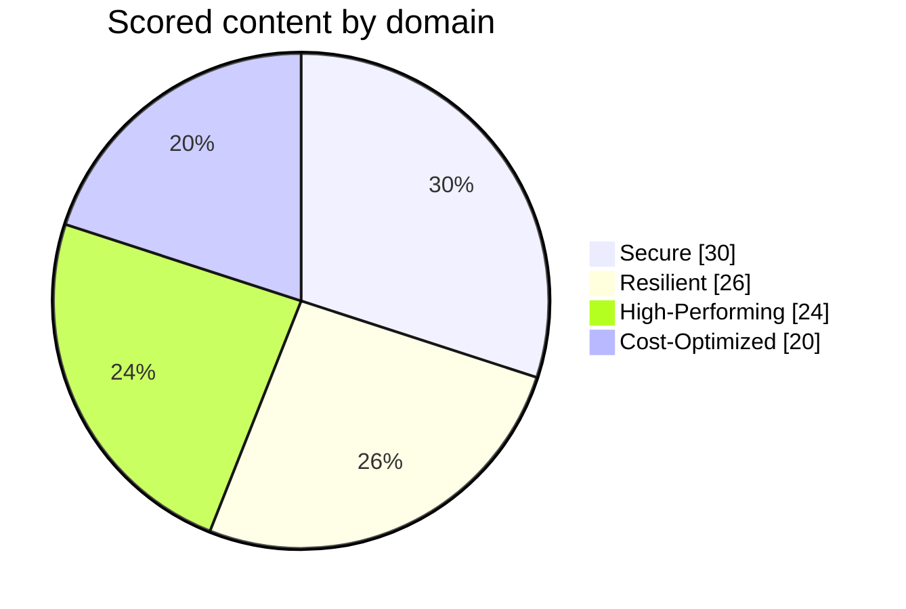

# SAA-C03 Exam Overview

Everything official about the exam, on one page. The facts below were checked against AWS's exam guide and certification pages on 2 November 2026. AWS can change its policies, so check the [certification page](https://aws.amazon.com/certification/certified-solutions-architect-associate/) before you book.

## Exam facts

| Item | Detail |
| --- | --- |
| Exam code | SAA-C03 |
| Level | Associate |
| Questions | 65: 50 scored, and 15 unscored that are not identified |
| Duration | 130 minutes |
| Question types | Multiple choice (1 correct of 4), multiple response (2 or more correct of 5 or more) |
| Passing score | 720, on a scale of 100 to 1,000 |
| Scoring | Compensatory: you must pass overall, not in each domain |
| Unanswered questions | Marked incorrect. There is no penalty for guessing |
| Result | Pass or fail, with a scaled score |
| Cost | 150 USD, and exchange rates may apply |
| Delivery | Pearson VUE test centre, or online proctored |
| Languages | English, French (France), Italian, Japanese, Korean, Portuguese (Brazil), Spanish (Latin America), Spanish (Spain), Simplified Chinese, Traditional Chinese |
| Validity | 3 years |
| Target candidate | At least 1 year of hands-on experience designing cloud solutions on AWS |

AWS's FAQ adds that candidates with 1 to 3 years of IT experience have earned this certification as a starting point. Those with no IT work experience would benefit from taking AWS Certified Cloud Practitioner first.

The exam gives 2 minutes per question. You will not know which 15 are unscored, so treat every question as if it counts.

## Domains

| Domain | Weight | Share of the 65 | Tasks |
| --- | --- | --- | --- |
| [[Domain 1 Design Secure Architectures]] | 30% | 20 | 1.1, 1.2, 1.3 |
| [[Domain 2 Design Resilient Architectures]] | 26% | 17 | 2.1, 2.2 |
| [[Domain 3 Design High-Performing Architectures]] | 24% | 15 | 3.1, 3.2, 3.3, 3.4, 3.5 |
| [[Domain 4 Design Cost-Optimized Architectures]] | 20% | 13 | 4.1, 4.2, 4.3, 4.4 |

AWS gives these weights as a percentage of **scored** content, and only 50 of the 65 questions are scored, so the scored counts are about 15, 13, 12 and 10. The practice exams here use 20, 17, 15 and 13 questions out of 65, so every domain gets plenty of practice.

Each domain page lists every item in AWS's exam guide, says what you need to know about it, and links to the right chapter.

## Topics AWS lists

AWS says these technologies and concepts might appear. The order says nothing about their weight.

- Compute
- Cost management
- Database
- Disaster recovery
- High performance
- Management and governance
- Microservices and component delivery
- Migration and data transfer
- Networking, connectivity, and content delivery
- Resiliency
- Security
- Serverless and event-driven design principles
- Storage

## Service names on the exam

The exam uses short names for well-known services. For example, Amazon Simple Notification Service appears as Amazon SNS. The **Help** feature, available on every question, lists short names with their full names. Not every abbreviation is expanded, so names such as Amazon EMR and Amazon API Gateway appear as they are.

The in-scope and out-of-scope lists are in [[Service Index]].

## Booking and test day

1. Create an account through the [AWS Certification portal](https://aws.amazon.com/certification/), and schedule through Pearson VUE.
2. **Check the name on your ID.** It must match the name on your AWS Certification Account.
3. Pick a date. Having a date helps you stick to the plan.

| Rule | Detail |
| --- | --- |
| ID at a test centre | Two primary IDs, or one primary and one secondary |
| ID for online proctoring | One primary ID |
| Rescheduling | Up to 24 hours before. Each appointment can be rescheduled twice |
| Cancelling | At least 24 hours before |
| Online check-in | You can start up to 30 minutes before. Arriving more than 15 minutes late, or failing the system test, can forfeit your fee |
| Breaks online | None are allowed |
| Results | Posted to your AWS Certification Account within five business days |
| Retaking after a fail | Wait 14 calendar days, and pay the full fee again |
| After passing | You receive a 50% discount voucher for your next AWS exam, through your account |
| Recertifying | Pass the latest version, or earn the Solutions Architect Professional, before the three years end |

> [!tip] Non-native English speakers
> If English is not your first language, you can request an **ESL +30** accommodation in your AWS Certification Account, which gives you 30 extra minutes. Request it **before** you book.

### Test centre or online?

A test centre is the safer choice if you can get to one, because you avoid problems with your internet connection, camera or room. If you choose online, run the system test on the same computer and network that you will use on the day, and clear your desk.

## Exam guide status

- The current exam guide is **version 1.1, published 29 October 2026**. Version 1.0 was published on 28 August 2026.
- AWS says that guide updates are published about one month before they appear on the exam, so v1.1 should reach live exams around late November 2026. This timing is inferred from AWS's stated rule.
- AWS removed Amazon Elastic Transcoder from the in-scope list. It also removed AWS DeepComposer, Amazon DevOps Guru, Amazon Elastic Inference, Amazon Managed Blockchain and Amazon Sumerian from the out-of-scope list.
- AWS's pages show no SAA-C04 and no retirement date for the English exam. Blog posts describing one could not be confirmed, so rely on the AWS certification page.
- The Italian version of the exam retires after 31 December 2026.

## What the official preparation looks like

AWS's own four-step plan uses exam-style questions, digital courses, hands-on practice and its Official Practice Exam. This vault covers the same ground: [[Study Guide]] for the path, the chapters for knowledge, [[Hands-On Labs]] for practice, and [[Practice Exam 1]] to [[Practice Exam 5]] for exam-style questions.

AWS's free **Official Practice Question Set** on Skill Builder is optional, but it is a useful test of whether your preparation matches the real wording.

---
**Next:** [[Exam Technique]] · **Plan:** [[Study Guide]]
