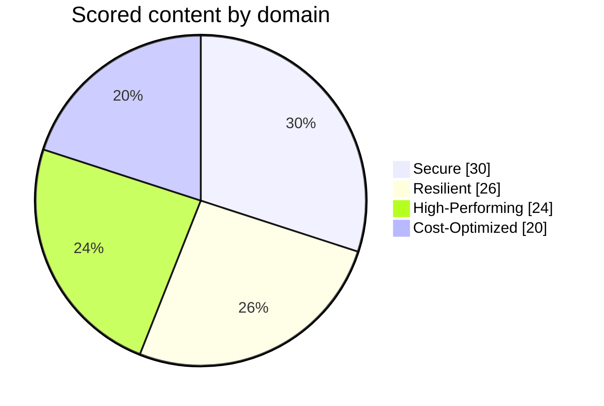

# SAA-C03 Exam Overview

| Item | Detail |
| --- | --- |
| Exam code | SAA-C03 |
| Level | Associate |
| Questions | 65 (50 scored, 15 unscored and not identified) |
| Duration | 130 minutes |
| Question types | Multiple choice (1 correct of 4), multiple response (2+ correct of 5+) |
| Passing score | 720 on a scale of 100 to 1,000 |
| Scoring | Compensatory: pass overall, not per section |
| Unanswered | Marked incorrect, with no penalty for guessing |
| Cost | 150 USD |
| Delivery | Pearson VUE test centre or online proctored |
| Validity | 3 years |
| Target candidate | At least 1 year of hands-on experience designing cloud solutions on AWS |

## Domains

- [[Domain 1 Design Secure Architectures]]
- [[Domain 2 Design Resilient Architectures]]
- [[Domain 3 Design High-Performing Architectures]]
- [[Domain 4 Design Cost-Optimized Architectures]]

## Exam guide status
- The current exam guide is **version 1.1, published 29 October 2026**. Version 1.0 was published on 28 August 2026.
- AWS publishes guide updates about one month before they reach the exam, so v1.1 changes should reach live exams around late November 2026. That timing is an inference from AWS's stated rule.
- AWS's pages show no SAA-C04. Blog posts describing one couldn't be confirmed, so rely on the AWS certification page.
- The Italian version of the exam retires after 31 December 2026.
- The exam shows short names for some services, and the Help button lists the full names.

## Scope
- [[In-Scope Services]]
- [[Out-of-Scope Services]]
- [[Service Lifecycle Status]]

## In this topic
- [[Exam Technique]]
- [[Exam Traps]]
- [[Keyword Cheat Sheet]]
- [[Must-Know Combos]]
- [[Study Roadmap]]

---
**Up:** [[Home]]
