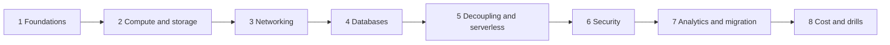

# Study Roadmap

A suggested order. Each stage builds on the one before.

1. **Foundations:** [[AWS Global Infrastructure]], [[Shared Responsibility Model]], [[AWS IAM]], [[AWS Well-Architected Framework]]
2. **Compute and storage:** [[Amazon EC2]], [[Amazon EBS]], [[Amazon EFS]], [[Amazon S3]], [[Elastic Load Balancing]], [[Amazon EC2 Auto Scaling]]
3. **Networking:** [[Amazon VPC]], [[Amazon Route 53]], [[Amazon CloudFront]], [[AWS Direct Connect]], [[AWS Transit Gateway]]
4. **Databases:** [[Amazon RDS]], [[Amazon Aurora]], [[Amazon DynamoDB]], [[Amazon ElastiCache]], [[Database Selection Guide]]
5. **Decoupling and serverless:** [[Amazon SQS]], [[Amazon SNS]], [[Amazon EventBridge]], [[AWS Lambda]], [[Amazon API Gateway]], [[Amazon ECS]], [[AWS Step Functions]]
6. **Security:** [[AWS KMS]], [[AWS Secrets Manager]], [[AWS WAF]], [[AWS Shield]], [[Amazon GuardDuty]], [[AWS Organizations]]
7. **Analytics and migration:** [[Amazon Kinesis]], [[AWS Glue]], [[Amazon Athena]], [[Disaster Recovery Strategies]], [[AWS DMS]], [[AWS DataSync]]
8. **Cost and drills:** [[Cost Optimization Checklist]], [[Drills Map]], then timed practice exams

Notes alone won't prepare you for scenario questions. Add timed practice exams and hands-on labs, and review every wrong answer back to its note.

---
**Up:** [[SAA-C03 Exam Overview]]
