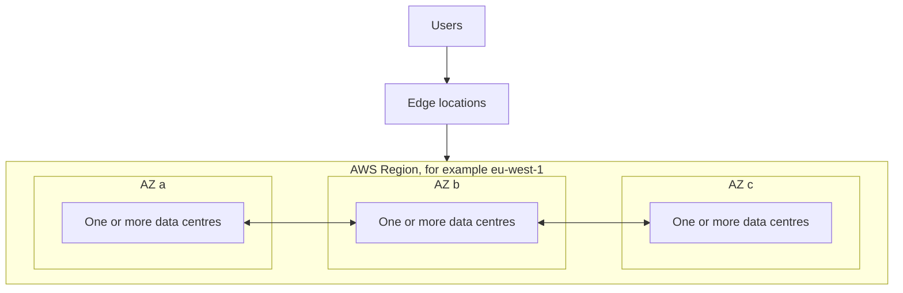

# Cloud Foundations

> [!info] Why this chapter comes first
> Everything else in the vault assumes these ideas. They appear directly in [[Domain 1 Design Secure Architectures#Task 1.1|Task 1.1]] (global infrastructure, shared responsibility) and [[Domain 2 Design Resilient Architectures#Task 2.2|Task 2.2]] (Regions, quotas, throttling). The vocabulary also decides whole questions: an answer that is "highly available" is not automatically "fault tolerant".
>
> **Study time:** about 2 hours.

## The global infrastructure

AWS is built from nested locations. Knowing which layer a failure affects is how you decide where to put things.

| Layer | What it is | Failure it protects against |
| --- | --- | --- |
| **Region** | A separate geographic area with multiple AZs. Fully independent of other Regions. Data stays in a Region unless you move it. | A whole-Region event, if you deploy to two Regions |
| **Availability Zone (AZ)** | One or more data centres with independent power, cooling and networking, joined to the other AZs by low-latency links | A data centre failure, if you deploy to two or more AZs |
| **Edge location** | A point of presence used by CloudFront, Route 53, Global Accelerator and WAF to serve users close by | Not a resilience layer. It improves latency and absorbs attacks |
| **Regional edge cache** | A larger CloudFront cache that sits between edge locations and your origin | Reduces origin load |
| **Local Zone** | An extension of a Region into a large city for single-digit millisecond latency | Latency to a metro area |
| **Wavelength Zone** | AWS compute inside a telecom operator's 5G network | Ultra-low latency to mobile devices |
| **Outposts** | AWS racks installed in your own data centre | Local processing and data residency on-premises |

The last three are covered in [[19 Other Compute Services#Running AWS closer to users|Other Compute Services]].

AZ names such as `us-east-1a` are mapped differently for each account, so `1a` in your account may not be the same physical zone as `1a` in another account. AZ IDs such as `use1-az1` are the same everywhere, which matters when two accounts need to line up.

### Choosing a Region

Work through these in order. The first one that rules a Region out wins.

1. **Compliance and data residency.** Law or contract may require data to stay in a country. This overrides everything.
2. **Latency.** Choose a Region close to your users.
3. **Service availability.** Not every service or instance type exists in every Region.
4. **Pricing.** Prices differ by Region.

### Which resources live where

The scope of a resource tells you what you have to do to make it resilient. An AZ-scoped resource needs you to design for failure. A Regional one usually already spans AZs.

| Scope | Examples |
| --- | --- |
| **Global** | IAM, Route 53, CloudFront, WAF for CloudFront, Organizations, Global Accelerator |
| **Regional** | VPC, S3 buckets (the name is globally unique, the data is Regional), Lambda, DynamoDB, SQS, SNS, KMS keys, ELB, EFS (Regional type), API Gateway |
| **AZ** | EC2 instance, EBS volume, subnet, zonal NAT gateway, network interface, a single RDS instance |

## The shared responsibility model

AWS is responsible for security **of** the cloud. You are responsible for security **in** the cloud.

| AWS | Customer |
| --- | --- |
| Hardware, facilities and the global network | Customer data and encryption choices |
| Host operating system and virtualisation layer | IAM users, roles and policies |
| The software of managed services | Network settings such as security groups and NACLs |
| | Application code |

The line moves depending on how managed a service is. This table is the part the exam tests.

| Service type | Example | You manage | AWS manages |
| --- | --- | --- | --- |
| Infrastructure | EC2 | Guest OS patching, firewall rules, applications, data | Hardware and hypervisor |
| Managed | RDS | Access, encryption settings, parameters, data, when maintenance runs | OS and database engine patching, hardware |
| Abstracted or serverless | S3, DynamoDB, Lambda | Data, access policies, code | Everything underneath, including the runtime for Lambda |

Some controls are **inherited** from AWS (physical security), some are **shared** (patching: AWS patches the infrastructure, you patch your guest OS and applications), and some are **customer-specific** (the security of your data).

## Availability vocabulary

These words have exact meanings. The exam uses them deliberately.

| Term | Meaning | Example |
| --- | --- | --- |
| **Scalability** | Handling more load by adding resources | Moving from a small to a large instance |
| **Vertical scaling** | Scaling up or down with a bigger or smaller instance. Common for databases and other non-distributed systems. Limited by the largest instance and usually needs a restart | `t3.micro` to `t3.large` |
| **Horizontal scaling** | Scaling out or in by adding or removing instances. Requires a distributed design | An Auto Scaling group |
| **Elasticity** | Scaling automatically with demand, and paying only for what you use | Target tracking on CPU |
| **High availability** | The system stays usable after a failure, perhaps with a short interruption. On AWS this means at least two AZs | RDS Multi-AZ failing over in a minute or two |
| **Fault tolerance** | The system keeps working through a failure with no visible interruption, usually through full redundancy | Active-active across AZs with spare capacity |
| **Durability** | The chance that data is not lost | S3's 11 nines |
| **Availability** | The chance that the service can be used at a given moment | S3 Standard's 99.99% |
| **RPO** | Recovery point objective: how much data you can afford to lose, measured in time | One hour of transactions |
| **RTO** | Recovery time objective: how long you can afford to be down | Fifteen minutes |

Durability and availability are independent. S3 One Zone-IA has 11 nines of durability inside one AZ, but only 99.5% availability, and the data is gone if that AZ is destroyed. RPO and RTO are covered in depth in [[28 High Availability and Disaster Recovery#RPO and RTO|High Availability and Disaster Recovery]].

### What the nines mean

| Availability | Downtime per year |
| --- | --- |
| 99% | About 3.65 days |
| 99.9% | About 8.77 hours |
| 99.95% | About 4.38 hours |
| 99.99% | About 52.6 minutes |
| 99.999% | About 5.26 minutes |

If components are in **series**, multiply the availabilities: two 99.9% services in a chain give about 99.8%. If they are in **parallel** and either one is enough, multiply the failure rates: two independent 99% AZs give 1 - (0.01 × 0.01) = 99.99%. This is why adding an AZ helps so much.

## The AWS Well-Architected Framework

The framework is AWS's description of a good cloud design. Almost every scenario question is a test of one of its pillars, and the qualifier in the question tells you which one.

| Pillar | Question it asks | Design principles worth remembering | Typical services |
| --- | --- | --- | --- |
| **Operational Excellence** | Can we run and improve this? | Operations as code; small, frequent, reversible changes; anticipate failure; learn from it | CloudFormation, Systems Manager, CloudWatch |
| **Security** | Are data and systems protected? | Strong identity foundation; traceability; security at every layer; automate security; protect data in transit and at rest; keep people away from data | IAM, KMS, WAF, GuardDuty, CloudTrail |
| **Reliability** | Will it recover and meet demand? | Automatically recover from failure; test recovery; scale horizontally; stop guessing capacity; manage change through automation | Multi-AZ, Auto Scaling, Route 53, Backup |
| **Performance Efficiency** | Are resources used efficiently as demand changes? | Use advanced technology as a service; go global in minutes; use serverless; experiment often; mechanical sympathy (use the technology that fits how the data is accessed) | Lambda, CloudFront, ElastiCache, Graviton |
| **Cost Optimization** | Are we avoiding waste? | Consumption model; measure efficiency; stop spending on undifferentiated heavy lifting; analyse and attribute spending | Cost Explorer, Savings Plans, Spot, S3 lifecycle |
| **Sustainability** | Are we limiting environmental impact? | Maximise utilisation; adopt more efficient hardware; use managed services; reduce downstream impact | Graviton, serverless, Auto Scaling |

The **AWS Well-Architected Tool** is a free console service. You answer questions about a workload and receive a report of high-risk issues and an improvement plan. It is a review tool, not a scanner. **AWS Trusted Advisor** is the opposite: it inspects your account automatically. See [[25 Monitoring and Auditing#AWS Trusted Advisor|Trusted Advisor]].

The older cloud best-practice principles still appear in question wording:

- **Scalability:** design to grow, vertically and horizontally.
- **Disposable resources:** servers should be replaceable, not repaired.
- **Automation:** let code and managed scaling do the work.
- **Loose coupling:** see [[31 Architecture Patterns#Loose coupling|Architecture Patterns]].
- **Services, not servers:** prefer managed services over self-managed software on EC2.

## How you talk to AWS

Every AWS action is an API call, whichever tool you use.

| Method | Protected by | Exam status |
| --- | --- | --- |
| **AWS Management Console** | Password plus MFA | In scope |
| **AWS CLI** | Access keys, or better, temporary credentials through IAM Identity Center | In scope |
| **AWS SDKs** | Access keys or temporary credentials | Tools and SDKs are on the out-of-scope list, though code-based access is still assumed knowledge |
| **AWS CloudShell** | Your console session | Out of scope |

**Access keys** are long-lived credentials made of an access key ID and a secret access key. They sign API requests. Treat them like passwords, and avoid them where a role will do. See [[02 IAM and Federation#Roles and temporary credentials|Roles and temporary credentials]].

## Service quotas and throttling

**Service quotas** are limits on resources or API rates, usually per account and per Region. Many are adjustable through the Service Quotas console. Some are hard limits.

- A **disaster recovery Region needs its own quotas raised before the disaster**. A standby that cannot launch enough instances during failover is a classic scenario. See [[28 High Availability and Disaster Recovery#Quotas in a standby Region|Quotas in a standby Region]].
- Trusted Advisor and CloudWatch alarms can warn you when usage nears a quota.
- **Throttling** is a service protecting itself by rejecting excess requests, usually with an HTTP 429 or a `ThrottlingException`. The fix is to retry with **exponential backoff and jitter**, or put a queue in front so that bursts are absorbed.
- [[17 API Gateway and Front-End Services#Throttling and usage plans|API Gateway]] can throttle your own clients through usage plans.

## Exam patterns

Some scenario patterns in this vault are adapted from [RonitSachdev/aws-saa-c03-guides](https://github.com/RonitSachdev/aws-saa-c03-guides) (CC BY 4.0), with outdated facts changed.

| If the question says | Think | Why |
| --- | --- | --- |
| Two solutions work, choose the **most cost-effective** | The cheaper one that meets every requirement | Spot beats On-Demand for fault-tolerant batch work |
| Improve the reliability of a single-AZ database | Enable Multi-AZ | Survives an AZ failure with automatic failover |
| **Least operational overhead** | Managed or serverless | Fargate instead of EC2, RDS instead of a database on EC2 |
| Improve performance for global users | CloudFront | Go global, cache at the edge |
| Free review of a workload against best practices | Well-Architected Tool | A guided questionnaire that produces an improvement plan |
| Reduce the environmental impact | Graviton and serverless | Sustainability is about utilisation |
| Data must stay in a country | Choose the Region first | Compliance overrides latency and price |
| Survive the loss of a data centre | Multi-AZ | Multi-Region is more than this needs |
| Survive the loss of a Region | Multi-Region | Multi-AZ does not help |
| `ThrottlingException` from an AWS API | Exponential backoff with jitter | Optionally request a quota increase |
| Patch the OS on EC2 | Customer | Patching the OS on RDS is AWS's job |

## Check yourself

Answer each one before opening the fold. Read the explanation even when you are right.

**1.** A European bank is choosing a Region for a new application. Regulators require customer records to stay inside the EU. The cheapest Region on the shortlist is in the US. All users are in Germany. What should decide the Region first?

- A. Price, because Region pricing differs
- B. Service availability, because some services are missing in some Regions
- C. Data residency, because it is a legal requirement
- D. The number of nearby edge locations

> [!success]- Answer
> **C.** Compliance comes first because no amount of savings or latency makes a non-compliant Region usable. After that you weigh latency, service availability and price.

**2.** A team runs PostgreSQL on Amazon RDS. Which task is the customer's responsibility?

- A. Patching the host operating system
- B. Replacing a failed storage device
- C. Configuring security groups and enabling encryption
- D. Applying patches to the virtualisation layer

> [!success]- Answer
> **C.** On a managed service, AWS handles the OS, the hardware and the virtualisation layer. You still decide who can reach the database and how the data is protected.

**3.** Which two tasks are the customer's responsibility for an application on Amazon EC2? (Choose two.)

- A. Patching the guest operating system
- B. Physical security of the data centre
- C. Managing the hypervisor
- D. Configuring the security groups
- E. Replacing failed network hardware

> [!success]- Answer
> **A and D.** With EC2 you own everything from the guest OS upwards. B, C and E are AWS's responsibilities.

**4.** An online store must keep running if one data centre fails. Users may notice a brief slowdown, but the design should not be more expensive than necessary. What is the best approach?

- A. Run the application in one AZ with a very large instance
- B. Run the application across multiple AZs behind a load balancer
- C. Run the application in two Regions with active-active routing
- D. Take hourly snapshots and restore them after a failure

> [!success]- Answer
> **B.** The failure described is a data centre, so multiple AZs are enough. C works but costs more than the requirement justifies. A is a single point of failure, and D gives a long outage.

**5.** A service's SLA promises 99.99% availability. Roughly how much downtime does this allow in a year?

- A. 5 minutes
- B. 53 minutes
- C. 8.8 hours
- D. 3.6 days

> [!success]- Answer
> **B.** 99.99% allows about 52.6 minutes. Five minutes corresponds to 99.999%, 8.8 hours to 99.9%, and 3.6 days to 99%.

**6.** A company tests its pilot-light disaster recovery plan in a second Region. The Auto Scaling group cannot launch the required number of instances, even though the first Region runs that many without trouble. What is the most likely cause?

- A. The AMI is encrypted
- B. Service quotas in the second Region were never raised
- C. Pilot light does not support Auto Scaling
- D. The instances need a Multi-AZ setting

> [!success]- Answer
> **B.** Quotas are per Region. A standby Region starts with default limits, so they must be raised in advance. You cannot rely on a quota increase being approved in the middle of a disaster.

**7.** A batch job calling an AWS API starts receiving `ThrottlingException` errors during peak hours. The API is otherwise healthy. What should the developers do first?

- A. Retry immediately in a tight loop
- B. Move the job to a larger instance
- C. Retry with exponential backoff and jitter
- D. Deploy the job to a second Region

> [!success]- Answer
> **C.** Backoff spreads retries out so that the service can recover, and jitter stops many clients retrying at the same moment. Immediate retries make throttling worse, and a bigger instance does not change the API limit.

**8.** A security manager wants a structured review of a workload against AWS best practices, with a list of high-risk issues, at no extra charge. Which tool fits best?

- A. AWS Well-Architected Tool
- B. Amazon Inspector
- C. AWS Config
- D. AWS Artifact

> [!success]- Answer
> **A.** It is a free guided review that produces an improvement plan. Inspector scans for vulnerabilities, Config tracks resource settings, and Artifact provides compliance reports.

---
**Next:** [[02 IAM and Federation]] · **Plan:** [[Study Guide]]
