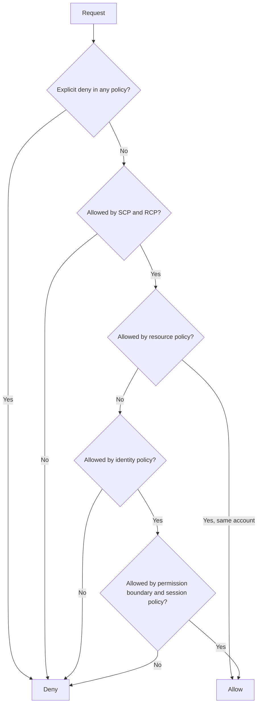
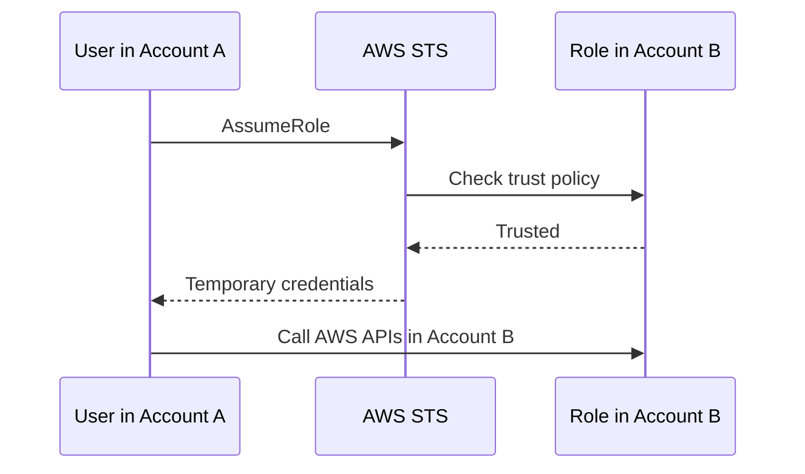
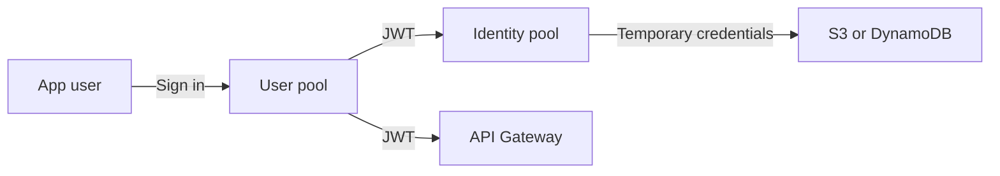

# IAM and Federation

> [!info] Why this matters
> Identity runs through all of [[Domain 1 Design Secure Architectures|Domain 1]], the largest domain at 30%. Expect questions on roles, cross-account access, policy evaluation, federation and Cognito.
>
> **Covers:** [[Domain 1 Design Secure Architectures#Task 1.1|Task 1.1]] in full, part of [[Domain 1 Design Secure Architectures#Task 1.2|Task 1.2]].
> **Study time:** about 5 hours. If you are short of time, this is not the chapter to skim.

## IAM in one minute

**AWS Identity and Access Management (IAM)** controls who can do what in an AWS account. It is global and free. Every API request carries four questions:

| Part of the request | Question | Example |
| --- | --- | --- |
| **Principal** | Who is asking? | A user, a role, an AWS service |
| **Action** | What do they want to do? | `s3:GetObject` |
| **Resource** | On what? | `arn:aws:s3:::reports/2026.csv` |
| **Condition** | In what circumstances? | From this IP, with MFA, in this Region |

IAM evaluates the policies that apply and returns allow or deny. **Everything starts denied.**

## The root user

The root user is created with the account and has unrestricted access. It cannot be limited by IAM policies in its own account, although a service control policy can limit the root user of a member account.

Protect it as follows:

- Turn on MFA.
- Have no access keys for it.
- Do not use it for daily work. Create an administrator through IAM Identity Center instead.

A few tasks need the root user, and the exam likes to ask about them:

- Changing the account's root email address or name, or closing the account
- Restoring IAM permissions if the only administrator has lost access
- Changing some billing and support settings
- Enabling [[07 S3 Security and Data Protection#MFA Delete|MFA Delete]] on an S3 bucket
- Editing a bucket policy that has locked everyone out

## IAM identities

| Identity | What it is | Credentials | Use it for |
| --- | --- | --- | --- |
| **IAM user** | A long-lived identity in one account | Password and/or access keys | Rare cases that cannot use federation or roles |
| **IAM group** | A collection of users. Policies attach to it, and users inherit them | None | Managing permissions by job function |
| **IAM role** | An identity with no permanent credentials that is assumed temporarily | Temporary, issued by STS | AWS services, cross-account access, federated users |

Details the exam relies on:

- A user can belong to several groups. **Groups cannot contain other groups.**
- A group is not a principal. You cannot name a group in a resource-based policy.
- A role has two policy documents: a **trust policy** saying who may assume it, and **permissions policies** saying what it can do. If a role "can't be assumed", the trust policy is the first thing to check.
- AWS's guidance for people is federation with temporary credentials rather than IAM users.

### Passwords and MFA

An **account password policy** can set minimum length, required character types, expiry and reuse prevention.

**MFA** combines something you know with something you have. Supported types are:

- Virtual authenticator apps, such as Google Authenticator or Authy
- Passkeys and FIDO security keys, such as a YubiKey
- Hardware TOTP tokens

## Policies

### Structure of a policy

Policies are JSON documents.

```json
{
  "Version": "2012-10-17",
  "Statement": [
    {
      "Sid": "ReadReportsFromOffice",
      "Effect": "Allow",
      "Action": ["s3:GetObject"],
      "Resource": "arn:aws:s3:::reports/*",
      "Condition": {
        "IpAddress": { "aws:SourceIp": "203.0.113.0/24" }
      }
    }
  ]
}
```

| Element | Meaning |
| --- | --- |
| `Version` | Language version. Use `2012-10-17` so that features such as policy variables work |
| `Statement` | One or more permission statements |
| `Sid` | An optional label |
| `Effect` | `Allow` or `Deny` |
| `Principal` | Who the statement applies to. **Only in resource-based and trust policies.** An identity policy already knows its principal |
| `Action` | The API actions, written as `service:Action` |
| `Resource` | The ARNs it applies to |
| `Condition` | When it applies |

### Policy types

| Type | Attached to | What it does | Grants access? |
| --- | --- | --- | --- |
| **AWS managed** | User, group, role | Maintained by AWS, reusable | Yes |
| **Customer managed** | User, group, role | Yours, reusable and versioned. Preferred for custom permissions | Yes |
| **Inline** | One identity | Lives and dies with that identity | Yes |
| **Resource-based** | A resource, such as an S3 bucket, SQS queue or KMS key | Says who may access this resource. Has a `Principal` element | Yes |
| **Permission boundary** | User or role | Sets the maximum an identity can have | No |
| **Service control policy** | Root, OU or account | Sets the maximum for principals in an account | No |
| **Resource control policy** | Root, OU or account | Sets the maximum for resources in an account | No |
| **Session policy** | A temporary session | Narrows a role session further | No |

The last four are limits, not grants. They can only take permissions away. See [[03 Multi-Account Governance#Policy ceilings compared|the comparison in Multi-Account Governance]].

### Policy evaluation logic

Learn this flow. When a question says "the user has an Allow but gets Access Denied", it is testing this.



This diagram is simplified from AWS's full flow. The rules to remember are:

1. **An explicit deny always wins**, wherever it comes from.
2. **Without an allow, the answer is deny.** This is an implicit deny.
3. Limits such as SCPs must also allow the action. They do not grant it.
4. **Within one account**, an allow in either the identity policy or the resource policy is generally enough.
5. **Across accounts**, the caller's identity policy **and** the resource policy must both allow the action.

Worked examples:

| Situation | Result | Reason |
| --- | --- | --- |
| Identity policy allows `s3:*`, bucket policy denies this user | Denied | Explicit deny wins |
| Identity policy allows `s3:PutObject`, the SCP does not include S3 | Denied | SCPs set the ceiling |
| Developer has `AdministratorAccess`, boundary allows only S3 | Only S3 works | The effective permission is the overlap |
| Account B's bucket policy allows Account A's user, but the user has no identity policy | Denied | Cross-account needs both sides |
| No policy mentions the action | Denied | Implicit deny |

### Useful condition keys

| Condition key | Use |
| --- | --- |
| `aws:SourceIp` | Restrict the caller's public IP range |
| `aws:SourceVpc`, `aws:SourceVpce` | Require that a request comes through a VPC or VPC endpoint |
| `aws:RequestedRegion` | Restrict the Regions that may be called |
| `aws:MultiFactorAuthPresent` | Require MFA for sensitive actions |
| `aws:PrincipalOrgID` | Allow only principals from your organisation |
| `aws:PrincipalTag`, `aws:ResourceTag` | Attribute-based access control |
| `aws:SecureTransport` | Require TLS |
| `s3:x-amz-server-side-encryption` | Require a particular encryption type on upload |
| `kms:ViaService` | Allow a KMS key to be used only through a named service |
| `dynamodb:LeadingKeys` | Limit a user to items with their own partition key |

A statement that denies everything outside two office ranges:

```json
{
  "Version": "2012-10-17",
  "Statement": {
    "Effect": "Deny",
    "Action": "*",
    "Resource": "*",
    "Condition": {
      "NotIpAddress": { "aws:SourceIp": ["192.0.2.0/24", "203.0.113.0/24"] }
    }
  }
}
```

A statement that restricts Regions, with global services excluded through `NotAction` because they are not called in a Region:

```json
{
  "Version": "2012-10-17",
  "Statement": [{
    "Sid": "DenyOutsideEurope",
    "Effect": "Deny",
    "NotAction": ["cloudfront:*", "iam:*", "route53:*", "support:*"],
    "Resource": "*",
    "Condition": {
      "StringNotEquals": { "aws:RequestedRegion": ["eu-central-1", "eu-west-1"] }
    }
  }]
}
```

A bucket policy that lets only your organisation's accounts in. It saves listing every account, and new accounts work automatically:

```json
{
  "Version": "2012-10-17",
  "Statement": [{
    "Effect": "Allow",
    "Principal": "*",
    "Action": ["s3:GetObject", "s3:PutObject"],
    "Resource": "arn:aws:s3:::financial-data/*",
    "Condition": { "StringEquals": { "aws:PrincipalOrgID": "o-exampleorgid" } }
  }]
}
```

### IAM and S3: bucket-level versus object-level

This small detail is a very common cause of access errors.

- `s3:ListBucket` applies to the **bucket**: `arn:aws:s3:::example`
- `s3:GetObject`, `s3:PutObject` and `s3:DeleteObject` apply to **objects**: `arn:aws:s3:::example/*`

A policy that needs both must list both ARNs.

### Least privilege

Grant only the permissions a task needs. In practice:

- Start with little access, and add to it when something is shown to be needed.
- Use roles and temporary credentials, not long-lived access keys.
- Find unused access with the [[#Auditing IAM|tools below]].
- Set ceilings with permission boundaries and SCPs.

**Role-based access control (RBAC)** gives permissions by job function, typically through roles or groups. **Attribute-based access control (ABAC)** uses tags: a rule such as "people may touch resources whose `Project` tag matches their own" keeps working as projects are added, with no policy changes. ABAC suits fast-growing environments.

### Permission boundaries

A permission boundary is a managed policy that sets the **maximum** permissions a user or role can have. It does not apply to groups, and it grants nothing.

The classic use is safe delegation: developers may create roles for their applications, but must attach the boundary to any role they create. They cannot escalate beyond it. Use a boundary to restrict one identity, and an SCP to restrict a whole account or OU.

### Passing roles and service-linked roles

To give a role to a service, such as an instance profile to EC2 or an execution role to Lambda, a person needs **`iam:PassRole`** on that role. This stops people giving a service more access than they have themselves. If someone can create a function but gets an error when choosing its role, this is usually why.

**Service-linked roles** are predefined roles that a service creates and manages for itself. You cannot edit their permissions, and SCPs do not limit them.

The **IAM Policy Simulator** tests what a policy would allow, before you apply it.

## Roles and temporary credentials

**AWS Security Token Service (STS)** issues temporary credentials: an access key ID, a secret access key and a session token. They expire automatically, so a leaked credential loses its value quickly.

| API | Used for |
| --- | --- |
| `AssumeRole` | Switching to a role, within an account or across accounts |
| `AssumeRoleWithSAML` | SAML 2.0 federation |
| `AssumeRoleWithWebIdentity` | OIDC federation. For mobile and web apps AWS recommends Cognito instead |
| `GetSessionToken` | MFA-protected API access for an IAM user |

Role sessions last one hour by default, and a role can be configured for up to 12 hours.

Roles for AWS services:

- **EC2:** attach an **instance profile**. The application gets rotating credentials from the instance metadata service. This replaces access keys on the instance.
- **Lambda:** every function has an **execution role**.
- **ECS:** the **task role** is for your application's AWS calls, and the **task execution role** is for ECS itself. See [[18 Containers#IAM roles for ECS|Containers]].

If a question shows access keys stored in code, a config file or an AMI, the wrong part is the keys. The right answer is a role.

**IAM Roles Anywhere** gives workloads **outside** AWS temporary credentials using X.509 certificates, replacing long-lived keys on on-premises servers. It is not on AWS's in-scope list, so treat it as background.

## Cross-account access

There are two ways to reach a resource in another account.

**Option 1: a role in the target account.**

1. Create a role in Account B with a trust policy naming Account A.
2. Attach the permissions to that role.
3. Allow principals in Account A to call `sts:AssumeRole` on it.



**Option 2: a resource-based policy** on the resource itself, such as an S3 bucket policy.

The difference is what happens to the caller's permissions.

| | Assume a role | Resource-based policy |
| --- | --- | --- |
| Caller's permissions | Given up for the session. The caller has only the role's permissions | Kept. The caller still has its own |
| Good when | The caller works entirely in the other account | The caller must touch resources on both sides |

The textbook example: a user in Account A must scan a DynamoDB table in Account A and write the result to an S3 bucket in Account B. A role would remove their access to the table, so use a bucket policy.

**Third parties and the confused deputy.** When an external company assumes a role in your account, require an **ExternalId** in the trust policy. Without it, a different customer of that vendor could trick the vendor into using your role.

**Which targets use which method?** This matters for EventBridge, which needs permission to reach its target:

| Permission model | Targets |
| --- | --- |
| Resource-based policy | Lambda, SNS, SQS, S3, API Gateway |
| IAM role | Kinesis Data Streams, Systems Manager Run Command, ECS tasks |

## Federation

Federation lets people sign in with an identity they already have, so you do not create an IAM user for them.

| Who needs access | To what | Use |
| --- | --- | --- |
| **Employees** | Multiple AWS accounts and business apps | IAM Identity Center |
| **Employees with an external IdP** such as Okta or Microsoft Entra ID | AWS accounts | IAM Identity Center with SAML 2.0 |
| **Employees in on-premises Active Directory** | AWS accounts | IAM Identity Center connected through AWS Directory Service |
| **One account, existing SAML IdP** | One AWS account | IAM SAML identity provider with a role |
| **Customers of your app** | Your app and possibly AWS resources | Amazon Cognito |

The one-line memory aid: **workforce means Identity Center, customers mean Cognito.**

### AWS IAM Identity Center

Formerly AWS Single Sign-On, this is the recommended way to give people access to multiple accounts. It is free.

- **Identity source:** its own directory, Active Directory, or an external identity provider. SCIM can sync users and groups automatically from an external IdP.
- **Permission sets:** collections of policies. Assigning one to a user or group in an account creates a matching role there. Users pick an account and role from a portal.
- **Application assignments:** SSO to SAML 2.0 business applications.
- **ABAC:** use attributes from the identity source in permissions.

To connect a self-managed Active Directory, use either a two-way trust through AWS Managed Microsoft AD, or AD Connector.

## AWS Directory Service

**Active Directory (AD)** is Microsoft's directory for users, computers and groups. Windows workloads on AWS, such as FSx for Windows File Server, RDS for SQL Server and domain-joined EC2 instances, need one. AWS offers three options:

| | AWS Managed Microsoft AD | AD Connector | Simple AD |
| --- | --- | --- | --- |
| What it is | Real Microsoft AD run by AWS, in two AZs by default | A proxy that forwards requests to your on-premises AD | A low-cost, AD-compatible directory based on Samba |
| Users stored in | AWS | On-premises only | AWS |
| Trust with on-premises AD | **Yes** | No trust needed, it forwards | No |
| MFA | Yes | Yes | No |
| Pick it when | You need real AD features in AWS, or a trust | No identities may be stored in the cloud | Small, basic needs, existing customers only |

> [!warning] Lifecycle
> Simple AD has been closed to new customers since 30 June 2026. Older questions may still use it for "low cost, basic LDAP".

## Amazon Cognito

Cognito provides identity for the **users of your own web and mobile apps**. It has two separate parts, and the exam tests which one you need.

| | User pools | Identity pools |
| --- | --- | --- |
| Purpose | Sign-up and sign-in | AWS credentials for users |
| Output | JSON Web Tokens (JWTs) | Temporary AWS credentials from STS |
| Features | Password reset, MFA, social and SAML sign-in, hosted login pages | Maps users to IAM roles, including a role for guests |
| Used with | API Gateway authorisers, ALB authentication, AppSync | Direct access to S3 or DynamoDB from the app |



Remember: **a user pool is the login box, and an identity pool is the exchange desk that swaps a login for AWS credentials.**

Per-user data isolation uses IAM policy variables. An identity pool role can include `${cognito-identity.amazonaws.com:sub}` in an S3 prefix, so that each user sees only their own folder. In DynamoDB, the condition `dynamodb:LeadingKeys` limits users to items whose partition key equals their identity ID.

## Auditing IAM

| Tool | Scope | Answers |
| --- | --- | --- |
| **Credential report** | Account | Which users exist, and what is the status of their passwords, keys and MFA? |
| **Access Advisor** (last accessed data) | One identity | Which services can this identity reach, and when did it last use them? |
| **IAM Access Analyzer** | Account or organisation | Which resources are shared outside my trust zone? Which permissions are unused? Is this policy valid? It can also generate a policy from CloudTrail activity |
| **CloudTrail** | Account | Who actually made this API call? See [[25 Monitoring and Auditing#AWS CloudTrail\|CloudTrail]] |

Access Analyzer is the answer whenever a question asks about **unintended external access** to S3 buckets, IAM roles, KMS keys, Lambda functions, SQS queues or Secrets Manager secrets.

## Exam patterns

| If the question says | Think | Why |
| --- | --- | --- |
| App on EC2 needs AWS access, most secure | Instance role | Never store keys on the instance |
| Lambda must read S3 | Execution role | The same pattern for serverless |
| Keys are hardcoded | Replace them with a role | Any answer that keeps keys is wrong |
| Users in Account A need temporary access to Account B | Role in B trusting A | Cross-account plus temporary means STS |
| Allow exists, but access is denied | Explicit deny, SCP or boundary | Deny beats allow |
| Works in a standalone account, fails in Organizations | SCP | "Organizations" is the signal |
| Developers create roles that must never exceed a set | Permission boundary | "Maximum permissions" |
| Thousands of employees with AD logins, many accounts | Identity Center | No IAM users needed |
| Third party assumes a role in your account | ExternalId | Prevents the confused deputy problem |
| New account, first security step | MFA on root, no root keys | Then create an administrator |
| Require MFA for a destructive action | `aws:MultiFactorAuthPresent` | A policy condition |
| Who shares what outside the account | IAM Access Analyzer | Not Access Advisor |
| Find stale users or unused permissions | Credential report, Access Advisor | Account level, identity level |
| Mobile app sign-up with Google and Facebook | Cognito user pool | Login box |
| Authenticated app users upload directly to S3 | Cognito identity pool | Swap a JWT for credentials |
| Guests may browse without an account | Identity pool unauthenticated role | Only identity pools have guests |
| Protect a REST API with no custom code | Cognito user pool authoriser | API Gateway validates the JWT |
| Each user may reach only their own S3 prefix | Identity pool and policy variables | One policy, one prefix per user |
| Employees need SSO to accounts | Identity Center, not Cognito | Workforce versus customers |
| Enterprise customers use their SAML IdP with your SaaS app | User pool SAML federation | Still authentication for an app |
| FSx for Windows must use on-premises AD identities | Managed Microsoft AD with a trust, or AD Connector | Both reach on-premises identities |
| No user identities may be stored in the cloud | AD Connector | A proxy only |
| Two-way trust between AWS and on-premises domains | Managed Microsoft AD | The only option with trusts |
| RDS for SQL Server with Windows Authentication | Managed Microsoft AD | Direct integration |
| Worker in Account A copies a table to a bucket in Account B | Bucket policy | The worker keeps its own permissions |

## Check yourself

**1.** An application on EC2 needs to write items to a DynamoDB table. What is the most secure way to give it credentials?

- A. Store an IAM user's access keys in the application config file
- B. Store access keys in an environment variable
- C. Attach an IAM role to the instance with a DynamoDB policy
- D. Embed the keys in a custom AMI

> [!success]- Answer
> **C.** An instance role provides short-lived credentials that rotate automatically. All the other options leave long-lived keys somewhere they can leak.

**2.** A user's identity policy allows `s3:PutObject` on a bucket in the same account, yet uploads fail with Access Denied. The user has no permission boundary, and the account is in AWS Organizations. What are the two most likely causes? (Choose two.)

- A. The bucket policy contains an explicit deny for this user
- B. An SCP does not allow `s3:PutObject`
- C. IAM policies do not work for S3
- D. The bucket needs an ACL granting the user access
- E. The user needs a role, because users cannot call S3

> [!success]- Answer
> **A and B.** An explicit deny in any policy overrides the allow, and an SCP sets a ceiling that an identity policy cannot exceed. C, D and E are false.

**3.** A company wants developers to create IAM roles for their own applications, but those roles must never get more permissions than an agreed set. Developers must not need to ask the security team each time. What should the company use?

- A. A service control policy on the account
- B. A permission boundary, required when developers create roles
- C. An inline policy on each developer
- D. IAM Access Analyzer

> [!success]- Answer
> **B.** Boundaries set the maximum for an identity, and the developers can be required to attach one to every role they create. An SCP is too broad because it limits everyone in the account. Access Analyzer reports, and it does not prevent.

**4.** Users in Account A need short-term access to an S3 bucket in Account B. They only need that bucket for the session. Which approach gives temporary credentials and least privilege?

- A. Create IAM users in Account B and share the passwords
- B. Create a role in Account B that trusts Account A, then allow the users to assume it
- C. Share Account B's root access keys
- D. Copy the data to Account A every night

> [!success]- Answer
> **B.** This is the standard cross-account role pattern. The role trusts Account A, the users call `sts:AssumeRole`, and STS issues temporary credentials.

**5.** A worker running in Account A must read from a DynamoDB table in Account A and write the results to an S3 bucket in Account B. What should the company do?

- A. Have the worker assume a role in Account B for the whole job
- B. Add a bucket policy in Account B that allows the worker's role to write
- C. Move the table to Account B
- D. Make the bucket public for the duration of the job

> [!success]- Answer
> **B.** With a resource-based policy the worker keeps its own permissions, so it can read the table and write to the bucket at the same time. If it assumed a role in Account B, it would give up its Account A permissions.

**6.** An audit vendor needs read access to your account, and it uses the same process for many customers. Which control protects you from the confused deputy problem?

- A. A long password on an IAM user
- B. An ExternalId condition in the role's trust policy
- C. An IP allow-list on the vendor's laptop
- D. A permission boundary

> [!success]- Answer
> **B.** The ExternalId is a value that is unique to you and must be supplied when the vendor assumes the role, so another customer cannot trick the vendor into using your role.

**7.** A company has 8,000 employees with accounts in Microsoft Entra ID. They need single sign-on to 40 AWS accounts. Which approach involves the least administration?

- A. Create IAM users in each account
- B. Create a Cognito user pool
- C. Use IAM Identity Center with the external IdP, and assign permission sets
- D. Build a custom login page with STS

> [!success]- Answer
> **C.** Identity Center is built for workforce access to many accounts, and permission sets are applied centrally. Cognito is for customers of an app.

**8.** A mobile app lets users sign in and upload photos straight to S3. Each user must be able to reach only their own folder. Which combination is correct? (Choose two.)

- A. A Cognito user pool for sign-in
- B. A Cognito identity pool to obtain temporary AWS credentials
- C. An IAM user for each app user
- D. Access keys compiled into the app
- E. A public bucket with a hidden naming scheme

> [!success]- Answer
> **A and B.** The user pool handles sign-in and issues a JWT. The identity pool exchanges it for temporary credentials, and a policy variable limits each user to their own prefix.

**9.** A company must deploy FSx for Windows File Server. Users authenticate with on-premises Active Directory, and security policy forbids storing any identities in AWS. Which directory option fits?

- A. Simple AD
- B. AD Connector
- C. A Cognito user pool
- D. AWS Managed Microsoft AD with its own users

> [!success]- Answer
> **B.** AD Connector is a proxy that forwards authentication to on-premises AD and stores no identities in AWS. Option D stores users in AWS, Simple AD cannot connect to on-premises AD, and Cognito is not a Windows directory.

**10.** A security team wants to know whether any S3 bucket or KMS key in the organisation can be reached from outside it. Which tool answers this directly?

- A. IAM Access Advisor
- B. IAM credential report
- C. IAM Access Analyzer
- D. AWS Trusted Advisor

> [!success]- Answer
> **C.** Access Analyzer reports resources shared outside your zone of trust. Access Advisor shows when an identity last used services, and the credential report lists credential status.

---
**Previous:** [[01 Cloud Foundations]] · **Next:** [[03 Multi-Account Governance]] · **Plan:** [[Study Guide]]
