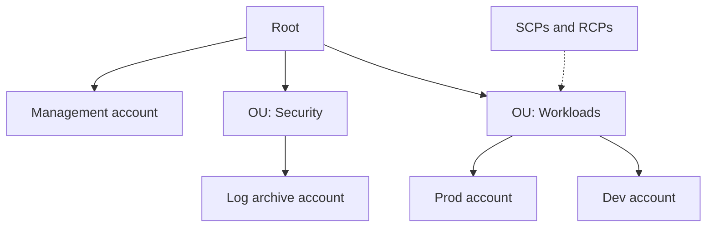

# Multi-Account Governance

> [!info] Why this matters
> Most real AWS estates use many accounts, so the exam asks how to control them. Expect questions on SCPs, Control Tower and resource sharing.
>
> **Covers:** "Designing a security strategy for multiple AWS accounts" in [[Domain 1 Design Secure Architectures#Task 1.1|Task 1.1]], and multi-account billing in [[Domain 4 Design Cost-Optimized Architectures|Domain 4]].
> **Study time:** about 2.5 hours.

## Why use many accounts

An AWS account is the strongest isolation boundary available. Splitting workloads into accounts gives you:

- Isolation of production from development, so that a mistake or breach stays contained
- Separate service quotas for each workload
- Simple cost tracking, because each account is billed separately
- A place for central logging that workload owners cannot tamper with

A common layout separates accounts by purpose: security, log archive, shared networking, and then production and development workloads.

### A typical structure

| OU | Accounts | Purpose |
| --- | --- | --- |
| **Security** | Log archive, security tooling | Central logs and security services, with tightly limited access |
| **Infrastructure** | Networking, shared services | Transit Gateway, DNS and shared tools |
| **Workloads: production** | One per application | Strict SCPs |
| **Workloads: non-production** | One per application or team | More freedom, with cost limits |
| **Sandbox** | Personal or team experiments | Small budgets, and no connection to production |

Attach policies at OU level rather than account by account, and test new SCPs on a non-production OU first, because a wrong SCP can break every account below it.

## AWS Organizations

**AWS Organizations** manages many accounts together. It is a global service.

| Term | Meaning |
| --- | --- |
| **Management account** | The account that created the organisation. Pays the bill. Keep workloads out of it |
| **Member account** | Any other account in the organisation |
| **Root** | The top container of the hierarchy, not to be confused with the root user |
| **Organisational unit (OU)** | A folder of accounts, which can be nested. Policies attached here apply to everything below |



What it gives you:

- **Consolidated billing:** one invoice for all accounts.
- **Aggregated usage:** volume discounts are calculated across the organisation, so S3 and data transfer tiers are reached sooner.
- **Shared discounts:** Reserved Instances and Savings Plans bought in one account apply across the others, unless sharing is turned off.
- **Automated account creation** through an API.
- **Central policies:** SCPs, RCPs, tag policies, backup policies and declarative policies.
- **Delegated administration:** a member account can run a service such as GuardDuty or Security Hub for the organisation.

- **Organisation-wide views:** AWS Config aggregators, CloudTrail organisation trails and Security Hub collect data from every account.

An organisation can run with **all features** (needed for policies) or **consolidated billing only**.

Good practice is an **organisation trail** in CloudTrail sending all logs to a central S3 bucket in a log archive account, and central CloudWatch logging. See [[25 Monitoring and Auditing#AWS CloudTrail|CloudTrail]].

**Tag policies** standardise how tags are written across accounts. **Declarative policies** enforce a service configuration, such as blocking public access to VPCs, across accounts.

## Service control policies

**SCPs** limit what **principals in member accounts** can do.

- They attach to the root, an OU or an account, and they are inherited down the tree.
- They apply to all users and roles in an account, **including that account's root user**.
- They **do not apply to the management account**.
- They **do not affect service-linked roles**, which other AWS services use to integrate with your account.
- They **never grant anything**. A user also needs an IAM allow. The effective permission is the overlap.
- By default the `FullAWSAccess` SCP is attached, which allows everything. Removing it without a replacement makes every action in member accounts fail.

There are two styles:

- **Deny list (the usual way):** keep `FullAWSAccess` and add explicit denies.
- **Allow list:** replace `FullAWSAccess` and list only what is allowed. Stricter, and more work to maintain.

Typical uses are restricting Regions, preventing accounts from leaving the organisation, and protecting CloudTrail from being turned off.

```json
{
  "Version": "2012-10-17",
  "Statement": [{
    "Sid": "ProtectCloudTrail",
    "Effect": "Deny",
    "Action": ["cloudtrail:StopLogging", "cloudtrail:DeleteTrail"],
    "Resource": "*"
  }]
}
```

## Resource control policies

**RCPs** limit what can be done **to resources in member accounts**, whoever is calling. This covers something SCPs cannot: principals from **outside** your organisation.

The standard use is a "data perimeter": even if someone writes an over-permissive bucket policy, an RCP can stop anyone outside the organisation reaching it.

RCPs also do not grant permissions and do not affect the management account. They apply to a list of services that includes S3, STS, KMS, SQS and Secrets Manager. They do not apply to AWS managed KMS keys or to service-linked roles.

## Policy ceilings compared

| | Service control policy | Resource control policy | Permission boundary |
| --- | --- | --- | --- |
| Limits | Principals in member accounts | Resources in member accounts | One user or role |
| Attached to | Root, OU, account | Root, OU, account | User or role |
| Stops outsiders? | No | **Yes** | No |
| Grants access? | Never | Never | Never |
| Management account | Not affected | Not affected | Applies |

Permission boundaries are explained in [[02 IAM and Federation#Permission boundaries|IAM and Federation]].

## AWS Control Tower

**Control Tower** sets up and governs a multi-account environment following AWS best practice. It builds on Organizations, IAM Identity Center, Config and CloudTrail, so you do not need to wire these together yourself.

| Part | What it does |
| --- | --- |
| **Landing zone** | The pre-configured multi-account environment, including a log archive account and an audit account |
| **Account Factory** | Standardised, self-service creation of new accounts |
| **Controls** (formerly guardrails) | Ongoing governance rules |
| **Dashboard** | Shows compliance across accounts |

Controls come in three kinds. The kind tells you what happens to a violation.

| Control | Mechanism | Effect | Example |
| --- | --- | --- | --- |
| **Preventive** | SCPs | Blocks the action | Restrict Regions across all accounts |
| **Detective** | AWS Config rules | Reports the violation | Find untagged resources |
| **Proactive** | CloudFormation Hooks | Checks resources before they are provisioned | Reject a non-compliant template |

If a question says "automatically set up" or "governed" multi-account environment, the answer is Control Tower. If it says only "prevent this action", the answer is an SCP.

## AWS Resource Access Manager

**AWS RAM** shares resources between accounts, or across an organisation, without copying them.

Commonly shared resources include VPC subnets, Transit Gateways, Route 53 Resolver rules, Aurora DB clusters, Capacity Reservations and License Manager configurations.

**VPC sharing** is the important case. A central networking account owns the VPC and shares subnets. Other accounts launch their own instances into those subnets, which keeps one network and many billing owners. Participants cannot change the VPC itself.

## AWS Service Catalog

**Service Catalog** lets administrators publish approved CloudFormation-based products so that users can launch only what is allowed.

| Term | Meaning |
| --- | --- |
| **Product** | A CloudFormation template |
| **Portfolio** | A collection of products, with access granted to users or shared with accounts |
| **Launch constraint** | An IAM role used to launch the product, so users do not need broad permissions themselves |

If a question says "self-service" plus "approved configurations" plus "without giving users broad permissions", the answer is Service Catalog.

## AWS License Manager

**License Manager** tracks software licences, such as those from Microsoft or Oracle, and enforces rules on how many can be used. It helps with bring-your-own-licence scenarios, often together with [[04 Amazon EC2#Dedicated Hosts and Dedicated Instances|Dedicated Hosts]].

## Exam patterns

| If the question says | Think | Why |
| --- | --- | --- |
| Stop all accounts launching resources outside approved Regions | SCP on the root or an OU | An organisation-wide ceiling |
| The SCP denies an action, yet the management account can do it | SCPs do not apply to the management account | The exemption trap |
| Account administrator is denied | Check the SCP | It caps even administrators and root |
| Stop principals outside the organisation reaching resources | RCP | SCPs only limit your own principals |
| One bill and shared RI discounts | Consolidated billing | Organizations |
| Automatically set up a best-practice multi-account environment | Control Tower | Landing zone plus controls |
| New teams need pre-configured accounts by self-service | Account Factory | Standardised account vending |
| Rule flags non-compliant resources but does not block them | Detective control | Config rule |
| Rule blocks an action | Preventive control | SCP |
| Accounts must share subnets or a Transit Gateway | AWS RAM | Share, do not duplicate |
| Non-technical teams deploy only approved stacks without broad IAM rights | Service Catalog | Products in portfolios |
| Limit one user, not an account | Permission boundary | SCP is too broad |

## Check yourself

**1.** A company with 60 accounts must make sure nobody in the workload accounts can use any Region outside the EU, including account administrators. What is the simplest effective control?

- A. An identity policy on each administrator
- B. An SCP attached to the workloads OU that denies other Regions
- C. An AWS Config rule that reports other Regions
- D. A permission boundary on each user

> [!success]- Answer
> **B.** An SCP is inherited by every account in the OU and applies even to administrators and root users there. A Config rule only reports. Per-user controls do not scale and can be missed.

**2.** An SCP attached at the organisation root denies `ec2:TerminateInstances`. An administrator in the management account successfully terminates an instance. Why?

- A. The SCP needs to be attached to each account directly
- B. SCPs take 24 hours to apply
- C. SCPs do not apply to the management account
- D. The administrator has MFA

> [!success]- Answer
> **C.** The management account is exempt. This is one reason to keep workloads out of it.

**3.** A company must block access to its S3 buckets and KMS keys from any principal outside the organisation, even if someone accidentally writes a permissive resource policy. What should it use?

- A. An SCP
- B. A resource control policy
- C. An IAM permission boundary
- D. A tag policy

> [!success]- Answer
> **B.** RCPs set a ceiling on resources regardless of who is calling. An SCP only restricts principals inside your organisation, so an outsider would not be affected by it.

**4.** A company is starting its AWS journey and wants a multi-account environment that follows best practice, with central logging, account vending and ongoing compliance monitoring, and as little manual setup as possible. What should it use?

- A. AWS Organizations alone
- B. AWS Control Tower
- C. AWS Service Catalog
- D. AWS CloudFormation StackSets

> [!success]- Answer
> **B.** Control Tower builds the landing zone and adds Account Factory and controls. Organizations is one of the pieces it uses, but it does not configure the rest for you.

**5.** A central networking team owns a VPC. Application teams in other accounts must launch instances into its subnets, without any network peering. Which service makes this possible?

- A. AWS RAM
- B. AWS Direct Connect
- C. AWS PrivateLink
- D. VPC Flow Logs

> [!success]- Answer
> **A.** RAM can share subnets from the owner's VPC with other accounts. This is VPC sharing.

**6.** Business analysts must be able to launch a standard reporting stack, but only the version approved by IT, and they should not hold permissions to create the underlying resources. What is the best fit?

- A. Give them `AdministratorAccess` for one hour
- B. Publish the stack as a product in AWS Service Catalog with a launch constraint
- C. Email them a CloudFormation template
- D. Use AWS Config to delete non-compliant stacks

> [!success]- Answer
> **B.** A launch constraint runs the deployment with a designated role, so analysts need only permission to use the product.

**7.** A compliance team wants to be told when an account has an unencrypted volume, but it does not want to stop anyone deploying. Which kind of Control Tower control is this?

- A. Preventive
- B. Detective
- C. Proactive
- D. Mandatory SCP

> [!success]- Answer
> **B.** Detective controls use AWS Config to report violations without blocking. Preventive controls block, and proactive controls check before provisioning.

**8.** After a new SCP is attached, a user with `AdministratorAccess` in a member account finds that everything except S3 now fails. The SCP contains a single Allow for `s3:*`, and `FullAWSAccess` was detached. What is the explanation?

- A. SCPs replace IAM policies
- B. Only `s3:*` is now inside the ceiling, so all other actions are blocked
- C. `AdministratorAccess` does not work in member accounts
- D. The user needs to log out

> [!success]- Answer
> **B.** With an allow-list SCP, only listed actions fall within the ceiling. The user's S3 access works only because their IAM policy also allows it.

---
**Previous:** [[02 IAM and Federation]] · **Next:** [[04 Amazon EC2]] · **Plan:** [[Study Guide]]
