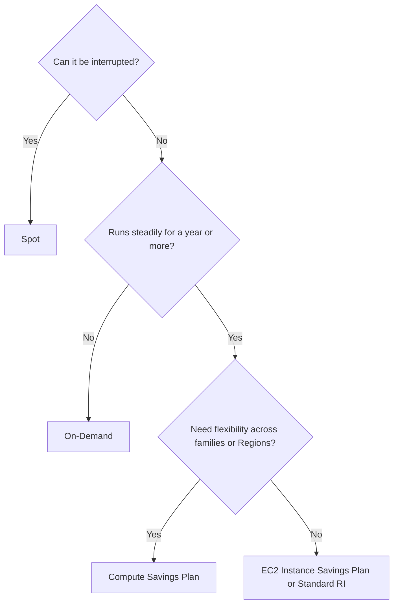

# Amazon EC2

> [!info] Why this matters
> EC2 is the base layer under much of AWS. The exam tests which instance type, which purchasing option and which placement fit a scenario. Purchasing options alone can decide several questions, because they appear in both performance and cost domains.
>
> **Covers:** [[Domain 3 Design High-Performing Architectures#Task 3.2|Task 3.2]], [[Domain 4 Design Cost-Optimized Architectures#Task 4.2|Task 4.2]].
> **Study time:** about 4 hours.

## What EC2 is

**Amazon Elastic Compute Cloud (EC2)** rents virtual machines called **instances**. It is infrastructure as a service: AWS runs the hardware and hypervisor, and you manage the operating system and everything above it. Linked services complete the picture:

- [[08 Block and File Storage#Amazon EBS|EBS]] provides virtual disks.
- [[05 Load Balancing and Auto Scaling|ELB]] distributes traffic across instances.
- [[05 Load Balancing and Auto Scaling#Amazon EC2 Auto Scaling|Auto Scaling]] adjusts the number of instances.

When you launch an instance you choose an AMI, an instance type, networking, storage, a security group and optionally a bootstrap script.

## Instance types

An instance type name such as `m7g.large` breaks down like this: `m` is the family, `7` the generation, `g` an attribute (here AWS Graviton, an Arm processor), and `large` the size.

| Family | Letters | Optimised for | Typical use |
| --- | --- | --- | --- |
| General purpose | M, T | Balance of CPU, memory, network | Web servers, small databases. T is burstable |
| Compute optimised | C | CPU | Batch, HPC, video encoding, gaming servers |
| Memory optimised | R, X | RAM | In-memory databases and caches. X is extra large, for example SAP HANA |
| Storage optimised | I, D | Local disk | NoSQL, data warehousing. I for fast NVMe, D for dense HDD |
| Accelerated computing | P, G, Inf, Trn | GPUs or ML chips | P for ML training, G for graphics and inference, Inf for inference, Trn for training |
| HPC optimised | Hpc | Tightly coupled compute | Simulations |

**Burstable T instances** earn CPU credits when idle and spend them under load. A T instance that performs well and then slows down after hours of sustained load has run out of credits. The fix is a fixed-performance family such as M or C, or **Unlimited mode**, which keeps performance but charges for extra credits. A bill that jumps after enabling that setting is the same issue from the other side.

**Graviton** usually gives the best price-performance and is more energy efficient. It suits software that runs on Arm.

**The Nitro System** is the hardware and hypervisor behind modern instances. Several features need it, such as the highest EBS performance and Multi-Attach. **Nitro Enclaves** provide isolated compute inside an instance for handling very sensitive data.

## Launching and configuring

### User data and instance metadata

**User data** is a script that runs once at first launch, as root. It installs software and pulls configuration.

**Instance metadata** is information an instance can read about itself at `169.254.169.254`, including its ID, its AZ and the temporary credentials of its role. **IMDSv2** uses session tokens, which protects against server-side request forgery attacks. Enforce it with `HttpTokens=required`.

### AMIs

An **Amazon Machine Image (AMI)** is the template for an instance: OS, software and configuration.

- AMIs are **Regional**. Copy one to another Region to use it there.
- They can come from AWS, from you, or from the AWS Marketplace.
- A **golden AMI** has your software pre-installed, so instances boot quickly.
- **EC2 Image Builder** automates building, testing and distributing AMIs and container images on a schedule. It is not on the in-scope list, but it supports the immutable infrastructure idea from [[Domain 2 Design Resilient Architectures#Task 2.2|Task 2.2]].

**Sharing an encrypted AMI** with another account needs two things: share the AMI itself, and give that account access to the customer managed KMS key used to encrypt its snapshots. An AMI encrypted with the default AWS managed key cannot be shared, because that key cannot be shared. Re-encrypt with a customer managed key first.

### Starting applications quickly

| Technique | How | Good for |
| --- | --- | --- |
| Golden AMI | Pre-install everything | Fast boot, consistent instances |
| User data | Install at boot | Dynamic configuration |
| Hybrid | Golden AMI plus a small user data script | Most real systems. Elastic Beanstalk works this way |
| RDS or EBS snapshot | Restore a database or disk with data already in place | Avoids slow loading |

### Instance lifecycle

| Action | Instance store data | EBS data | Public IP | RAM |
| --- | --- | --- | --- | --- |
| **Reboot** | Kept | Kept | Kept | Lost |
| **Stop** | Lost | Kept | Changes, unless Elastic IP | Lost |
| **Hibernate** | Lost | Kept | Changes, unless Elastic IP | Saved to EBS |
| **Terminate** | Lost | Root volume is deleted by default, other volumes are kept by default | Released | Lost |

You pay for EC2 only while running, although EBS volumes and Elastic IPs continue to cost money while an instance is stopped.

### Hibernation

Hibernation saves RAM to the encrypted EBS root volume and stops the instance. On resume, applications continue where they were, so long-running in-memory start-ups are skipped.

Requirements:

- It must be enabled at launch. You cannot enable it on an existing instance.
- The root volume must be EBS, **encrypted**, and big enough to hold the RAM.
- RAM must be under 150 GiB on Linux, and 16 GiB or less on Windows.
- It works with On-Demand and Spot, and with a [[05 Load Balancing and Auto Scaling#Warm pools|warm pool]].

### Connecting to instances

| Method | How it works | Open port 22? |
| --- | --- | --- |
| SSH with key pair | Traditional. You manage keys | Yes |
| **EC2 Instance Connect** | Pushes a temporary key, controlled by IAM | Yes |
| **EC2 Instance Connect Endpoint** | Reaches instances in private subnets with no public IP or bastion | Yes, from the endpoint only |
| **Session Manager** | Browser or CLI shell through Systems Manager. Fully logged | **No** |

If a question asks for the most secure admin access with no inbound ports, the answer is [[26 Infrastructure as Code and Operations#Session Manager|Session Manager]].

### Status checks and recovery

- A **system status check** failure is an AWS host problem. Stopping and starting the instance moves it to healthy hardware.
- An **instance status check** failure is usually inside your OS. Reboot or fix the OS.
- **Automatic recovery** moves an instance to new hardware while keeping its instance ID, private IP, Elastic IP and metadata. Instance store data is lost.

## Purchasing options

This is one of the most heavily tested areas. Work from two questions: can the workload be interrupted, and how long will it run?

| Option | Discount | Commitment | Best for |
| --- | --- | --- | --- |
| **On-Demand** | None | None | Short, unpredictable work that cannot be interrupted |
| **Reserved Instances** | Up to 72% | 1 or 3 years | Steady use of a known instance type |
| **Savings Plans** | Up to 72% | 1 or 3 years, $ per hour | Steady spending with more flexibility |
| **Spot** | Up to 90% | None | Interruptible, fault-tolerant work |
| **Dedicated Hosts and Instances** | Varies | Optional | Licensing and compliance |
| **Capacity Reservations** | None by itself | None | Guaranteed capacity in an AZ |

### On-Demand

You pay by the second for Linux and Windows, with a 60-second minimum. There is no commitment, and it has the highest unit price.

### Reserved Instances

You commit to an instance configuration for 1 or 3 years. Longer terms and more upfront payment give bigger discounts.

| | Standard RI | Convertible RI |
| --- | --- | --- |
| Discount | Up to 72% | Up to 66% |
| Change family, OS or tenancy | No | Yes, by exchange |
| Sell on the RI Marketplace | Yes | No |

**Scope** matters for capacity:

- A **Regional RI** is a billing discount across AZs. It reserves no capacity.
- A **zonal RI** reserves capacity in one AZ.

Payment options are All Upfront (largest discount), Partial Upfront and No Upfront.

### Savings Plans

You commit to a dollar amount per hour for 1 or 3 years, or for 1 year only on a Database Savings Plan. Anything above the commitment is charged at On-Demand rates.

| Plan | Discount | Applies to |
| --- | --- | --- |
| **Compute Savings Plan** | Up to 66% | Any EC2 family, size, AZ, Region, OS or tenancy, plus **Fargate and Lambda** |
| **EC2 Instance Savings Plan** | Up to 72% | One instance family in one Region. Size, OS and tenancy can vary |
| **SageMaker AI Savings Plan** | Up to 64% | SageMaker AI usage |
| **Database Savings Plan** | Up to 35% | Aurora, RDS, DynamoDB, ElastiCache, DocumentDB, Neptune, Keyspaces, Timestream, DMS and OpenSearch Service, across engines and Regions. 1-year term only |

Savings Plans do not reserve capacity, and a commitment cannot be changed after purchase.

### Spot Instances

Spot uses spare capacity at up to 90% off. AWS can reclaim an instance when it needs the capacity, and you get a **two-minute interruption notice**, delivered through instance metadata and EventBridge. A **rebalance recommendation** can warn earlier that an instance is at raised risk.

When interrupted, an instance can be terminated, stopped or hibernated.

Spot suits batch jobs, data analysis, image processing, stateless web tiers and CI. It does not suit databases or anything that "cannot tolerate interruption", no matter how strongly the question stresses cost.

To reduce interruptions, use several instance types and AZs. An Auto Scaling group with a [[05 Load Balancing and Auto Scaling#Mixed instances|mixed instances policy]] does this and is usually the best answer. **Spot Fleet** and **EC2 Fleet** do similar work outside Auto Scaling.

| Allocation strategy | Meaning |
| --- | --- |
| `price-capacity-optimized` | Lowest price among pools with the most capacity. AWS's recommended strategy |
| `capacity-optimized` | Pools least likely to be interrupted |
| `lowest-price` | Cheapest pools, with the highest interruption risk |
| `diversified` | Spread across pools |

### Dedicated Hosts and Dedicated Instances

| | Dedicated Instance | Dedicated Host |
| --- | --- | --- |
| Hardware | Not shared with other customers | A whole physical server for you |
| Visibility of sockets and cores | No | **Yes** |
| Bring your own per-socket or per-core licences | No | **Yes** |
| Control of instance placement | No | Yes |
| Cost | Lower | Highest |

Choose a Dedicated Host when the scenario mentions per-socket licensing, bring your own licence (BYOL) or strict compliance about physical placement. A requirement for hardware isolation alone is met by a Dedicated Instance.

### Capacity Reservations

**On-Demand Capacity Reservations** hold capacity in a specific AZ for any duration, with no term commitment. You pay the On-Demand rate whether or not you run instances. Combine them with Regional RIs or Savings Plans to get a discount as well.

Remember which options actually hold capacity: **zonal RIs and Capacity Reservations do. Savings Plans and Regional RIs do not.**

**Capacity Blocks for ML** reserve GPU capacity for a set window. They are unlikely to feature in the exam.

### Combining options

A common design uses each option where it fits:

- Savings Plan or RIs for the steady baseline
- On-Demand for the unpredictable remainder
- Spot for the interruptible surge

## Placement groups

Placement groups influence how instances are arranged on hardware.

| Strategy | Layout | Failure risk | Limits | Use |
| --- | --- | --- | --- | --- |
| **Cluster** | Packed close together in one AZ | High, one rack can fail together | Single AZ | Lowest latency and highest throughput between instances, HPC |
| **Spread** | Each instance on separate hardware | Lowest | **7 running instances per AZ** per group | A few critical instances that must not fail together |
| **Partition** | Groups of instances on separate racks | A partition can fail, not the group | **7 partitions per AZ**, hundreds of instances | Hadoop, Cassandra, Kafka |

A **precision time** placement group also exists for high-precision time sources. It is new and unlikely to feature.

If a launch into a cluster group fails with a capacity error, stop and start all instances in the group so they can be moved to hardware that has room for all of them.

## EC2 networking

### IP addresses

- **Private IP:** stays for the life of the instance.
- **Public IP:** assigned from AWS's pool and **changes on stop and start**.
- **Elastic IP (EIP):** a static public IPv4 address that you own until you release it. It can be moved between instances. All public IPv4 addresses have an hourly charge.

When users cannot reach an instance after a restart, the public IP has changed. The fix is an Elastic IP, or better, a load balancer or DNS name in front.

### Elastic network interfaces

An **ENI** is a virtual network card. It has a primary private IP, optional secondary private IPs, an Elastic IP per private IP, a MAC address and security groups.

- ENIs live in one AZ. They can be moved to another instance only in the **same AZ**.
- The primary ENI (`eth0`) cannot be detached.
- Moving a secondary ENI to a standby gives a simple failover that keeps the same private IP.
- Two ENIs make an instance dual-homed, for example to separate management traffic.

### Fast networking

| Technology | What it is | Use |
| --- | --- | --- |
| **Enhanced networking (SR-IOV)** | The mechanism that lets traffic bypass the hypervisor for higher performance at lower cost | Default on modern instances |
| **Elastic Network Adapter (ENA)** | AWS's enhanced networking interface, up to 100 Gbps and beyond on large instances | General high throughput |
| **Elastic Fabric Adapter (EFA)** | ENA plus OS-bypass for tightly coupled HPC and ML using MPI or NCCL | Very low latency between nodes |

EFA's OS-bypass does not work on Windows. There the interface behaves as a plain ENA.

**AWS ParallelCluster** is an open-source tool for building HPC clusters on AWS and can enable EFA.

## Exam patterns

| If the question says | Think | Why |
| --- | --- | --- |
| Nightly batch, can be re-run, minimise cost | Spot | Fault tolerant and interruptible |
| Critical workload that cannot be interrupted, minimise cost | RI or Savings Plan | "Cannot tolerate interruption" rules out Spot |
| Steady baseline plus unpredictable spikes | RI or Savings Plan plus Spot or On-Demand | The classic combination |
| Commit spending but keep freedom to change family, Region, or use Fargate and Lambda | Compute Savings Plan | Most flexible |
| One family in one Region, maximum discount | EC2 Instance Savings Plan or Standard RI | Up to 72% |
| Family may change during a 3-year reservation | Convertible RI | Up to 66% |
| Guarantee capacity in one AZ for an event | Capacity Reservation or zonal RI | Savings Plans do not hold capacity |
| Per-socket Windows Server licences | Dedicated Host | Sockets, cores and BYOL |
| Physical isolation only, no licence concerns | Dedicated Instance | Cheaper than a host |
| SAP HANA | X family | Extreme memory |
| Redis or in-memory analytics on EC2 | R family | Memory optimised |
| Lots of random local IOPS | I family | NVMe instance store |
| Train a deep learning model | P family | GPU training |
| ML inference, cheaply | G or Inf | Inference and graphics |
| T instance slows down after sustained load | CPU credits exhausted | Move to M or C, or Unlimited |
| Best price-performance, Arm-compatible | Graviton | `g` suffix |
| Lowest latency between nodes | Cluster placement group, EFA | Same AZ |
| A few critical instances isolated from each other | Spread placement group | 7 per AZ |
| Kafka, Cassandra or Hadoop | Partition placement group | Rack awareness |
| Standby must keep the same private IP | Move the ENI | Same AZ only |
| Users cannot reach the instance after stop and start | Public IP changed | Elastic IP |
| Keep RAM state across a stop | Hibernate | RAM to encrypted EBS root |
| Long application warm-up, want fast resume | Hibernate | Skips initialisation |
| Protect against SSRF stealing role credentials | Enforce IMDSv2 | Session tokens |
| Run a script once at launch | User data | Runs as root |
| Reduce boot time | Golden AMI | Software already installed |

## Check yourself

**1.** A media company runs a video transcoding job every night. Each job can be restarted if it fails, and the deadline is flexible. What is the most cost-effective option?

- A. On-Demand Instances
- B. Standard Reserved Instances
- C. Spot Instances
- D. Dedicated Hosts

> [!success]- Answer
> **C.** The work is interruptible and restartable, which is exactly what Spot is for. Reserved Instances would pay for capacity that sits idle during the day.

**2.** A company runs a critical payment system 24 hours a day for at least the next three years. It wants the lowest cost and may not tolerate interruptions. The instance family will not change. What should it buy?

- A. Spot Instances
- B. On-Demand Instances
- C. EC2 Instance Savings Plan or Standard RI for three years
- D. Compute Savings Plan for one year

> [!success]- Answer
> **C.** A fixed family with a steady workload earns the top discount of up to 72% on a three-year term. Spot can be reclaimed, and D gives less discount than needed.

**3.** A company wants to reduce compute costs. It uses EC2, Fargate and Lambda across several Regions and expects to change instance families over time. Which option fits?

- A. EC2 Instance Savings Plan
- B. Compute Savings Plan
- C. Convertible Reserved Instances
- D. Scheduled Instances

> [!success]- Answer
> **B.** It applies across families, Regions and compute services. An EC2 Instance Savings Plan is tied to one family in one Region, and an RI does not cover Fargate or Lambda.

**4.** A retailer needs guaranteed EC2 capacity in a specific AZ for a two-week sales event. It does not want a long commitment. What should it use?

- A. A Regional Reserved Instance
- B. A Savings Plan
- C. An On-Demand Capacity Reservation
- D. Spot Instances

> [!success]- Answer
> **C.** It reserves capacity for any duration in one AZ with no term commitment. Regional RIs and Savings Plans are discounts only, and Spot can be reclaimed.

**5.** A company has existing Windows Server licences tied to physical CPU sockets and wants to bring them to AWS. What should it use?

- A. Dedicated Instances
- B. Dedicated Hosts
- C. On-Demand Instances with shared tenancy
- D. Spot Instances

> [!success]- Answer
> **B.** Only Dedicated Hosts expose sockets and cores, which socket-based licences need.

**6.** A high-performance computing application needs the lowest possible network latency between its nodes. Which combination is best? (Choose two.)

- A. Cluster placement group
- B. Spread placement group
- C. Elastic Fabric Adapter
- D. Instances in different Regions
- E. A Network Load Balancer between nodes

> [!success]- Answer
> **A and C.** A cluster group places instances close together, and EFA provides OS-bypass networking for tightly coupled workloads. Spreading instances out increases latency.

**7.** A team runs a distributed Cassandra cluster of 90 instances on EC2. It wants to reduce the impact of a rack failure, and the database needs to know which instances share a rack. Which placement strategy is correct?

- A. Cluster
- B. Spread
- C. Partition
- D. No placement group

> [!success]- Answer
> **C.** Partition groups isolate groups of instances on separate racks and expose partition information to the application. Spread is limited to seven instances per AZ, so 90 would not fit easily.

**8.** After a maintenance stop and start, customers can no longer reach a server at its old public address. What is the simplest fix that keeps a fixed address?

- A. Use a larger instance
- B. Attach an Elastic IP
- C. Add a second private IP
- D. Create an AMI

> [!success]- Answer
> **B.** Default public IPs change on stop and start. An Elastic IP stays with you until you release it.

**9.** An application takes 20 minutes to load data into memory when it starts. Instances are stopped overnight to save money, and users complain about slow mornings. What should the company do?

- A. Use Spot Instances
- B. Use hibernation with an encrypted EBS root volume
- C. Use instance store volumes
- D. Use a larger root volume only

> [!success]- Answer
> **B.** Hibernation saves RAM to the encrypted EBS root volume, so the application resumes with its data already loaded. It must be enabled at launch.

**10.** A web application on a T3 instance works well, but it slows down badly after several hours of continuous high load. What is the most likely cause?

- A. EBS snapshots are running
- B. The instance has used all its CPU credits
- C. The AZ is failing
- D. The instance's public IP changed

> [!success]- Answer
> **B.** T instances earn and spend credits, then drop to baseline. Move to a fixed-performance family such as M or C, or enable Unlimited mode.

**11.** A company wants to share an encrypted AMI with a partner's account. The AMI's snapshots are encrypted with the default AWS managed key. What must it do first?

- A. Nothing, AMIs can always be shared
- B. Make the AMI public
- C. Copy the AMI using a customer managed KMS key, and share that key with the partner
- D. Turn off encryption on the existing snapshots

> [!success]- Answer
> **C.** AWS managed keys cannot be shared with other accounts. A customer managed key can, through its key policy.

---
**Previous:** [[03 Multi-Account Governance]] · **Next:** [[05 Load Balancing and Auto Scaling]] · **Plan:** [[Study Guide]]
