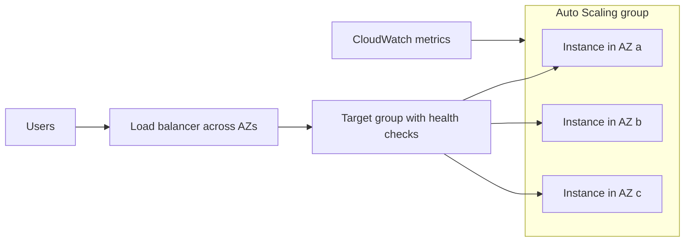
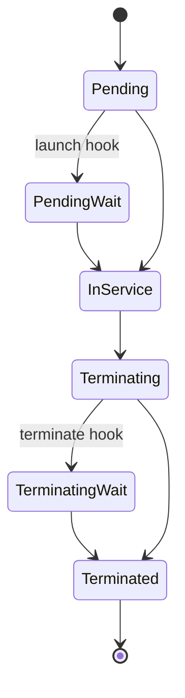

# Load Balancing and Auto Scaling

> [!info] Why this matters
> A load balancer in front of an Auto Scaling group across several AZs is the standard resilient, elastic web tier. Questions ask which load balancer, which scaling policy, and why something is not being replaced.
>
> **Covers:** [[Domain 2 Design Resilient Architectures#Task 2.1|Task 2.1]], [[Domain 2 Design Resilient Architectures#Task 2.2|Task 2.2]], [[Domain 3 Design High-Performing Architectures#Task 3.2|Task 3.2]], [[Domain 3 Design High-Performing Architectures#Task 3.4|Task 3.4]], [[Domain 4 Design Cost-Optimized Architectures#Task 4.2|Task 4.2]].
> **Study time:** about 3 hours.

## Elastic Load Balancing

A load balancer gives your application a single DNS name, spreads traffic across targets in several AZs, checks their health, and stops sending traffic to failed ones. **Elastic Load Balancing (ELB)** is the managed version: AWS handles scaling, patching and availability of the load balancer itself.

### Choosing a load balancer

| | Application Load Balancer | Network Load Balancer | Gateway Load Balancer |
| --- | --- | --- | --- |
| OSI layer | 7 | 4 | 3 |
| Protocols | HTTP, HTTPS, gRPC, WebSocket | TCP, UDP, TLS, QUIC | IP, using GENEVE on port 6081 |
| Routing | Path, host, headers, query string, method, source IP | Listener and port | Sends flows to appliances |
| Static IP | No | **Yes, one per AZ, Elastic IP allowed** | No |
| Targets | Instances, IPs, Lambda, containers | Instances, IPs, an ALB | Instances, IPs |
| Security groups | Yes | Yes | No |
| Keeps client IP | Through `X-Forwarded-For` | Yes, natively for instance targets | Yes, traffic is transparent |
| WAF support | **Yes** | No | No |
| Use for | Web apps, microservices | Extreme performance, static IPs, PrivateLink | Firewalls and inspection appliances |

The **Classic Load Balancer** is a previous-generation product. If it appears as an option, it is almost always wrong.

Load balancers are **internet-facing** or **internal**. Internal ones have private IPs and suit tiers behind the web layer.

### Listeners and target groups

- A **listener** accepts connections on a port and protocol.
- **Rules** on the listener decide where to send the request.
- A **target group** is a set of targets with its own health check.

Health checks use a port and a path such as `/health`. Failed targets are taken out of rotation automatically.

Common error codes:

| Code | Meaning |
| --- | --- |
| 503 | No healthy targets are registered |
| 504 | The target did not respond in time |
| 502 | The target returned an invalid response |

### Application Load Balancer

The ALB understands HTTP, so it can make decisions based on the content of a request.

| Routing condition | Example |
| --- | --- |
| Path | `/api/*` to one group, `/images/*` to another |
| Host | `one.example.com` versus `two.example.com` |
| Headers, method, source IP | Mobile clients to a separate group |
| Query string | `?platform=mobile` |

Other ALB features:

- **Actions:** forward, redirect (HTTP to HTTPS), return a fixed response, or authenticate users through Cognito or an OIDC identity provider.
- **Weighted target groups:** send 10% of traffic to a new version. Useful for blue/green and canary releases.
- **Target types:** instances, ECS tasks, Lambda functions and private IPs, including on-premises servers reached over Direct Connect or VPN.
- **Dynamic port mapping** for containers on ECS.
- **Slow start** gives new targets time to warm up.
- **Mutual TLS** can verify client certificates at the load balancer.
- **Routing algorithms:** round robin by default, or least outstanding requests.

The application behind an ALB sees the ALB's IP as the source. The real client IP is in the `X-Forwarded-For` header.

### Network Load Balancer

The NLB handles millions of requests per second at very low latency. It has **one static IP per AZ**, and you can assign Elastic IPs, which suits customers who must allow-list your addresses.

- Listeners support TCP, UDP, TLS and QUIC.
- A target can be an ALB, which combines a static IP with layer 7 routing.
- It fronts [[10 VPC Connectivity and Hybrid Networking#AWS PrivateLink|PrivateLink]] endpoint services.
- Health checks can use TCP, HTTP or HTTPS.
- A listener can forward to several target groups with weights.

### Gateway Load Balancer

The GWLB distributes traffic to a fleet of third-party virtual appliances, such as firewalls and intrusion detection systems. It combines two jobs:

- A **transparent network gateway** that leaves addresses unchanged, known as bump-in-the-wire
- A **load balancer** across the appliances

Traffic flows through a **Gateway Load Balancer endpoint** in your VPC, then to the appliances using GENEVE on port 6081.

### Cross-zone load balancing

Each load balancer node normally sends traffic only to targets in its own AZ. **Cross-zone load balancing** lets each node distribute evenly across all AZs. This helps when AZs have different numbers of targets.

| | Default | Charge for inter-AZ traffic |
| --- | --- | --- |
| ALB | On at the load balancer level. Can be turned off per target group | None |
| NLB | Off | Yes, if enabled |
| GWLB | Off | Yes, if enabled |

### Connection draining

**Deregistration delay** gives in-flight requests time to finish when a target is removed. New requests stop, and existing ones are allowed to complete. The range is 1 to 3,600 seconds, with a default of 300. Setting it to 0 disables it. Use a low value for short requests. Errors during scale-in often point to this setting being too low.

### Sticky sessions

Stickiness sends a client to the same target each time, so session data held on that target stays available.

| Cookie type | Generated by | Name |
| --- | --- | --- |
| Duration-based | Load balancer | `AWSALB` |
| Application-based, custom | Target | Your choice |
| Application-based, application cookie | Load balancer | `AWSALBAPP` |

Stickiness can unbalance load, and it makes instances stateful. A better design keeps sessions in [[14 DynamoDB|DynamoDB]] or [[15 ElastiCache and Other Databases#Amazon ElastiCache|ElastiCache]], so that any instance can serve any user.

### TLS on a load balancer

- The load balancer can **terminate** TLS, which saves work on the targets. Certificates usually come from [[23 Encryption and Secrets#AWS Certificate Manager|ACM]].
- An HTTPS listener has a default certificate and can hold more.
- **Server Name Indication (SNI)** lets one listener serve many domains, each with its own certificate, because the client names the host during the TLS handshake. It works with ALB, NLB and CloudFront.
- A **security policy** on the listener sets the allowed TLS versions and ciphers.
- For end-to-end encryption without termination, use an NLB with a TCP listener, which passes TLS through to targets.

### Security groups with a load balancer

Allow the internet to reach the load balancer on 80 and 443. Allow instances to accept traffic **only from the load balancer's security group**. This stops anyone going around the load balancer, and around any WAF attached to it.

### Monitoring

ELB publishes CloudWatch metrics and can write **access logs** to S3. Logs are compressed and include client IP, latency and response code.

## Amazon EC2 Auto Scaling

An **Auto Scaling group (ASG)** keeps the right number of instances running.

- It scales out and in with demand.
- It keeps the group between a **minimum** and **maximum**, aiming at a **desired capacity**.
- It **replaces unhealthy instances**.
- It registers new instances with a load balancer automatically.
- It spreads instances across AZs.

ASGs are free. You pay only for the instances.

### Launch templates

A **launch template** defines what to launch: AMI, instance type, key pair, security groups, user data and so on. Versions cannot be edited, but you create a new version and point the group at it. **Launch configurations** are the older mechanism, and new features require templates.

### Scaling policies

| Policy | How it works | Use when |
| --- | --- | --- |
| **Target tracking** | Keep a metric at a value, such as 40% average CPU | The default choice. Simplest |
| **Step scaling** | Different adjustments for different alarm sizes | You need finer control over large spikes |
| **Simple scaling** | One adjustment per alarm, then wait for a cooldown | Legacy. Prefer the two above |
| **Scheduled** | Change capacity at set times | Known patterns, such as 09:00 on weekdays |
| **Predictive** | Machine learning forecasts load and scales in advance | Regular, recurring patterns |
| **Manual** | You change the desired capacity | One-off changes |

Good metrics include average CPU, request count per target and average network in or out. You can also publish any custom metric. **Choosing the metric is part of the question.** For an SQS worker fleet, CPU tells you little. The right metric is **backlog per instance**, calculated from queue depth. See [[20 Messaging and Integration#Scaling workers on queue depth|Messaging and Integration]].

**Cooldown** (default 300 seconds) stops a simple scaling policy acting again before metrics settle. For target tracking and step scaling, the **instance warm-up** setting does a similar job. A golden AMI shortens the time needed.

### Health checks

By default an ASG uses **EC2 status checks**, which only spot a broken instance. If the operating system is fine and the application is failing, the ASG sees nothing wrong.

**Turn on ELB health checks** in the ASG so that an instance failing at the application level gets replaced. A **health check grace period** gives new instances time to start before they are judged.

### Lifecycle hooks

A hook pauses an instance as it launches or terminates, so that you can run custom actions.

Hooks attach to the `autoscaling:EC2_INSTANCE_LAUNCHING` and `autoscaling:EC2_INSTANCE_TERMINATING` transitions. The wait state lasts one hour by default. Uses include installing software before an instance joins, or copying logs off before it goes. Termination hooks are best effort.

### Warm pools

A **warm pool** keeps pre-initialised instances ready in a Stopped, Running or Hibernated state. It reduces scale-out latency for applications with long start-up times, at a lower cost than keeping them all in service.

### Instance refresh

**Instance refresh** replaces instances gradually when you change the launch template, keeping a set minimum healthy percentage during the rollout. This is the tidy way to roll out a new AMI.

### Mixed instances

A **mixed instances policy** combines several instance types and purchase options in one group: for example, an On-Demand base, then a percentage of Spot above it. Use the `price-capacity-optimized` strategy for Spot. Adding instance types increases the pools available and so reduces interruptions.

### Pausing an Auto Scaling group

- **Standby** takes an instance out of service without terminating it, so that you can troubleshoot or update it, then return it.
- **Suspending processes** stops activities such as `ReplaceUnhealthy` or `Launch` for a while, for example during maintenance.

### Termination order

When scaling in, the default policy works like this:

1. Choose the AZ with the most instances, to keep AZs balanced.
2. Within it, choose an instance with outdated configuration: launch configuration first, then a different launch template, then the oldest template version.
3. Then choose the instance closest to its next billing hour.
4. Break any tie at random.

For mixed instances groups, the allocation strategy is considered first. **Scale-in protection** can exempt particular instances.

### AWS Auto Scaling and Application Auto Scaling

The names are confusing, so learn the difference.

| Service | Scales |
| --- | --- |
| **Amazon EC2 Auto Scaling** | EC2 instances |
| **Application Auto Scaling** | ECS services, DynamoDB capacity, Aurora replicas, Lambda provisioned concurrency and others |
| **AWS Auto Scaling** | Scaling plans across EC2 Auto Scaling groups and those other resources, from one place |

## Exam patterns

| If the question says | Think | Why |
| --- | --- | --- |
| Route `/api/*` and `/images/*` differently | ALB path-based routing | Only layer 7 sees URLs |
| Many domains with different certificates on one load balancer | SNI | Multiple certificates, one listener |
| Redirect HTTP to HTTPS | ALB redirect action | Built in |
| UDP game traffic with a static IP | NLB | ALB has no UDP or static IP |
| Partners must allow-list your IPs | NLB with Elastic IPs, or Global Accelerator in front of an ALB | ALB IPs change |
| Static IP and path routing | NLB in front of an ALB | ALB is a valid NLB target |
| Millions of requests per second, ultra-low latency | NLB | Layer 4 |
| Inspect all traffic with third-party appliances | Gateway Load Balancer | GENEVE, bump-in-the-wire |
| Put WAF on a load balancer | ALB | Layer 7 only |
| Application needs the original client IP behind an ALB | `X-Forwarded-For` | NLB preserves it natively |
| PrivateLink service | NLB | Endpoint service front |
| Lambda behind a load balancer | ALB | Lambda is an ALB target type |
| Load balancer marks instances unhealthy, ASG does not replace them | Enable ELB health checks on the ASG | Default is EC2 status checks only |
| Keep average CPU at 40% with least configuration | Target tracking | "Keep at a value" |
| Traffic spikes at a known time | Scheduled scaling | Predictable |
| Forecast recurring patterns | Predictive scaling | Scales ahead of the load |
| Scale workers by unprocessed jobs | Queue backlog per instance | CPU is the wrong signal |
| Uneven load across AZs | Cross-zone load balancing | Each node spreads evenly |
| In-flight requests fail during scale-in | Deregistration delay | Connection draining |
| Sessions are lost when an instance is replaced | Store sessions in DynamoDB or ElastiCache | Make the tier stateless |
| Run a script before an instance enters service | Lifecycle hook | Pending wait |
| Roll a new AMI through a group with no outage | Instance refresh | Minimum healthy percentage |
| Instances must start much faster | Warm pool or golden AMI | Pre-initialised capacity |
| Stop people going around the load balancer | Instance SG allows only the load balancer's SG | SG-to-SG reference |
| Failover between instances | ELB | Immediate, in the path |
| Failover between Regions | Route 53 | DNS-based, slower |

## Check yourself

**1.** A company hosts several microservices behind a single domain name. Requests to `/orders` and `/payments` must reach different services. Which load balancer should it use?

- A. Network Load Balancer
- B. Application Load Balancer
- C. Gateway Load Balancer
- D. Classic Load Balancer

> [!success]- Answer
> **B.** Path-based routing is a layer 7 feature of the ALB.

**2.** A financial partner must allow-list the source addresses of a service that today runs behind an ALB. The application also relies on host-based routing. What is the best solution?

- A. Replace the ALB with an NLB
- B. Assign Elastic IPs to the ALB
- C. Put an NLB with Elastic IPs in front of the ALB, or put Global Accelerator in front
- D. Use a NAT gateway in front of the ALB

> [!success]- Answer
> **C.** ALBs do not have static IPs. An NLB can have Elastic IPs and can target an ALB, which keeps the host-based routing. Global Accelerator also gives static addresses.

**3.** A company must inspect all traffic entering a VPC with a fleet of third-party firewall appliances and scale them transparently. Which service is designed for this?

- A. Application Load Balancer
- B. Network Load Balancer
- C. Gateway Load Balancer
- D. AWS Global Accelerator

> [!success]- Answer
> **C.** GWLB distributes traffic to virtual appliances using GENEVE, without changing the addresses.

**4.** An Auto Scaling group sits behind an ALB. The ALB shows two instances as unhealthy because the application is returning errors, but the group does not replace them. What should be changed?

- A. Increase the maximum capacity
- B. Add a lifecycle hook
- C. Change the ASG health check type to include ELB
- D. Enable cross-zone load balancing

> [!success]- Answer
> **C.** By default the ASG uses EC2 status checks, which pass because the instance itself is running. ELB health checks expose application failures.

**5.** A company's traffic rises sharply every weekday at 09:00. New instances take several minutes to become ready, so users see errors each morning. What is the best fix?

- A. Scheduled scaling that adds capacity before 09:00
- B. Simple scaling on CPU
- C. Reducing the health check grace period
- D. Turning on cross-zone load balancing

> [!success]- Answer
> **A.** The pattern is known, so add capacity before it arrives. Predictive scaling would also work, but A is the direct answer for a fixed schedule. Reactive scaling always lags behind.

**6.** Workers on EC2 process jobs from an SQS queue. Their CPU stays low even when thousands of jobs are waiting. How should the ASG scale?

- A. Target tracking on average CPU
- B. Target tracking on a custom backlog-per-instance metric
- C. Scheduled scaling only
- D. Vertical scaling

> [!success]- Answer
> **B.** Backlog per instance reflects the real work outstanding, and AWS recommends this approach for SQS workers.

**7.** Users are logged out when the instance serving them is replaced. The team wants the tier to be stateless. What should it do?

- A. Enable sticky sessions
- B. Store session data in ElastiCache or DynamoDB
- C. Use larger instances
- D. Increase the deregistration delay

> [!success]- Answer
> **B.** External session storage lets any instance serve any user. Sticky sessions hide the problem, and the session is still lost when the instance goes.

**8.** A team sees failed requests whenever an ASG scales in. The requests take up to 60 seconds to finish, and deregistration delay is set to 5 seconds. What should it do?

- A. Increase the deregistration delay to more than 60 seconds
- B. Turn on stickiness
- C. Use a smaller instance type
- D. Disable health checks

> [!success]- Answer
> **A.** The delay gives in-flight requests time to complete before the target is removed.

**9.** A company needs one ALB to serve `shop.example.com` and `blog.example.org` over HTTPS, using different certificates. What makes this work?

- A. Two ALBs are always required
- B. Server Name Indication
- C. A wildcard certificate
- D. Cross-zone load balancing

> [!success]- Answer
> **B.** SNI lets the client state the hostname, so the listener can present the right certificate. A wildcard cannot cover two different domains.

**10.** An architect must make sure that web servers can be reached only through the load balancer. What is the correct security group configuration?

- A. Web servers allow 0.0.0.0/0 on port 443
- B. Web servers allow inbound from the load balancer's security group
- C. The load balancer allows inbound only from the web servers
- D. Remove the web servers' security group

> [!success]- Answer
> **B.** Referencing the load balancer's security group means only traffic from it is accepted.

---
**Previous:** [[04 Amazon EC2]] · **Next:** [[06 Amazon S3]] · **Plan:** [[Study Guide]]
