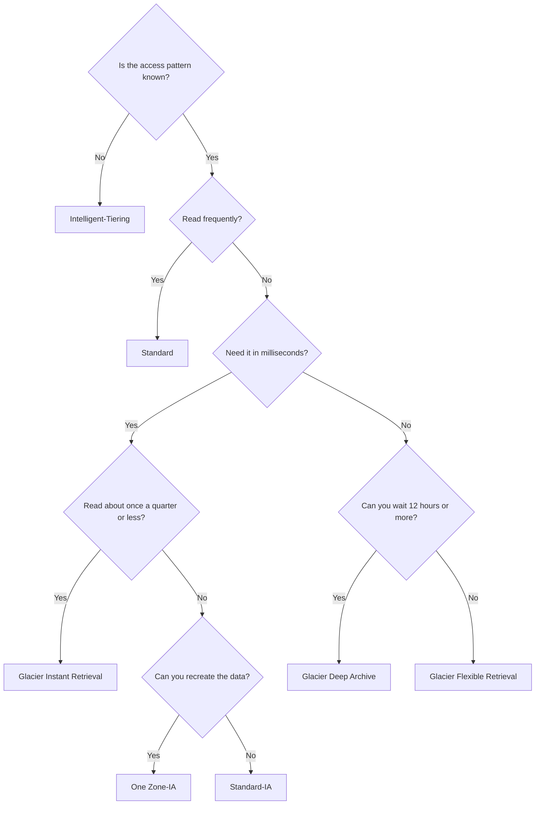
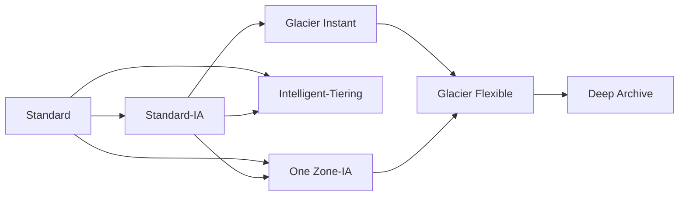

# Amazon S3

> [!info] Why this matters
> S3 appears in all four domains. Storage class questions alone are a reliable source of marks, because the answer can be worked out from three facts in the scenario: how often the data is read, how fast it must come back, and how long it is kept.
>
> **Covers:** [[Domain 3 Design High-Performing Architectures#Task 3.1|Task 3.1]], [[Domain 4 Design Cost-Optimized Architectures#Task 4.1|Task 4.1]]. Security is in [[07 S3 Security and Data Protection]].
> **Study time:** about 4 hours.

## The basics

**Amazon Simple Storage Service (S3)** stores objects in buckets. It is object storage: you read and write whole objects through an HTTP API, and you cannot edit part of a file in place or mount it as a normal disk.

| Term | Meaning |
| --- | --- |
| **Bucket** | A container for objects. Its name must be unique across all AWS accounts, but the bucket lives in one Region |
| **Object** | A file plus metadata. It can have tags and a version ID |
| **Key** | The full name of an object, such as `folder1/folder2/file.txt`. There are no real directories, only keys that contain slashes |
| **Prefix** | The part of the key before the object name. Performance limits apply per prefix |

S3 looks global because of the console, but buckets are Regional, and data never leaves the Region unless you replicate it.

Key facts:

| Fact | Value |
| --- | --- |
| Durability | 11 nines (99.999999999%), designed across all current classes |
| Consistency | Strong read-after-write |
| Maximum object size | 48.8 TiB, which AWS usually rounds to 50 TB. Older material and questions say 5 TB |
| Multipart upload | Up to 10,000 parts, 5 MiB to 5 GiB each. Recommended over 100 MB, required over 5 GiB |
| Console upload limit | 160 GB |
| Buckets per account | 10,000 general purpose buckets by default, adjustable |

Common uses are backup, disaster recovery, data lakes, static websites, software delivery and media hosting.

## Storage classes

You choose a class per object. All classes are low latency unless noted, and all hold data across at least three AZs except the one-zone classes.

| Class | Designed availability | AZs | Minimum storage | Minimum size billed | Retrieval | Use |
| --- | --- | --- | --- | --- | --- | --- |
| **Standard** | 99.99% | 3+ | None | None | Milliseconds, no fee | Frequently read data |
| **Intelligent-Tiering** | 99.9% | 3+ | None | Not monitored under 128 KB | Milliseconds, no retrieval fee | Unknown or changing access |
| **Standard-IA** | 99.9% | 3+ | 30 days | 128 KB | Milliseconds, per-GB fee | Infrequent but needs fast access |
| **One Zone-IA** | 99.5% | 1 | 30 days | 128 KB | Milliseconds, per-GB fee | Infrequent, re-creatable data |
| **Express One Zone** | 99.95% | 1 | None | None | Single-digit milliseconds | Very high request rates |
| **Glacier Instant Retrieval** | 99.9% | 3+ | 90 days | 128 KB | Milliseconds, higher fee | Archive read about once a quarter |
| **Glacier Flexible Retrieval** | 99.99% after restore | 3+ | 90 days | 40 KB overhead | Minutes to hours | Archive with flexible retrieval |
| **Glacier Deep Archive** | 99.99% after restore | 3+ | 180 days | 40 KB overhead | 12 to 48 hours | Lowest cost, long-term retention |

The pattern is simple: **the less often you read data, the cheaper the storage and the more expensive the read.**

Minimum storage durations matter. If an object is deleted early, you are still charged for the full minimum. Data that lives for 20 days is cheapest in Standard, because Standard-IA would bill 30 days.

### Glacier retrieval options

| Class | Tier | Time | Cost |
| --- | --- | --- | --- |
| Flexible Retrieval | Expedited | 1 to 5 minutes, for objects under 250 MB | Highest. Provisioned capacity guarantees availability |
| Flexible Retrieval | Standard | 3 to 5 hours | Moderate |
| Flexible Retrieval | Bulk | 5 to 12 hours | **Free** |
| Deep Archive | Standard | Within 12 hours | Low |
| Deep Archive | Bulk | Within 48 hours | Lowest |

Objects in Flexible Retrieval and Deep Archive must be **restored** first. A restore creates a temporary copy for the number of days you ask for.

### S3 Intelligent-Tiering

Intelligent-Tiering moves objects between tiers automatically, based on access, for a small monthly monitoring fee per object. There are **no retrieval fees**, so it is safe when you cannot predict access.

| Tier | When an object moves there |
| --- | --- |
| Frequent Access | Default |
| Infrequent Access | Automatic, after 30 days without access |
| Archive Instant Access | Automatic, after 90 days without access |
| Archive Access | Optional, configurable from 90 to 730 days. Retrieval takes hours |
| Deep Archive Access | Optional, configurable from 180 to 730 days. Retrieval takes up to 48 hours |

Objects under 128 KB are not monitored and stay in the Frequent Access tier.

### How to choose

**S3 Glacier as a separate service:** the exam guide lists Amazon S3 Glacier. Today this mostly means the Glacier storage classes above. The original vault-based Glacier API has been closed to new customers since 7 October 2025, but older questions may mention vaults. See [[07 S3 Security and Data Protection#Glacier Vault Lock|Glacier Vault Lock]].

## Lifecycle rules

**Lifecycle rules** automate moving and deleting objects. They can apply to a whole bucket, a prefix or objects with a tag.

- **Transition actions** move objects to a cheaper class.
- **Expiration actions** delete objects.

Rules can also act on **noncurrent versions** and **remove incomplete multipart uploads**. The second one is an easy saving, because abandoned parts are billed but invisible in normal listings.

Transitions flow **down** a waterfall, and never back up.

Rules to remember:

- There is no lifecycle transition from Glacier classes back to Standard. To move an object up, restore it and copy it.
- One Zone-IA can transition only to Glacier Flexible Retrieval or Deep Archive.
- Objects under 128 KB are not transitioned by default.
- The usual pattern waits at least 30 days before moving to Standard-IA or One Zone-IA, because those classes are designed and billed for objects kept 30 days or more. Exam questions traditionally treat 30 days as the minimum.

**Worked example 1.** An app creates thumbnails from uploaded photos. Thumbnails can be recreated and are needed for 60 days. Originals must be available immediately for 60 days, and after that a six-hour wait is acceptable.

- Originals: Standard, then a lifecycle rule moves them to Glacier Flexible Retrieval at 60 days.
- Thumbnails: One Zone-IA, with a rule that expires them at 60 days.

**Worked example 2.** Deleted objects must be recoverable immediately for 30 days, then within 48 hours for a year.

- Enable versioning, so that deletes are recoverable.
- Move noncurrent versions to Standard-IA, then to Deep Archive, using noncurrent-version transitions.

**S3 Storage Class Analysis** watches access patterns and recommends when to move data from Standard to Standard-IA. **S3 Storage Lens** gives organisation-wide insight. See [[#Tools for managing S3 at scale|below]].

## Versioning

**Versioning** keeps every version of an object in a bucket. It protects against overwrites and accidental deletes.

- Enable it at the bucket level. Once enabled, it can be **suspended** but never fully turned off.
- Objects uploaded before versioning have a version ID of `null`.
- Suspending does not delete existing versions.
- A simple delete adds a **delete marker**. The object appears to be gone, and you remove the marker to restore it.
- Each version is billed as a full object, so pair versioning with lifecycle rules for old versions.

## Replication

**S3 Replication** copies objects to another bucket automatically and asynchronously.

| Type | Use |
| --- | --- |
| **Cross-Region Replication (CRR)** | Disaster recovery, compliance, lower latency for users in another Region |
| **Same-Region Replication (SRR)** | Log aggregation, copying between production and test accounts |

Requirements:

- **Versioning on both buckets**
- An IAM role that lets S3 replicate
- Buckets can be in different accounts

Replication can be **one-way or two-way**. Two-way keeps both buckets in step, which is what you want for active-active use with Multi-Region Access Points.

What does and does not replicate:

| Replicated | Not replicated by default |
| --- | --- |
| New objects after the rule is created | **Existing objects**. Use **S3 Batch Replication** |
| Metadata, tags, ACLs, Object Lock settings | **Lifecycle actions** |
| SSE-S3 objects, and SSE-KMS objects if you enable it | **Version-specific deletes** |
| SSE-C objects | Objects already replicated from another bucket. Replication is **not transitive** |
| | Delete markers, unless you turn that on |
| | Objects in Glacier Flexible, Deep Archive and Intelligent-Tiering archive tiers until restored |

For **SSE-KMS** objects, enable the option, name the destination key, adjust that key's policy, and give the replication role `kms:Decrypt` on the source key and `kms:Encrypt` on the destination key. Multi-Region keys are treated as independent keys by S3, so objects are still decrypted and re-encrypted.

**S3 Replication Time Control (RTC)** adds a service level agreement: most objects replicate within seconds, and 99.9% within 15 minutes. It suits compliance deadlines, and it adds replication metrics.

## Performance

S3 scales automatically to at least **3,500 write requests (PUT, COPY, POST, DELETE) and 5,500 read requests (GET, HEAD) per second, per prefix**. There is no limit on the number of prefixes. Spreading reads across four prefixes gives 22,000 reads per second.

| Technique | What it does | Use when |
| --- | --- | --- |
| **Multipart upload** | Splits a file into parts uploaded in parallel | Files over 100 MB. Required over 5 GiB |
| **Transfer Acceleration** | Uploads to a nearby edge location, then uses the AWS backbone to the bucket. You pay only when it is faster | Users far from the bucket uploading large files |
| **Byte-range fetches** | Requests specific byte ranges in parallel | Speeding up downloads, or reading only part of an object |
| **S3 Express One Zone** | Directory bucket in one AZ with single-digit millisecond latency | Very latency-sensitive workloads next to compute |

Global **uploads** to one bucket point to Transfer Acceleration. Global **downloads** point to CloudFront.

**S3 Express One Zone** uses a special **directory bucket**. Data lives in one AZ, so place compute in the same AZ. It does not support SSE-C, DSSE-KMS, lifecycle transitions or server access logs.

## Event notifications

S3 can react to events such as object creation, deletion and restore, or replication failure. You can filter by prefix and suffix, for example only `.jpg` files.

| Destination | Note |
| --- | --- |
| **Lambda** | Run code on each object |
| **SQS** | Standard queues only. **FIFO queues are not supported** directly |
| **SNS** | Fan out to many subscribers |
| **EventBridge** | All events can go here, with advanced filtering, multiple targets such as Step Functions and Kinesis, and archive and replay |

Delivery is at least once, typically within seconds, and sometimes a minute or longer. Lambda, SQS and SNS need a resource policy that lets S3 send to them.

## Tools for managing S3 at scale

| Tool | Purpose |
| --- | --- |
| **S3 Batch Operations** | One job acting on many existing objects: copy, change tags or metadata, restore from Glacier, encrypt unencrypted objects, or invoke Lambda on each. It tracks progress and retries |
| **S3 Inventory** | A scheduled report of objects and their metadata, often the input to Batch Operations |
| **S3 Storage Lens** | Organisation-wide metrics and recommendations. Finds incomplete multipart uploads, the fastest-growing buckets and data protection gaps. Free metrics are kept 14 days, and advanced metrics 15 months |
| **Storage Class Analysis** | Recommends when to move data between Standard and Standard-IA |

Storage Lens metrics cover storage summaries, cost optimisation, data protection, access management, events, performance, activity and status codes. The default dashboard cannot be deleted, but it can be disabled, and metrics can be exported daily to S3.

## Hosting a static website

A bucket can serve a static site from a website endpoint. The objects must be publicly readable, so Block Public Access has to be relaxed and a bucket policy added. A **403 Forbidden** error usually means the bucket policy does not allow public reads.

The website endpoint is HTTP only. The better design is **CloudFront in front of a private bucket**, using Origin Access Control. This gives HTTPS, caching and no public bucket. See [[12 CloudFront and Global Accelerator#Keeping S3 origins private|CloudFront]].

## Other features

**Requester Pays.** Normally the bucket owner pays for storage and data transfer. With Requester Pays, the person downloading pays for the request and the data transfer. The requester must be an authenticated AWS user. It suits sharing large datasets with other organisations.

**Multi-Region Access Points.** One global endpoint for buckets in several Regions. Requests go to the closest bucket over the AWS network, using Global Accelerator, and can fail over. Combine with two-way replication.

**S3 Select and Glacier Select.** These retrieved a subset of an object with SQL. They have been closed to new customers since 25 July 2024. Use Athena for new designs.

**S3 Object Lambda.** This transformed objects with Lambda as they were read, for example to redact personal data. It has been closed to new customers since 7 November 2025, though older questions may still describe it.

**S3 Tables** store Apache Iceberg data for analytics. They are a newer feature that you only need to recognise.

## Exam patterns

| If the question says | Think | Why |
| --- | --- | --- |
| Unknown or unpredictable access, minimise cost | Intelligent-Tiering | Its one clear signal |
| Known pattern over time | Lifecycle rule | Cheaper than paying for monitoring |
| Data can be regenerated, infrequent access | One Zone-IA | Single-AZ risk is acceptable |
| Deleted after 20 days | Standard | Under every minimum duration |
| Infrequent, needs instant access | Standard-IA | Milliseconds |
| Archive, needs milliseconds | Glacier Instant Retrieval | Stays online |
| Archive, minutes acceptable | Flexible Retrieval, Expedited | 1 to 5 minutes |
| Compliance data, retrieval within two business days, cheapest | Deep Archive | 12 hours or more is acceptable |
| Keep for 7 years, almost never read | Deep Archive | Lowest cost |
| Replication enabled, but old objects did not copy | S3 Batch Replication | Only new objects replicate |
| Copy to another Region for DR | CRR with versioning on both sides | |
| Aggregate logs in one Region | SRR | |
| 15-minute replication commitment | Replication Time Control | SLA backed |
| Protect against accidental deletes | Versioning | Add MFA Delete for stronger control |
| Global users upload multi-GB files | Transfer Acceleration plus multipart | Upload path |
| Global users download content | CloudFront | Download path |
| More requests per second | More prefixes | Limits are per prefix |
| Download part of a large file | Byte-range fetch | |
| Abandoned upload parts are costing money | Lifecycle rule to abort incomplete uploads | |
| Object created, then process it | Event notification to Lambda or SQS | |
| Send S3 events to a FIFO queue or several targets | EventBridge | Direct FIFO not supported |
| Encrypt or tag millions of existing objects | Batch Operations | |
| SQL across S3 data | Athena | S3 Select is closed |
| Partners download a large dataset and pay for it | Requester Pays | |
| Find the fastest-growing buckets across the organisation | Storage Lens | |

## Check yourself

**1.** A company stores compliance records that are read about twice a year. When an auditor asks, the records must be available within 10 minutes. Which class is the most cost-effective?

- A. S3 Standard
- B. S3 Glacier Flexible Retrieval with Expedited retrieval
- C. S3 Glacier Deep Archive
- D. S3 One Zone-IA

> [!success]- Answer
> **B.** Expedited retrieval takes 1 to 5 minutes, and storage is much cheaper than Standard. Deep Archive cannot return data in under 12 hours, and One Zone-IA risks losing compliance data.

**2.** Log files are read heavily for 30 days, rarely until 90 days, and must always be retrievable in milliseconds. After a year they can be deleted. Which approach is the most cost-effective?

- A. Keep everything in Standard
- B. Use a lifecycle rule: Standard, then Standard-IA at 30 days, Glacier Instant Retrieval at 90 days, expire at 365 days
- C. Use a lifecycle rule to Deep Archive at 30 days
- D. Use One Zone-IA from the start

> [!success]- Answer
> **B.** The pattern is known, so a lifecycle rule fits. "Milliseconds" keeps you out of Flexible Retrieval and Deep Archive, and One Zone-IA would risk the data.

**3.** A startup cannot predict how often its stored objects will be read, and some may not be touched for months. It wants to reduce storage cost with no performance impact and no operational effort. Which class fits?

- A. Standard-IA
- B. Glacier Instant Retrieval
- C. Intelligent-Tiering
- D. Deep Archive

> [!success]- Answer
> **C.** Intelligent-Tiering moves data automatically and has no retrieval fees. Standard-IA would add a retrieval fee on every read, which could be expensive if access turns out to be high.

**4.** Processing output is kept for 20 days and then deleted. Which class is the cheapest?

- A. Standard-IA
- B. One Zone-IA
- C. Standard
- D. Glacier Flexible Retrieval

> [!success]- Answer
> **C.** Every other class here has a minimum storage charge longer than 20 days, so they would bill for 30 or 90 days anyway.

**5.** A team turned on Cross-Region Replication, but objects already in the bucket did not appear in the destination. What should it do?

- A. Disable and re-enable versioning
- B. Use S3 Batch Replication
- C. Enable Transfer Acceleration
- D. Add a lifecycle rule

> [!success]- Answer
> **B.** Replication rules cover new objects only. Batch Replication handles existing ones.

**6.** A company has 40 prefixes in one bucket. One prefix is hitting request limits at about 5,500 GET requests per second. What is the simplest way to increase read throughput?

- A. Spread the objects across more prefixes
- B. Move to Standard-IA
- C. Enable versioning
- D. Use a larger EC2 instance

> [!success]- Answer
> **A.** S3's request limits apply per prefix, and there is no limit on the number of prefixes.

**7.** Users on several continents upload large video files to a bucket in Ireland, and uploads are slow. What is the best improvement? (Choose two.)

- A. S3 Transfer Acceleration
- B. Multipart upload
- C. CloudFront signed cookies
- D. Glacier Instant Retrieval
- E. A NAT gateway

> [!success]- Answer
> **A and B.** Transfer Acceleration moves data to the AWS backbone at the nearest edge location, and multipart upload parallelises large files.

**8.** An application must process each uploaded object exactly in arrival order, using an SQS FIFO queue. S3 event notifications will not accept the queue as a destination. What is the most suitable design?

- A. Send events to EventBridge, then route them to the FIFO queue
- B. Convert the queue to a standard queue and accept duplicates
- C. Poll the bucket from EC2
- D. Enable S3 Replication

> [!success]- Answer
> **A.** S3 cannot send directly to a FIFO queue, but EventBridge can receive S3 events and target a FIFO queue.

**9.** Monthly bills show storage charges much higher than the total size of visible objects in a bucket used for large uploads. What is the likely cause, and what is the fix?

- A. Delete markers. Disable versioning
- B. Incomplete multipart uploads. Add a lifecycle rule that aborts them
- C. Replication. Remove the destination bucket
- D. Object tags. Remove the tags

> [!success]- Answer
> **B.** Parts of unfinished multipart uploads are billed but do not appear in normal listings. Storage Lens can also reveal them.

**10.** A research group shares a 500 TB dataset with other organisations and does not want to pay for their downloads. What should it use?

- A. S3 Replication
- B. Requester Pays
- C. Presigned URLs
- D. Transfer Acceleration

> [!success]- Answer
> **B.** The requester, an authenticated AWS user, pays for requests and data transfer.

---
**Previous:** [[05 Load Balancing and Auto Scaling]] · **Next:** [[07 S3 Security and Data Protection]] · **Plan:** [[Study Guide]]
