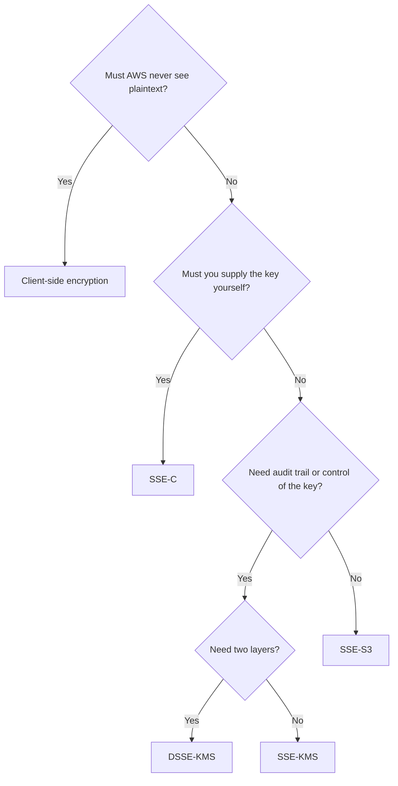

# S3 Security and Data Protection

> [!info] Why this matters
> S3 is where the exam tests data security in practice: who can read an object, how it is encrypted, and how to make sure nobody can delete it.
>
> **Covers:** [[Domain 1 Design Secure Architectures#Task 1.3|Task 1.3]], part of [[Domain 1 Design Secure Architectures#Task 1.1|Task 1.1]].
> **Study time:** about 2.5 hours.

## How access is decided

Four main mechanisms can affect access to an S3 object.

| Mechanism | Type | Use |
| --- | --- | --- |
| **IAM policies** | Identity-based | What this user or role can do. Covers S3 and everything else |
| **Bucket policies** | Resource-based | Rules on the bucket. Used for cross-account access and public access |
| **ACLs** | Legacy | Disabled by default. Avoid them |
| **Block Public Access** | Safety override | Stops public access, whatever the policies say |

An IAM principal can reach an object if its IAM policy **or** the resource policy allows it, and **nothing explicitly denies it**. For cross-account access, both sides must allow it. See [[02 IAM and Federation#Policy evaluation logic|policy evaluation]].

### Block Public Access

All four Block Public Access settings are on by default for new buckets. They can also be set for the whole account. They override any bucket policy or ACL that would make data public, so leave them on unless a bucket really must be public.

If a public bucket policy exists but access still fails, Block Public Access is the likely reason.

### Object Ownership and ACLs

New buckets default to the **Bucket owner enforced** setting: ACLs are disabled, and the bucket owner owns every object. If ACLs are enabled again with **Object writer**, an uploader from another account owns its objects. With **Bucket owner preferred**, the bucket owner owns new objects uploaded with the `bucket-owner-full-control` canned ACL. An S3 ACL has nothing to do with a network ACL.

### Bucket policy examples

Require HTTPS for all access:

```json
{
  "Version": "2012-10-17",
  "Statement": [{
    "Sid": "DenyInsecureTransport",
    "Effect": "Deny",
    "Principal": "*",
    "Action": "s3:*",
    "Resource": ["arn:aws:s3:::example", "arn:aws:s3:::example/*"],
    "Condition": { "Bool": { "aws:SecureTransport": "false" } }
  }]
}
```

Allow access only through one VPC endpoint:

```json
{
  "Version": "2012-10-17",
  "Statement": [{
    "Sid": "OnlyThroughEndpoint",
    "Effect": "Deny",
    "Principal": "*",
    "Action": "s3:*",
    "Resource": ["arn:aws:s3:::example", "arn:aws:s3:::example/*"],
    "Condition": { "StringNotEquals": { "aws:SourceVpce": "vpce-1a2b3c4d" } }
  }]
}
```

Other common bucket policy patterns:

- Grant public read for a static site
- Grant access to another account
- Allow only CloudFront, through [[12 CloudFront and Global Accelerator#Keeping S3 origins private|Origin Access Control]]
- Limit access to your organisation with `aws:PrincipalOrgID`
- Reject uploads that do not use the right encryption

### Cross-account access to a bucket

| Method | How | Suits |
| --- | --- | --- |
| **Bucket policy** | Allow the other account's principal, and that account's IAM policy must also allow it | Programmatic access that keeps the caller's own permissions |
| **Role** | The other account assumes a role in the bucket's account | When objects must end up owned and managed by the bucket account |
| **Access point** | A policy on an access point, delegated from the bucket | Many teams or applications |

If objects are encrypted with a KMS key, the other account also needs access to the key. The AWS managed key `aws/s3` cannot be used across accounts, so use a customer managed key.

Requiring a specific type of encryption on upload:

```json
{
  "Version": "2012-10-17",
  "Statement": [{
    "Sid": "RequireKms",
    "Effect": "Deny",
    "Principal": "*",
    "Action": "s3:PutObject",
    "Resource": "arn:aws:s3:::example/*",
    "Condition": {
      "StringNotEquals": { "s3:x-amz-server-side-encryption": "aws:kms" }
    }
  }]
}
```

## S3 Access Points

An **access point** is a named endpoint attached to a bucket, with its own DNS name and policy. Instead of one huge bucket policy covering every team, each team gets an access point that limits it to a prefix.

An access point can be restricted to **VPC origin**, so that it is reachable only from a chosen VPC. This requires a VPC endpoint whose policy allows the access point and the bucket.

## Presigned URLs

A **presigned URL** gives temporary access to one object. Anyone holding the URL can perform the allowed action, with no AWS account, until it expires. The URL carries the permissions of the identity that signed it, checked at request time.

| Generated with | Maximum expiry |
| --- | --- |
| S3 console | 12 hours |
| AWS CLI | 7 days |

Typical uses:

- Letting logged-in users download a premium video
- Letting a user upload directly to a specific key, so that the traffic does not pass through your servers

If the signer's permissions are removed, the URL stops working, even before it expires. [[12 CloudFront and Global Accelerator#Signed URLs and signed cookies|CloudFront signed URLs]] are a separate feature, for content served through CloudFront.

## CORS

**Cross-Origin Resource Sharing (CORS)** is a browser rule. A page from one origin cannot call another origin unless that origin agrees, using headers such as `Access-Control-Allow-Origin`.

If a website on `www.example.com` loads objects from a bucket on a different domain and the browser reports a CORS error, add a **CORS configuration to the bucket** that allows the website's origin. This is a browser issue, not an IAM issue.

## Encryption

### Encryption at rest

| Option | Who manages the key | Header value | Audit key use? | Notes |
| --- | --- | --- | --- | --- |
| **SSE-S3** | AWS | `AES256` | No | **The default** for all new objects since January 2023. No extra cost |
| **SSE-KMS** | KMS, you control the key and policy | `aws:kms` | **Yes**, through CloudTrail | Control over rotation and who can use the key |
| **DSSE-KMS** | KMS | `aws:kms:dsse` | Yes | Two layers of encryption for strict compliance |
| **SSE-C** | You supply the key with each request | Key sent in headers | No | HTTPS required. AWS does not store the key. Blocked by default on new buckets since April 2026 |
| **Client-side** | You, completely | Not applicable | Your own logs | Encrypt before upload. AWS never sees plaintext |



**SSE-KMS and throttling.** Each upload calls `GenerateDataKey` and each download calls `Decrypt`. These count toward KMS request quotas and cost money. An **S3 Bucket Key** reduces KMS calls by up to 99% by using a bucket-level key. It gives a coarser audit trail in CloudTrail.

**Enforcing encryption.** SSE-S3 applies automatically, but a bucket policy can insist on a particular type, by denying `PutObject` requests without the right header. Bucket policies are evaluated before default encryption.

**Encrypting existing objects.** Use [[06 Amazon S3#Tools for managing S3 at scale|S3 Batch Operations]] to copy them in place with new settings.

### Encryption in transit

S3 offers HTTP and HTTPS endpoints. Use a bucket policy that denies `aws:SecureTransport = false` to force HTTPS, as shown above. KMS encryption protects data at rest, not in transit.

## Protecting against deletion

| Control | What it prevents | Who can get round it |
| --- | --- | --- |
| **Versioning** | Losing data to overwrites and deletes | Anyone who can delete versions |
| **MFA Delete** | Permanently deleting versions, or changing versioning, without MFA | Only the bucket owner's root user can enable it |
| **Object Lock, Governance mode** | Deletes and overwrites for a retention period | Users with `s3:BypassGovernanceRetention` |
| **Object Lock, Compliance mode** | Deletes and overwrites for a retention period | **Nobody, not even root** |
| **Legal hold** | Deletes with no end date | Anyone with `s3:PutObjectLegalHold` can remove it |

### MFA Delete

MFA Delete needs versioning, and only the root user of the bucket owner account can enable or disable it. It then requires an MFA code to permanently delete a version or to suspend versioning.

### S3 Object Lock

**Object Lock** applies a write-once-read-many (**WORM**) model to object versions. It requires versioning.

- **Retention period:** a fixed time. It can be extended, but in Compliance mode it can never be shortened.
- **Compliance mode:** no user can change the mode, shorten the period or delete the version. This includes the root user.
- **Governance mode:** most users are blocked, but those with special permissions can override it.
- **Legal hold:** protects an object indefinitely, independently of any retention period, until the hold is removed. Use it for litigation with no known end date.

The word in the question decides the mode. "**Even administrators**" or "**not even root**" means Compliance.

### Glacier Vault Lock

**Vault Lock** applied a WORM policy to a legacy S3 Glacier vault. Once locked, the policy cannot be changed. New designs use Object Lock on buckets, but the term still appears in questions.

## Logging and monitoring

| Tool | What it records | Best for |
| --- | --- | --- |
| **Server access logs** | Each request to a bucket, delivered to a log bucket in the same Region. Free apart from storage | Cheap, best-effort, delayed access records |
| **CloudTrail data events** | Object-level API calls with IAM identity, paid per event | Audit with identity detail, near real time |
| **CloudTrail management events** | Bucket-level changes | Who changed a bucket policy |
| **Amazon Macie** | Finds sensitive data in buckets | PII discovery |
| **IAM Access Analyzer** | Buckets reachable from outside | Unintended sharing |

**Never make a bucket log to itself.** Each log delivery creates more log objects, so the bucket grows without end. Query the logs with Athena.

## Private access from a VPC

Instances in a private subnet can reach S3 without the internet by using a [[10 VPC Connectivity and Hybrid Networking#VPC endpoints|Gateway VPC Endpoint]], which is free. Add a bucket policy using `aws:SourceVpce` to make the endpoint the only way in.

## Exam patterns

| If the question says | Think | Why |
| --- | --- | --- |
| Audit exactly when each key was used | SSE-KMS | CloudTrail logs key use |
| KMS request costs or throttling are too high | S3 Bucket Key | Up to 99% fewer KMS calls |
| Customer supplies a key per request | SSE-C | HTTPS needed |
| AWS must never see plaintext | Client-side encryption | Encrypt before upload |
| Two layers of encryption | DSSE-KMS | Strict compliance |
| All data must be encrypted in transit | Deny `aws:SecureTransport` false | HTTPS, not KMS |
| Encrypt existing objects | S3 Batch Operations | |
| WORM, not even root can delete | Object Lock, Compliance mode | |
| WORM, privileged users may override | Object Lock, Governance mode | |
| Lawsuit with no end date | Legal hold | Indefinite |
| Temporary download link for a non-AWS user | Presigned URL | Up to 7 days from the CLI |
| Upload directly to S3 from a browser | Presigned URL | Bypasses your servers |
| Public policy exists, access still fails | Block Public Access | Overrides it |
| Website gets a 403 from a static site bucket | Bucket policy for public reads | Or use CloudFront with OAC |
| S3 reachable only through CloudFront | Origin Access Control | Keep the bucket private |
| Browser error loading from another bucket | CORS configuration | Browser rule |
| Each team needs its own view of one bucket | Access points | Separate policies |
| Reachable only from one VPC | VPC-origin access point, or `aws:SourceVpce` | |
| Who accessed an object, cheaply | Server access logs | Different bucket |
| Who accessed an object, with IAM identity | CloudTrail data events | |
| Stop anyone deleting versions without a token | MFA Delete | Root enables it |
| Find PII in buckets | Macie | |

## Check yourself

**1.** A company must record each use of the encryption key for its S3 data and rotate that key on its own schedule. Which option meets this with the least effort?

- A. SSE-S3
- B. SSE-KMS with a customer managed key
- C. SSE-C
- D. Client-side encryption

> [!success]- Answer
> **B.** KMS logs key use in CloudTrail, and a customer managed key gives control over policy and rotation.

**2.** After moving to SSE-KMS, a data lake sees throttling errors and a large increase in KMS costs. What is the best fix?

- A. Enable S3 Bucket Keys
- B. Use SSE-C
- C. Remove encryption
- D. Add more prefixes

> [!success]- Answer
> **A.** Bucket Keys reduce calls to KMS by using a short-lived bucket-level key. Extra prefixes do nothing for KMS limits.

**3.** Regulation requires financial records to be impossible to delete for seven years, even by account administrators or the root user. What should the company use?

- A. Versioning and MFA Delete
- B. Object Lock in Governance mode
- C. Object Lock in Compliance mode
- D. A bucket policy with an explicit deny

> [!success]- Answer
> **C.** In Compliance mode nobody can delete a locked version until the period ends. Governance can be bypassed, and an administrator could edit a bucket policy.

**4.** Legal asks that objects connected to a court case be kept until further notice. The end date is unknown. What should be applied?

- A. A retention period of 100 years
- B. A legal hold
- C. A lifecycle expiration rule
- D. Glacier Deep Archive

> [!success]- Answer
> **B.** A legal hold has no end date and stays until someone with permission removes it.

**5.** All access to a bucket must use encrypted connections. What is the simplest way to enforce this?

- A. Enable SSE-KMS
- B. A bucket policy that denies requests where `aws:SecureTransport` is false
- C. Move the bucket into a private subnet
- D. Enable versioning

> [!success]- Answer
> **B.** SSE-KMS encrypts at rest and does nothing for the connection. Buckets are not inside subnets.

**6.** A website offers paid downloads. Only customers who have paid should be able to fetch a file, the link should expire in an hour, and customers have no AWS accounts. What should it do?

- A. Make the bucket public
- B. Create an IAM user for each customer
- C. Generate presigned URLs after payment
- D. Use Requester Pays

> [!success]- Answer
> **C.** Presigned URLs grant time-limited access to a single object without AWS credentials.

**7.** A front-end at `app.example.com` loads fonts from an S3 bucket through the bucket's own hostname. Browsers block the request, although a direct link works. What should the team change?

- A. Add a CORS configuration to the bucket
- B. Attach an IAM role to the browser
- C. Disable Block Public Access
- D. Enable Transfer Acceleration

> [!success]- Answer
> **A.** A direct link works, but the browser blocks the cross-origin request. This is a CORS issue.

**8.** A team sets a logging bucket to log to itself, and storage grows quickly. Why?

- A. Logs are not compressed
- B. Every log delivery is itself logged, which creates a loop
- C. Versioning is on
- D. Server access logs are stored in Standard-IA

> [!success]- Answer
> **B.** Logs must go to a different bucket to avoid the loop.

**9.** Several teams share one data bucket, and the bucket policy has become unmanageable. Each team needs access to its own prefix. What simplifies this?

- A. S3 Access Points
- B. S3 Replication
- C. ACLs
- D. Requester Pays

> [!success]- Answer
> **A.** Each access point has its own policy, so the bucket policy can stay simple.

**10.** A security team needs to know which IAM identity downloaded a particular object in the last 24 hours. Which source gives this, assuming it was enabled? (Choose the best answer.)

- A. CloudTrail data events
- B. CloudTrail management events only
- C. S3 Storage Lens
- D. VPC Flow Logs

> [!success]- Answer
> **A.** Object reads are data events. Management events cover bucket-level operations, and Storage Lens shows aggregates.

---
**Previous:** [[06 Amazon S3]] · **Next:** [[08 Block and File Storage]] · **Plan:** [[Study Guide]]
