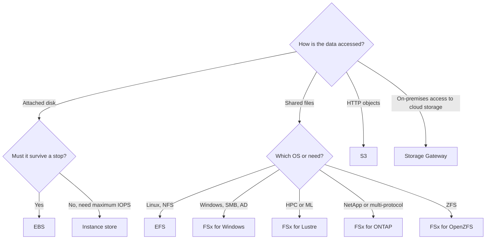

# Block and File Storage

> [!info] Why this matters
> The exam gives you a workload and asks for the storage type. Almost all of these questions come down to the table below, plus a few trigger words such as "Windows", "HPC" or "shared across AZs".
>
> **Covers:** storage types in [[Domain 2 Design Resilient Architectures#Task 2.1|Task 2.1]], [[Domain 3 Design High-Performing Architectures#Task 3.1|Task 3.1]], [[Domain 4 Design Cost-Optimized Architectures#Task 4.1|Task 4.1]].
> **Study time:** about 3.5 hours.

## Three kinds of storage

| Type | How it is accessed | AWS services | Good for |
| --- | --- | --- | --- |
| **Block** | Attached as a disk to an instance | EBS, instance store | Boot volumes, databases |
| **File** | Mounted as a share over NFS or SMB | EFS, FSx | Shared content, home directories |
| **Object** | HTTP API | S3 | Backups, data lakes, static assets |

| | Amazon EBS | Amazon EFS | Amazon S3 |
| --- | --- | --- | --- |
| Attaches to | One instance, or several with Multi-Attach in one AZ | Thousands of Linux clients across AZs | Nothing, it is an API |
| Scope | One AZ | Region, or One Zone | Region |
| Scaling | Manual resize | Automatic | Automatic |
| Pricing | Provisioned GB | Used GB | Used GB plus requests |
| Typical use | Boot disks, databases | Shared files, content management | Backups, data lakes, websites |

### Choosing storage

## Amazon EBS

**Elastic Block Store (EBS)** volumes are network-attached disks for EC2.

- A volume lives in **one AZ**. To move it, snapshot it and create a volume from the snapshot elsewhere.
- It usually attaches to one instance at a time.
- It persists independently of the instance.
- Size, type and IOPS can be changed while the volume is in use (Elastic Volumes). After growing a volume, extend the file system too.
- You pay for what you provision, whether you use it or not.

**Delete on termination** controls what happens when an instance is terminated. The root volume is deleted by default, and additional volumes are kept by default. To keep a root volume, set the attribute to false.

### Volume types

| Type | Media | Size | Maximum IOPS | Maximum throughput | Boot? | Use |
| --- | --- | --- | --- | --- | --- | --- |
| **gp3** | SSD | 1 GiB to 64 TiB | 80,000 | 2,000 MiB/s | Yes | Default choice. Baseline 3,000 IOPS and 125 MiB/s included |
| **gp2** | SSD | 1 GiB to 16 TiB | 16,000 | 250 MiB/s | Yes | Older. 3 IOPS per GiB, bursts to 3,000 under 1 TiB |
| **io2 Block Express** | SSD | 4 GiB to 64 TiB | 256,000 | 4,000 MiB/s | Yes | Critical databases, 99.999% durability |
| **io1** | SSD | 4 GiB to 16 TiB | 64,000 | 1,000 MiB/s | Yes | Older provisioned IOPS |
| **st1** | HDD | 125 GiB to 16 TiB | 500 | 500 MiB/s | **No** | Big data, logs, frequent sequential reads |
| **sc1** | HDD | 125 GiB to 16 TiB | 250 | 250 MiB/s | **No** | Cold data, lowest cost |

How to reason:

- **Random access with small reads and writes** (databases) means SSD, measured in IOPS.
- **Large sequential reads** (log processing) means HDD, measured in MiB/s.
- **gp2 ties IOPS to size.** gp3 sets IOPS and throughput separately and costs 20% less per GiB. If a question has gp2 needing more IOPS but no more space, migrate to gp3.
- Older guides say gp3 tops out at 16,000 IOPS. That is out of date. Older questions may still assume io2 is needed above that level, so check the wording, such as "critical" or "sub-millisecond".
- All io2 volumes have been Block Express since April 2025. The highest IOPS needs a Nitro instance.
- The instance also has its own EBS bandwidth limit. A slow volume on a small instance may be limited by the instance.

### Snapshots

A **snapshot** is a point-in-time backup of a volume, stored in S3 behind the scenes, though you cannot see it in a bucket.

- Snapshots are **incremental**. Only changed blocks are stored, but you can still restore from any one of them.
- You can snapshot a volume in use, though stopping I/O gives better consistency.
- Copy across AZs or Regions to move data or prepare for disaster recovery.
- **Data Lifecycle Manager (DLM)** automates creating, retaining and deleting snapshots. [[28 High Availability and Disaster Recovery#AWS Backup|AWS Backup]] does this across many services.

| Feature | Purpose | Details |
| --- | --- | --- |
| **Snapshot Archive** | Cheap long-term retention | Up to 75% cheaper, 90-day minimum, restore can take up to 72 hours |
| **Recycle Bin** | Recover after accidental deletion | Retention rules for EBS volumes, snapshots and EBS-backed AMIs |
| **Fast Snapshot Restore** | Removes first-read latency on new volumes | Enabled per AZ, charged, limited number per Region |

Volumes created from snapshots load data lazily from S3, so first reads are slow. Fast Snapshot Restore avoids this, at a price.

### Encryption

When a volume is encrypted:

- Data at rest is encrypted.
- Data moving between the instance and the volume is encrypted.
- Snapshots are encrypted, and volumes from them are encrypted.

Encryption uses KMS with AES-256, has minimal impact on latency, and can be turned on by default for an account in a Region.

**You cannot encrypt an existing volume in place.** The process is:

1. Snapshot the volume.
2. Copy the snapshot with encryption turned on.
3. Create a new volume from the encrypted snapshot.
4. Swap the volumes.

### Multi-Attach

**Multi-Attach** attaches one io1 or io2 volume to up to **16 Nitro instances in the same AZ**, each with full read and write access.

The application or file system must handle concurrent writes. A normal file system such as XFS or EXT4 is not cluster-aware and will corrupt data. Use it for clustered applications that manage their own storage access. It is not a shared file system. For that, use EFS.

### RAID

You can build software RAID across EBS volumes in the operating system.

- **RAID 0** (striping) adds performance and combined capacity. Losing one volume loses everything.
- **RAID 1** (mirroring) adds fault tolerance by writing to two volumes.

Today this is rarely the best answer, because gp3 and io2 offer high performance directly.

## EC2 instance store

**Instance store** is storage physically attached to the host. It gives the highest I/O performance, but it is **ephemeral**.

| Event | Instance store data |
| --- | --- |
| Reboot | Kept |
| Stop, hibernate or terminate | **Lost** |
| Host or disk failure | **Lost** |
| Instance type change | **Lost** |

Instance store volumes must be specified at launch and cannot be attached later. Use them for buffers, caches, scratch data, and for databases that replicate across nodes, such as Cassandra. The word "temporary" unlocks this answer. The word "persist" rules it out.

## Amazon EFS

**Elastic File System (EFS)** is a managed NFS file system for **Linux**.

- It uses NFS v4 and POSIX file semantics.
- It can be mounted by thousands of instances across AZs at the same time.
- It grows and shrinks automatically to petabytes, with no capacity planning. You pay for what you use.
- On-premises Linux servers can mount it over Direct Connect or VPN.
- Security groups control network access to its mount targets, and KMS can encrypt it at rest. Encryption at rest can be chosen only when the file system is created.
- **Access points** give applications a set entry directory and user identity.

**EFS is not for Windows.** This is one of the most common traps in the exam.

### Types, classes and modes

| Setting | Options | Guidance |
| --- | --- | --- |
| **File system type** | Regional (multi-AZ) or One Zone | One Zone is cheaper, for data that does not need multi-AZ |
| **Storage class** | Standard, Infrequent Access, Archive | Lifecycle policies move files automatically |
| **Throughput mode** | **Elastic**, Provisioned, Bursting | Elastic is recommended, especially for spiky workloads |
| **Performance mode** | **General Purpose**, Max I/O | General Purpose. Max I/O is a previous-generation mode |

More detail:

- **Infrequent Access** has a retrieval charge and no minimum storage duration. **Archive** is for data read a few times a year and has a 90-day minimum. Both bill at least 128 KiB per file. Archive requires Elastic throughput.
- **EFS Replication** keeps a copy of a file system in the Region of your choice, usually another Region for disaster recovery. The RPO is 15 minutes for most file systems.
- Older questions use Max I/O for very high parallel access. Current guidance is General Purpose, which now scales far beyond its old limits. Max I/O cannot be used with One Zone or Elastic throughput.

## Amazon FSx

**FSx** launches third-party high-performance file systems as a managed service. There are four, and each has a clear trigger.

| | FSx for Windows File Server | FSx for Lustre | FSx for NetApp ONTAP | FSx for OpenZFS |
| --- | --- | --- | --- | --- |
| Protocols | SMB | Lustre (POSIX) | NFS, SMB, iSCSI, NVMe | NFS |
| Clients | Windows and Linux | Linux | Windows, Linux, macOS | Linux, Windows, macOS |
| Trigger | Windows, AD, SMB, NTFS | HPC, ML, media rendering | NetApp, or multi-protocol | ZFS |
| Availability | Single-AZ or Multi-AZ | Scratch or Persistent | Single-AZ or Multi-AZ | Single-AZ or Multi-AZ |
| Standout | AD integration | S3 integration, TB/s throughput | Multi-protocol, tiering, clones | Up to 2 million IOPS, clones |

### FSx for Windows File Server

- Supports SMB and NTFS, and integrates with Microsoft Active Directory.
- Supports access control lists, user quotas and DFS Namespaces.
- Offers SSD or HDD storage, and **data deduplication** lowers the cost of general file shares.
- Can be accessed from on-premises over VPN or Direct Connect.
- Can be **joined to an existing on-premises AD**, which keeps existing groups and permissions.
- Multi-AZ provides automatic failover, and backups are taken to S3.

### FSx for Lustre

Lustre is a **parallel** distributed file system for large-scale computing. It delivers throughput up to multiple TB per second and sub-millisecond latency.

| Deployment | Replication | Use |
| --- | --- | --- |
| **Scratch** | None. Data is lost if a file server fails | Short-term, cheapest, high burst |
| **Persistent** | Replicated within one AZ (SSD and HDD), failed files replaced in minutes | Long-term processing, sensitive data |

It **links to an S3 bucket**: S3 objects appear as files, jobs read them at high speed, and results can be written back to S3. This is the answer when HPC or ML needs fast access to data held in S3.

### FSx for NetApp ONTAP

A managed NetApp ONTAP file system. It is the only option here that serves **NFS, SMB and iSCSI** from the same system, so it is the answer for "Linux and Windows clients share data" or "migrate NetApp".

It supports snapshots, SnapMirror replication, deduplication, compression, instant clones and automatic tiering of cold data to a cheaper storage tier.

### FSx for OpenZFS

A managed OpenZFS file system reached over NFS. It moves ZFS workloads to AWS, delivers up to 2 million IOPS with latencies of hundreds of microseconds, and offers snapshots, compression and instant clones.

## Exam patterns

| If the question says | Think | Why |
| --- | --- | --- |
| Database needs 12,000 IOPS, cost-effective | gp3 | Provisions IOPS cheaply |
| Critical database needs very high sustained IOPS | io2 Block Express | Up to 256,000 IOPS |
| gp2 needs more IOPS, not more space | Move to gp3 | IOPS independent of size |
| Large sequential log processing, cheap | st1 | Throughput, frequent access |
| Coldest, cheapest block storage | sc1 | Cannot boot |
| Boot volume on HDD | Not possible | SSD only |
| Linux fleet in an ASG shares uploaded files | EFS | Many mounts across AZs |
| Windows shared storage with AD | FSx for Windows | EFS is Linux only |
| ML training on data in S3 at high speed | FSx for Lustre | S3-linked |
| Short-term HPC, cheapest | Lustre Scratch | No replication |
| NetApp migration | FSx for ONTAP | The name is the answer |
| Linux and Windows clients share a file system | FSx for ONTAP | Multi-protocol |
| ZFS file server | FSx for OpenZFS | |
| Temporary scratch data, fastest possible | Instance store | Ephemeral is fine |
| High IOPS that must survive a stop | EBS io2 | Instance store would lose it |
| Keep a root volume after termination | `DeleteOnTermination` false | Default true for root |
| Encrypt an existing volume | Snapshot, copy encrypted, restore | No in-place option |
| Move a volume to another AZ | Snapshot and restore | Volumes are AZ-bound |
| Automate snapshots | DLM or AWS Backup | |
| Recover a deleted snapshot | Recycle Bin | |
| Keep old snapshots cheaply | Snapshot Archive | Up to 75% cheaper |
| New volumes must perform fully at once | Fast Snapshot Restore | |
| Same block volume, several instances, one AZ | io1 or io2 Multi-Attach | Up to 16 |
| Reduce EFS cost for cold files | Lifecycle to IA or Archive | |
| Unpredictable EFS throughput | Elastic throughput | |

## Check yourself

**1.** A fleet of Linux instances in an Auto Scaling group across three AZs must read and write the same uploaded files. Which storage fits?

- A. EBS gp3
- B. Instance store
- C. Amazon EFS
- D. FSx for Windows File Server

> [!success]- Answer
> **C.** EFS can be mounted by many Linux instances across AZs. An EBS volume belongs to one AZ, and instance store is not shared.

**2.** Windows servers need a shared file system with Active Directory permissions, and it must survive the loss of an AZ. What is the best choice?

- A. Amazon EFS Regional
- B. FSx for Windows File Server, Multi-AZ
- C. EBS Multi-Attach
- D. FSx for Lustre

> [!success]- Answer
> **B.** EFS does not support Windows. FSx for Windows provides SMB, AD integration and Multi-AZ failover.

**3.** A machine learning team stores training data in S3. Training jobs on GPU instances need very high throughput to it for a few days. Which service is the best fit?

- A. FSx for Lustre linked to the S3 bucket
- B. S3 Standard, read directly with the CLI
- C. EFS Standard
- D. AWS Storage Gateway

> [!success]- Answer
> **A.** Lustre presents S3 objects as a high-speed file system, built for this kind of work.

**4.** A database on EC2 needs 20,000 IOPS, and the team wants to minimise cost. The workload is not mission-critical and does not need sub-millisecond latency. What should it choose?

- A. sc1
- B. st1
- C. gp3 with provisioned IOPS
- D. io2 Block Express

> [!success]- Answer
> **C.** gp3 reaches 80,000 IOPS and is cheaper than io2. HDD volumes cannot deliver this.

**5.** A nightly ETL job reads terabytes of log data sequentially. It wants the lowest cost that still gives good throughput. Which volume fits?

- A. st1
- B. gp3
- C. io2
- D. sc1

> [!success]- Answer
> **A.** Frequent, large sequential reads are what st1 is for. sc1 is for colder data with lower throughput.

**6.** A company discovers that an important EBS volume is unencrypted. What must it do to encrypt the data?

- A. Enable encryption on the volume while attached
- B. Create a snapshot, copy it with encryption, then create a new volume
- C. Enable default encryption for the account, which converts it
- D. Attach a KMS key to the instance

> [!success]- Answer
> **B.** There is no in-place conversion. Default encryption affects only new volumes.

**7.** An application uses a local cache that can be rebuilt at any time, and it needs the fastest possible disk. Which is the best option?

- A. EBS io2
- B. EFS
- C. Instance store
- D. S3 Express One Zone

> [!success]- Answer
> **C.** Temporary, rebuildable data is exactly what instance store is for.

**8.** A company wants to replace an on-premises NetApp filer that serves both NFS and SMB clients, with as few changes as possible. What should it use?

- A. Amazon EFS
- B. FSx for NetApp ONTAP
- C. FSx for OpenZFS
- D. S3 File Gateway

> [!success]- Answer
> **B.** ONTAP provides multi-protocol access and familiar NetApp features.

**9.** An instance is terminated, and an attached data volume survives, but the root volume disappears. Why?

- A. Snapshots failed
- B. The default `DeleteOnTermination` setting is true for root volumes and false for additional volumes
- C. Root volumes are instance store
- D. EBS volumes only persist if encrypted

> [!success]- Answer
> **B.** This is the default behaviour, and it can be changed for each volume.

**10.** A clustered application must write to the same block device from four instances in one AZ, and it manages concurrent writes itself. What should be used?

- A. gp3 Multi-Attach
- B. io2 with Multi-Attach
- C. Instance store
- D. EFS

> [!success]- Answer
> **B.** Multi-Attach needs io1 or io2. EFS is file storage, and the question asks for a block device.

---
**Previous:** [[07 S3 Security and Data Protection]] · **Next:** [[09 VPC Fundamentals]] · **Plan:** [[Study Guide]]
