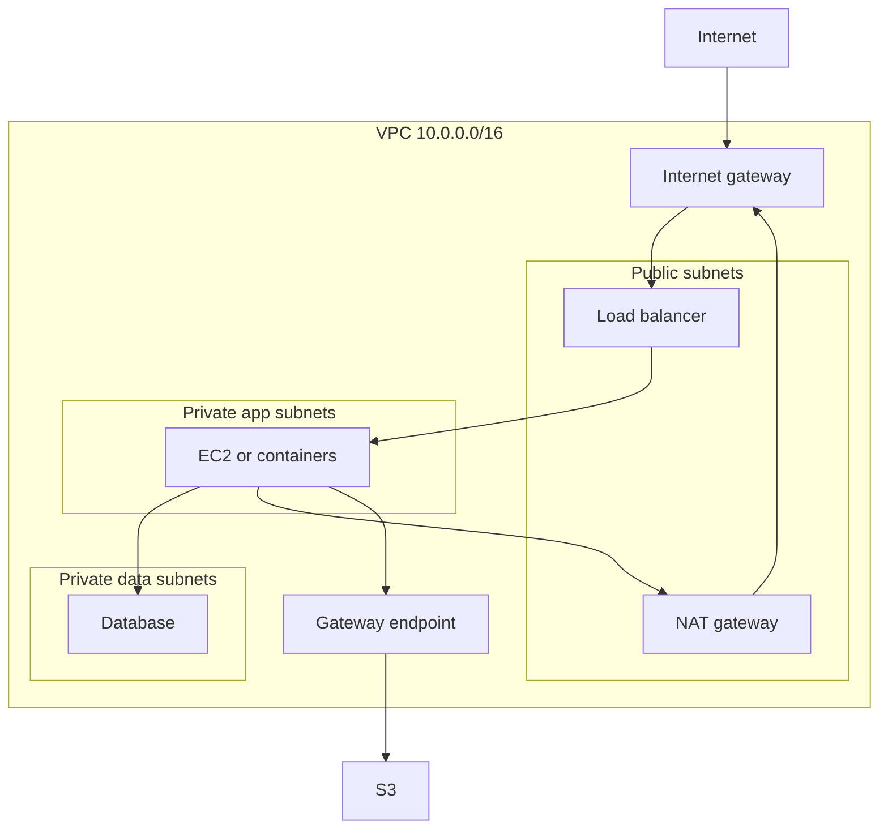
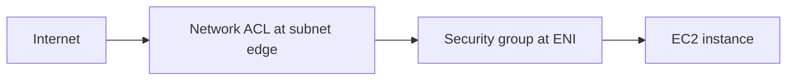

# VPC Fundamentals

> [!info] Why this matters
> Networking is the area candidates most often find hard, and it appears in every domain. Learn this chapter thoroughly and draw the diagrams yourself. If you can sketch a three-tier VPC from memory, most scenario questions become straightforward.
>
> **Covers:** [[Domain 1 Design Secure Architectures#Task 1.2|Task 1.2]], [[Domain 3 Design High-Performing Architectures#Task 3.4|Task 3.4]], [[Domain 4 Design Cost-Optimized Architectures#Task 4.4|Task 4.4]].
> **Study time:** about 5 hours.

## The big picture

A **Virtual Private Cloud (VPC)** is your private network in a Region. A **subnet** is a slice of that network in one AZ. Route tables decide where traffic goes, and firewalls decide whether it is allowed.

This is the **three-tier design**. Only the load balancer and NAT gateway sit in public subnets. Application servers and databases are private, with the same layout repeated in each AZ.

Every new account has a **default VPC** in each Region, with a public subnet in each AZ, so that instances get public IPs and internet access straight away. It is convenient for testing, but production workloads should use custom VPCs.

## IP addressing and CIDR

**CIDR notation** describes a range of IP addresses. The number after the slash says how many leading bits are fixed. The remaining bits can vary.

| CIDR | Host bits | Addresses | Usable in an AWS subnet |
| --- | --- | --- | --- |
| /32 | 0 | 1 | Not a valid subnet |
| /28 | 4 | 16 | 11 |
| /27 | 5 | 32 | 27 |
| /26 | 6 | 64 | 59 |
| /25 | 7 | 128 | 123 |
| /24 | 8 | 256 | 251 |
| /20 | 12 | 4,096 | 4,091 |
| /16 | 16 | 65,536 | 65,531 |

To work out the number of addresses, use 2 to the power of (32 minus the prefix). A /24 gives 2⁸ = 256. Each step down in the prefix doubles the size.

`0.0.0.0/0` means every IPv4 address. `10.0.1.5/32` means exactly one address.

**Private IP ranges** (RFC 1918) cannot be routed on the internet:

- `10.0.0.0/8`
- `172.16.0.0/12`
- `192.168.0.0/16`

**VPC sizing rules:**

- A CIDR block can be from /16 (65,536 addresses) to /28 (16 addresses).
- You can add secondary IPv4 CIDR blocks: 5 by default, up to 50.
- Do not overlap with other VPCs or on-premises networks you may ever want to connect.
- Plan generously, because you cannot resize a subnet.

### Subnets

A subnet belongs to **one AZ**. AWS reserves **five addresses** in each subnet. For `10.0.0.0/24`:

| Address | Reserved for |
| --- | --- |
| 10.0.0.0 | Network address |
| 10.0.0.1 | VPC router |
| 10.0.0.2 | Amazon-provided DNS |
| 10.0.0.3 | Future use |
| 10.0.0.255 | Network broadcast. AWS does not support broadcast |

> [!example] Worked question
> You need 29 instances in a subnet. Is a /27 big enough?
> A /27 has 32 addresses, minus 5 reserved, leaving 27. That is too small, so use a /26, which leaves 59.

## Internet gateways and route tables

An **internet gateway (IGW)** connects a VPC to the internet. It is highly available and scales automatically. A VPC has one, and an IGW attaches to one VPC.

A **route table** holds rules that send traffic to a target. Each subnet is associated with one route table. When several routes match, the **most specific route wins** (longest prefix match).

| Destination | Target | Meaning |
| --- | --- | --- |
| `10.0.0.0/16` | `local` | Traffic inside the VPC. Always present and cannot be removed |
| `0.0.0.0/0` | `igw-…` | Everything else goes to the internet |
| `0.0.0.0/0` | `nat-…` | Private subnet: outbound internet through NAT |
| `pl-…` (S3 prefix list) | `vpce-…` | S3 traffic through a gateway endpoint |

**A subnet is public only if its route table has a route to an internet gateway.** Nothing else makes it public. Having a public IP is also needed for an instance to be reachable, but the route is what defines the subnet.

For an instance to be reachable from the internet, all of these must be true:

1. The VPC has an internet gateway attached.
2. The subnet's route table has a route to it.
3. The instance has a public or Elastic IP.
4. The security group and network ACL allow the traffic.

## NAT for private subnets

Network address translation lets instances in private subnets reach the internet, for updates or external APIs, while nothing on the internet can start a connection to them.

### NAT gateway

A **NAT gateway** is the managed option. It is charged per hour and per GB processed.

| Setting | Zonal NAT gateway | Regional NAT gateway |
| --- | --- | --- |
| Lives in | One public subnet, in one AZ | The VPC, with no public subnet needed |
| Availability | Resilient within its AZ only | Expands to AZs where you have workloads, which can take up to 60 minutes for a new AZ |
| Route tables | Usually one per AZ | One route to one NAT ID |
| Elastic IPs | Up to 8 | Managed automatically or manually, up to 32 per AZ |
| Private NAT | Supported | Not supported |

A zonal gateway has these rules:

- It lives in a **public subnet**, with an Elastic IP, and needs an internet gateway.
- It cannot be used by instances in its own subnet.
- It scales up to 100 Gbps automatically.
- It has no security group. Control traffic with the instances' security groups and NACLs.

**Availability and cost trade-off** (tested in [[Domain 4 Design Cost-Optimized Architectures#Task 4.4|Task 4.4]]):

- **One zonal NAT gateway per AZ**, each private subnet using its local gateway. This is highly available, and it avoids cross-AZ data charges.
- **One shared NAT gateway.** Cheaper hourly, but it is a single point of failure, and other AZs pay cross-AZ transfer.
- **A regional NAT gateway.** Simplifies this by handling the AZs itself.

### NAT instance

A **NAT instance** is an EC2 instance doing NAT. It is the legacy option.

| | NAT gateway | NAT instance |
| --- | --- | --- |
| Managed | Yes | No, you patch it |
| Availability | Within an AZ, or regional mode across AZs | Needs your own failover, such as an ASG |
| Bandwidth | Scales automatically | Depends on instance type |
| Security groups | Not attachable | Yes |
| Can be a bastion | No | Yes |
| Port forwarding | No | Yes |
| Cost | Hourly plus per GB | Instance cost |
| Setup | None | **Disable the source/destination check** |

The source/destination check is a very common exam item. EC2 normally drops traffic not addressed to itself, and NAT only works if you turn that check off. A small NAT instance can be cheaper for low traffic in non-production environments.

## Bastion hosts

A **bastion host** (jump box) is an instance in a public subnet used to reach instances in private subnets.

- Its security group allows SSH on port 22 only from a restricted range, such as the corporate public CIDR.
- The private instances' security group allows SSH from the bastion's security group.

The more modern and secure approach is [[26 Infrastructure as Code and Operations#Session Manager|Systems Manager Session Manager]], which needs no open inbound ports, no bastion and no SSH keys, and logs every session.

## Security groups and network ACLs

These two firewalls work together and are tested constantly.

| | Security group | Network ACL |
| --- | --- | --- |
| Level | Network interface or instance | Subnet |
| Rules | **Allow only** | Allow and deny |
| State | **Stateful:** return traffic is allowed automatically | **Stateless:** return traffic needs its own rule |
| Evaluation | All rules together | Lowest number first, first match wins |
| Can reference | IPs and other security groups | IPs only |
| Default | Inbound denied, outbound allowed | Default NACL allows all. A custom NACL denies all |

### Security groups

- Rules can reference another security group. This is how you say "only the app tier may reach the database", and it keeps working as instances come and go.
- A security group belongs to a VPC in a Region.
- One group can attach to many instances, and an interface can have up to 5 groups.
- There is no deny rule. To block a specific IP, use a network ACL.

> [!tip] Diagnosing connection failures
> A **timeout** usually means a firewall is dropping traffic: check the security group or NACL. **Connection refused** means traffic arrived but nothing is listening: check the application.

### Network ACLs

- Each subnet has one NACL, and new subnets get the default one.
- Rule numbers run from 1 to 32,766. Lower numbers are checked first.
- There is a final catch-all `*` rule that denies everything.
- Leave gaps between numbers so that you can insert rules later.

**Ephemeral ports.** When a client connects to a server, the client uses a temporary high port. Because NACLs are stateless, the return traffic needs an explicit rule. Allow **1024-65535** outbound for responses from a web server, and inbound for responses to outbound requests.

> [!example] Worked example: web server in a public subnet with custom NACL
> Inbound: allow TCP 443 from `0.0.0.0/0`.
> Outbound: allow TCP 1024-65535 to `0.0.0.0/0`, so that responses can return to clients.
> Without the outbound rule the request arrives, and the response is silently dropped. The security group, being stateful, needs no such rule.

### AWS Network Firewall

**Network Firewall** is a managed firewall for a whole VPC, from layer 3 to layer 7. It filters traffic between VPCs, to and from the internet, and to and from Direct Connect and VPN.

- It runs from a firewall endpoint in a dedicated subnet, in each AZ.
- Route tables send traffic through it.
- Rules can allow, drop or alert, and they support Suricata-compatible stateful inspection and domain filtering.
- It uses Gateway Load Balancer technology internally.
- Logs can go to S3, CloudWatch Logs or Data Firehose.
- Firewall Manager can apply it across accounts.

| Need | Use |
| --- | --- |
| Instance-level allow rules | Security group |
| Block an IP range at the subnet | Network ACL |
| Filter HTTP attacks such as SQL injection | [[24 Threat Protection and Security Services#AWS WAF\|AWS WAF]] |
| Deep inspection and domain filtering for a whole VPC | Network Firewall |
| Your own third-party appliances | Gateway Load Balancer |

## DNS in a VPC

Two VPC attributes control DNS:

| Attribute | Effect | Default VPC | Custom VPC |
| --- | --- | --- | --- |
| `enableDnsSupport` | Amazon DNS server at the VPC base plus 2 resolves names | On | On |
| `enableDnsHostnames` | Instances with public IPs get public DNS names | On | Off |

Both must be on for [[11 Route 53#Hosted zones|private hosted zones]] and for private DNS on interface endpoints.

## IPv6

- IPv6 addresses in AWS are public and internet-routable. There is no private range.
- IPv4 cannot be turned off for a VPC. IPv6 is enabled in **dual-stack** mode.
- An **egress-only internet gateway** is the IPv6 equivalent of a NAT gateway: outbound only. Route `::/0` to it from private subnets. For public subnets, route `::/0` to the internet gateway.
- NAT gateways can also help IPv6-only workloads reach IPv4 services through NAT64 and DNS64.
- If you cannot launch an instance into a dual-stack subnet, the reason is usually that the subnet has run out of **IPv4** addresses, not IPv6.

## Visibility and troubleshooting

### VPC Flow Logs

Flow logs capture metadata about IP traffic: source, destination, ports, protocol, bytes and whether it was **ACCEPT** or **REJECT**. They do not capture packet contents. They can be set for a VPC, subnet or network interface, and sent to CloudWatch Logs, S3 or Data Firehose.

Some traffic is not logged, including Amazon DNS queries, DHCP and instance metadata traffic.

To work out which firewall is at fault, follow the action field:

| Flow log shows | Likely cause |
| --- | --- |
| Inbound REJECT | Security group or NACL |
| Inbound ACCEPT, outbound REJECT | NACL. A security group would have allowed the reply |
| Outbound ACCEPT, inbound reply REJECT | NACL |

Query flow logs with Athena on S3 or with CloudWatch Logs Insights. A metric filter and an alarm can alert on patterns.

### Traffic Mirroring

**Traffic Mirroring** copies actual packets from a network interface to a monitoring appliance for inspection, such as intrusion detection. Choose it when you need **packet contents**. Flow logs give only metadata.

### Other tools

- **Reachability Analyzer** checks whether a path exists between two resources without sending traffic, and it tells you which component blocks it.
- **DHCP option sets** control the DNS servers and domain name that instances receive.
- **VPC IP Address Manager (IPAM)** plans and tracks IP addresses across accounts, which helps avoid overlapping CIDRs.
- **VPC Block Public Access** can block internet traffic across a VPC or an account in one setting, overriding route tables and gateways. It has bidirectional and ingress-only modes.

## Ports to know

| Service | Port |
| --- | --- |
| FTP | 21 |
| SSH, SFTP | 22 |
| DNS | 53 |
| HTTP | 80 |
| HTTPS | 443 |
| SMB | 445 |
| Microsoft SQL Server | 1433 |
| Oracle | 1521 |
| NFS | 2049 |
| MySQL, MariaDB, Aurora MySQL | 3306 |
| RDP | 3389 |
| PostgreSQL, Aurora PostgreSQL | 5432 |
| Redis OSS, Valkey | 6379 |
| Memcached | 11211 |
| GENEVE (Gateway Load Balancer) | 6081 |

## Default quotas

| Quota | Value |
| --- | --- |
| VPCs per Region | 5 |
| Subnets per VPC | 200 |
| IPv4 CIDR blocks per VPC | 5, up to 50 |
| Elastic IPs per Region | 5 |
| Route tables per VPC | 200 |
| Routes per route table | 500, up to 1,000 |
| Security groups per interface | 5 |
| Rules per security group | 60 inbound, 60 outbound |
| Rules per NACL direction | 20, up to 40 |

## Exam patterns

| If the question says | Think | Why |
| --- | --- | --- |
| Block traffic from a specific IP | NACL deny rule | Security groups cannot deny |
| Only the app tier may reach the database | DB security group allows the app security group | SG reference |
| Private instances need OS updates | NAT gateway | Outbound only |
| Make NAT highly available | One gateway per AZ, or regional NAT | Zonal gateways die with their AZ |
| Reduce NAT cost in a dev environment | One shared gateway, or a NAT instance | Trade availability for cost |
| NAT instance not forwarding traffic | Disable source/destination check | Classic fix |
| Outbound works, replies never arrive | NACL ephemeral ports | Stateless |
| Most secure admin access | Session Manager | No port 22 |
| Why is traffic being rejected? | VPC Flow Logs | ACCEPT and REJECT |
| Full packet capture | Traffic Mirroring | Flow logs are metadata |
| IPv6-only outbound | Egress-only internet gateway | The IPv6 version of NAT |
| Define a public subnet | Route to an internet gateway | The route is what counts |
| 29 hosts, smallest subnet | /26 | /27 leaves only 27 usable |
| Inspect all VPC traffic, filter domains | Network Firewall | Managed, whole VPC |
| Instance launch fails in a dual-stack subnet | No IPv4 addresses left | Add an IPv4 CIDR |
| Private hosted zone does not resolve | Enable DNS hostnames and DNS support | Both VPC attributes |
| Connection times out | Firewall | Check SG and NACL |
| Connection refused | Application | The port is reachable |

## Check yourself

**1.** Instances in a private subnet must download patches from the internet. The solution must require no administration and survive the loss of one AZ. What should the architect do?

- A. Attach an internet gateway to each private subnet
- B. Deploy a NAT gateway in each AZ, each private subnet routing to its local gateway
- C. Deploy one NAT instance
- D. Give each instance a public IP

> [!success]- Answer
> **B.** A zonal NAT gateway is resilient only in its own AZ, so you need one per AZ. A regional NAT gateway would also meet the need. A and D make the subnets public, and C is one managed-by-you point of failure.

**2.** A web server in a subnet with a custom network ACL receives requests, but clients never get a response. The security group is correct, and the NACL allows inbound TCP 443. What is missing?

- A. An outbound NACL rule for ephemeral ports
- B. An inbound security group rule for ephemeral ports
- C. A route to a NAT gateway
- D. A new key pair

> [!success]- Answer
> **A.** NACLs are stateless, so response traffic needs an outbound rule for ports 1024-65535. Security groups are stateful, so B is not needed.

**3.** A company is under attack from one IP address and wants to block it quickly at the network layer in the VPC. What should it use?

- A. A security group deny rule
- B. A network ACL deny rule
- C. An IAM policy
- D. A Route 53 health check

> [!success]- Answer
> **B.** Only NACLs have deny rules. Security groups can only allow.

**4.** Which statement makes a subnet public?

- A. Its instances have public IP addresses
- B. Its route table has a route to an internet gateway
- C. Its NACL allows all traffic
- D. It contains a NAT gateway

> [!success]- Answer
> **B.** A public IP alone does nothing without that route.

**5.** An architect needs a subnet for 58 instances, and wants the smallest possible size. Which CIDR should be chosen?

- A. /27
- B. /26
- C. /25
- D. /24

> [!success]- Answer
> **B.** A /26 has 64 addresses, minus 5 reserved, leaving 59. A /27 leaves only 27.

**6.** A NAT instance launched in a public subnet does not forward traffic from private instances, although routes are correct. What is the most likely cause?

- A. The instance has no IAM role
- B. Source/destination check is enabled
- C. It is in the wrong Region
- D. It uses gp3 storage

> [!success]- Answer
> **B.** EC2 drops traffic that is not addressed to the instance unless the check is disabled.

**7.** Security wants to analyse packet payloads for a suspicious workload. Which feature provides this?

- A. VPC Flow Logs
- B. CloudTrail
- C. VPC Traffic Mirroring
- D. AWS Config

> [!success]- Answer
> **C.** Traffic Mirroring copies real packets. Flow logs provide only metadata.

**8.** A flow log shows an inbound request as ACCEPT, and the response as REJECT. Which component is most likely responsible?

- A. The security group
- B. The network ACL
- C. The internet gateway
- D. The route table

> [!success]- Answer
> **B.** A security group would have allowed the return traffic automatically, so the stateless NACL is the cause.

**9.** An application server needs IPv6 outbound access to the internet, but must not accept inbound IPv6 connections. What should be used?

- A. NAT gateway
- B. Internet gateway route for `::/0`
- C. Egress-only internet gateway
- D. VPC peering

> [!success]- Answer
> **C.** It is built for this purpose. A plain internet gateway would allow inbound connections too.

**10.** An administrator must reach private instances without opening any inbound ports and with every session logged. What is the best approach?

- A. A bastion host
- B. A NAT gateway
- C. AWS Systems Manager Session Manager
- D. EC2 Instance Connect from the internet

> [!success]- Answer
> **C.** Session Manager uses an outbound agent connection, so there is no inbound port, and sessions can be logged to S3 or CloudWatch.

**11.** A team wants to filter outbound traffic from a VPC by domain name, and to perform stateful inspection for many VPCs. Which service fits?

- A. Security groups
- B. Network ACLs
- C. AWS Network Firewall
- D. AWS WAF

> [!success]- Answer
> **C.** Network Firewall supports domain filtering and stateful rules. WAF protects web applications at layer 7, and NACLs have only IP rules.

---
**Previous:** [[08 Block and File Storage]] · **Next:** [[10 VPC Connectivity and Hybrid Networking]] · **Plan:** [[Study Guide]]
