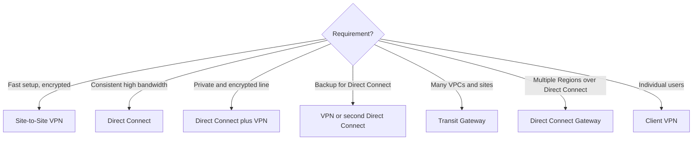
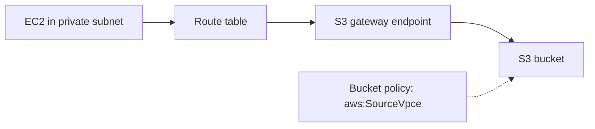
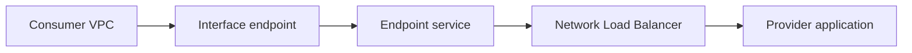
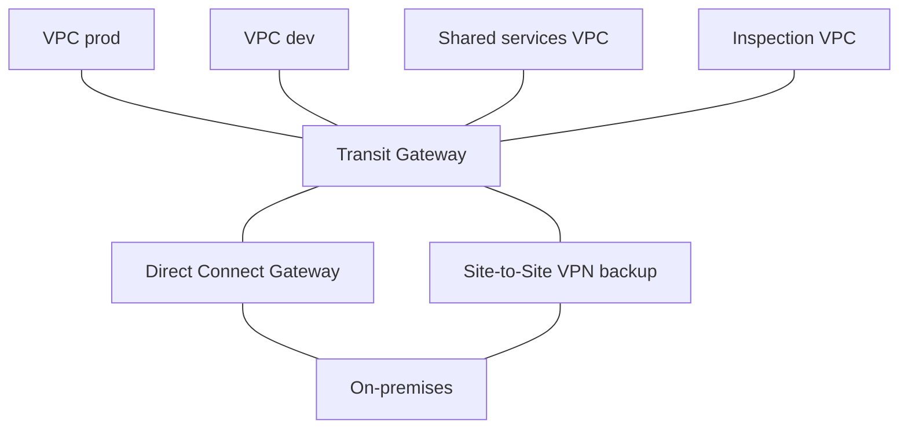
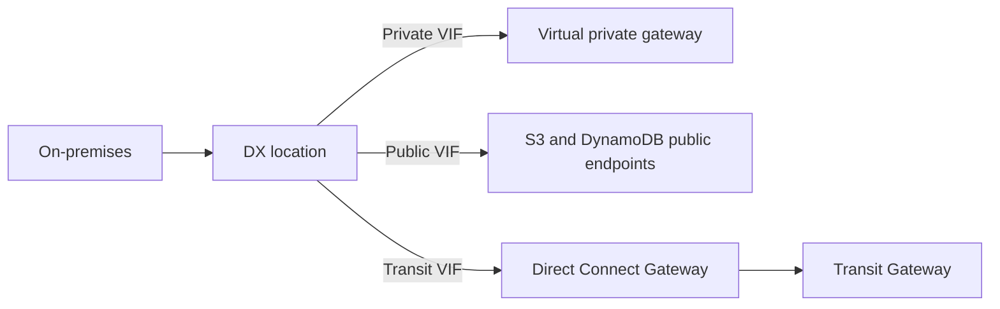

# VPC Connectivity and Hybrid Networking

> [!info] Why this matters
> Questions in this area give you a set of networks and ask for the right link between them. The answer depends on how many networks there are, whether they overlap, whether encryption is needed, and how much bandwidth and consistency you need.
>
> **Covers:** VPN and Direct Connect in [[Domain 1 Design Secure Architectures#Task 1.2|Task 1.2]], [[Domain 3 Design High-Performing Architectures#Task 3.4|Task 3.4]], [[Domain 4 Design Cost-Optimized Architectures#Task 4.4|Task 4.4]].
> **Study time:** about 4 hours.

## Choosing a connection

| Option | What it is | Use when |
| --- | --- | --- |
| **VPC peering** | Direct link between two VPCs | A few VPCs, full network access, no transitive routing needed |
| **Transit Gateway** | A central hub | Many VPCs and on-premises networks |
| **PrivateLink** | Private access to one service | Exposing one service, SaaS, or overlapping CIDRs |
| **Gateway endpoint** | Route to S3 or DynamoDB | Private and free access to those two services |
| **Interface endpoint** | Private IP for an AWS service | Private access to most AWS services |
| **Site-to-Site VPN** | IPsec tunnel over the internet | Quick to configure, encrypted. Variable latency |
| **Direct Connect** | Private dedicated line | Consistent, high bandwidth |
| **Client VPN** | VPN for individual users | Remote workers |

## VPC peering

**VPC peering** connects two VPCs privately over the AWS network, so that they behave as one network.

- CIDR ranges **must not overlap**.
- It is **not transitive**. If A peers with B, and B peers with C, A cannot reach C through B. Create a direct peering or use Transit Gateway.
- It works across accounts and across Regions.
- You must add routes in **both** VPCs, and allow traffic in security groups.
- Security groups can reference a peered VPC's group, in the same Region.
- There is no hourly charge. Data transfer is free within an AZ, but charged across AZs and Regions. There is no bandwidth bottleneck.
- No edge-to-edge routing: a peer cannot use your internet gateway, NAT gateway or VPN.

A full mesh grows fast: n VPCs need n(n-1)/2 peerings, so 25 VPCs need 300. That is when you should move to Transit Gateway.

## VPC endpoints

**VPC endpoints** let resources reach AWS services without an internet gateway, NAT or public IP.

| | Gateway endpoint | Interface endpoint |
| --- | --- | --- |
| Services | **S3 and DynamoDB only** | Most AWS services, including S3 and DynamoDB |
| How it works | Target in a route table | ENI with a private IP in your subnet |
| Cost | **Free** | Hourly plus per GB |
| Security | Endpoint policy | Security group plus endpoint policy |
| From on-premises, other-Region peered VPCs or via TGW | **No** | **Yes**, over VPN or Direct Connect |

An **endpoint policy** limits what can be done through the endpoint. It does not replace IAM or bucket policies. All of them must allow the request.

**Interface endpoints** with private DNS enabled let applications keep using the normal service hostname, which resolves to the private IP. This needs both VPC DNS settings to be on.

### Private access to S3

This is free, private and needs no NAT gateway. A private subnet sending S3 traffic through NAT works, but it costs money per GB, so this is a common cost question. Use an interface endpoint for S3 only if on-premises or peered networks need private access.

## AWS PrivateLink

**PrivateLink** exposes a single service to other VPCs privately. Consumers see an interface endpoint in their VPC, and traffic never crosses the internet.

- The provider puts a **Network Load Balancer** in front of the service and creates an endpoint service.
- The consumer creates an interface endpoint (ENI).
- No internet gateway, NAT device, public IP address, VPN or Direct Connect is needed.
- **Overlapping CIDRs do not matter**, because only one service is exposed, and not the whole network.
- It is one-way: consumers start connections to the provider.

This is the standard answer for SaaS providers, or for sharing one application with many consumer VPCs.

**Amazon VPC Lattice** is a newer application networking service that connects services across VPCs and accounts. It is not on the in-scope list, so treat it as background.

## AWS Transit Gateway

**Transit Gateway (TGW)** is a Regional hub that connects VPCs and on-premises networks with **transitive routing**.

| Feature | Detail |
| --- | --- |
| Attachments | VPCs, VPN, Direct Connect gateways, other TGWs (peering) |
| Scale | 5,000 attachments, up to 100 Gbps per VPC attachment per AZ |
| Route tables | Multiple tables segment traffic, such as keeping prod and dev apart while both reach on-premises |
| Sharing | Across accounts with AWS RAM |
| Cross-Region | TGW peering connects hubs |
| Multicast | The service to use for IP multicast between VPC subnets |
| Appliance mode | Keeps flows symmetric through an inspection VPC |
| Cost | Per attachment per hour, plus per GB |

**ECMP (equal-cost multi-path)** forwards traffic over several best paths. On Transit Gateway, multiple Site-to-Site VPN connections add up. Two connections of two tunnels each give up to 5 Gbps. A virtual private gateway does not support this.

Choose peering for a few VPCs on a budget, and TGW when the number grows or transitive routing is needed.

## AWS Site-to-Site VPN

A **Site-to-Site VPN** is an encrypted IPsec connection between your network and AWS over the public internet.

| Component | Side | Role |
| --- | --- | --- |
| **Customer gateway (CGW)** | On-premises | Your device or software. Uses a public IP, or the public IP of the NAT device in front of it, with NAT traversal |
| **Virtual private gateway (VGW)** | AWS | VPN endpoint attached to one VPC |
| **Transit Gateway** | AWS | Alternative to a VGW, for many VPCs |

What you need to know:

- Each connection has **two tunnels** for redundancy, each ending in a different AZ.
- A standard tunnel carries up to **1.25 Gbps**. **Large bandwidth tunnels** reach 5 Gbps on Transit Gateway.
- It can be configured in minutes.
- **Routing:** use dynamic routing (BGP) if the customer gateway device supports BGP. If it does not, use static routing and enter the on-premises prefixes yourself.
- Performance varies, because it uses the internet.
- **Enable route propagation** for the VGW in the subnets' route tables, or add static routes.
- **Accelerated VPN** routes through Global Accelerator, on Transit Gateway.
- To ping instances from on-premises, allow ICMP in the security groups.

**AWS VPN CloudHub** connects multiple sites to each other, through one VGW, using several VPN connections with dynamic routing. It offers a low-cost hub-and-spoke between branch offices over the internet.

## AWS Client VPN

**Client VPN** is a managed, OpenVPN-based service for **individual users**, such as remote employees reaching a VPC from a laptop. Site-to-Site VPN connects whole networks. Users authenticate through Active Directory, SAML federation or certificates.

Access is controlled by **authorization rules**, which allow an Active Directory or identity provider group to reach a given network. By default there are no rules, so users cannot reach anything until you add them. By default all client traffic goes through the tunnel. **Split-tunnel** sends only traffic for the VPC and other routes you define through the tunnel, and the rest uses the user's own internet connection.

## AWS Direct Connect

**Direct Connect (DX)** is a dedicated private connection from your network to AWS, through a DX location. Traffic does not cross the public internet.

Reasons to use it:

- Higher bandwidth, for large datasets
- A more consistent network experience
- Lower data transfer costs out of AWS for heavy use
- Hybrid environments

### Connection types

| Type | Speeds | How |
| --- | --- | --- |
| **Dedicated** | 1, 10, 100, 400 Gbps | A physical port for you, requested from AWS |
| **Hosted** | 50 Mbps to 25 Gbps | Through a partner. Port speed can only be changed by the partner |

AWS says it can take up to 72 business hours just to review a request and provision a port, so a new connection is slow compared with a VPN, which can be configured in minutes. If a question needs connectivity in days, use VPN first.

### Virtual interfaces

| VIF | Connects to | Note |
| --- | --- | --- |
| **Private VIF** | A VPC, through a VGW or DX gateway | Private IP traffic to your resources |
| **Public VIF** | AWS public services such as S3 and DynamoDB | Any Region's public endpoints |
| **Transit VIF** | A Transit Gateway, through a DX gateway | Many VPCs and Regions |

### Direct Connect Gateway

A **Direct Connect Gateway** links one DX connection to VPCs in **many Regions**, in the same or different accounts. It does not normally route traffic between those VPCs.

**SiteLink** can link your sites through AWS's DX network, without traffic passing through a Region.

A central team can share one DX connection across accounts. Use a DX gateway, or a transit VIF with Transit Gateway shared through RAM.

### Encryption

**Direct Connect is private, not encrypted.** To encrypt it:

- **Site-to-Site VPN over DX** (a public VIF or a transit VIF) gives IPsec encryption.
- **MACsec** encrypts at layer 2 on dedicated 10, 100 and 400 Gbps connections, at selected locations. It is not available on hosted connections.

### Resilience

| Level | Design | Use |
| --- | --- | --- |
| Development | Separate connections on separate devices in one location | Protects against device failure only |
| High resiliency | One connection at each of **two** locations | Protects against a location failure |
| Maximum resiliency | **Two** connections at each of two locations | Critical workloads |
| Cost-effective backup | Direct Connect with **Site-to-Site VPN** as backup | Cheap failover, lower throughput |

A **link aggregation group (LAG)** bundles dedicated connections at one location into one logical connection: up to 4 for port speeds under 100 Gbps, or 2 for 100 or 400 Gbps. It adds bandwidth and link redundancy, but not location redundancy.

## Exam patterns

| If the question says | Think | Why |
| --- | --- | --- |
| 25 VPCs plus on-premises must all talk | Transit Gateway | Peering would need 300 links |
| A peers with B, B with C, A cannot reach C | Peering is not transitive | Direct peering or TGW |
| Two VPCs, lowest cost | VPC peering | No hourly fee |
| Prod and dev isolated, both reach on-premises | TGW route tables | Segmentation at the hub |
| Application needs IP multicast | Transit Gateway | |
| Share the hub across 50 accounts | TGW with AWS RAM | |
| Connect hubs in two Regions | TGW peering | |
| Force inter-VPC traffic through a firewall | TGW with appliance mode | Symmetric flows |
| Expose one application to a partner, CIDRs overlap | PrivateLink | NLB plus endpoint service |
| SaaS for many customers without peering | PrivateLink | |
| Private instances reach S3 at lowest cost | Gateway endpoint | Free |
| On-premises reaches S3 privately | Interface endpoint | Gateway endpoints are not reachable from there |
| Reach KMS or Secrets Manager with no internet | Interface endpoint | |
| Connect in days, encrypted | Site-to-Site VPN | DX port provisioning alone can take up to 72 business hours |
| 5 TB nightly, VPN is inconsistent | Direct Connect | |
| Cost-effective backup for DX | Site-to-Site VPN | |
| Data over DX must be encrypted | VPN over DX, or MACsec | Private is not encrypted |
| No traffic on the public internet | Direct Connect | The VPN uses the internet |
| One DX, VPCs in many Regions | Direct Connect Gateway | |
| Laptops need access to a VPC | Client VPN | Devices, not sites |
| Branch offices connect to each other | VPN CloudHub | |
| More VPN bandwidth | ECMP on Transit Gateway | Or large bandwidth tunnels |
| Survive a DX location failure | Connections at two locations | |
| VPN is up, but no traffic flows | Check route propagation on the route table | Or routes and security rules |

## Check yourself

**1.** A company has 30 VPCs and two data centres, and all of them must communicate. Which is the most scalable design?

- A. A full mesh of VPC peering
- B. Transit Gateway with VPC and VPN or Direct Connect attachments
- C. PrivateLink between each pair of VPCs
- D. NAT gateways

> [!success]- Answer
> **B.** A hub gives transitive routing and avoids a mesh of 435 peerings.

**2.** A SaaS provider wants to offer an API to customers' VPCs, without exposing its network or needing peering. Some customers use overlapping CIDRs. What should it use?

- A. VPC peering
- B. Transit Gateway
- C. AWS PrivateLink with a Network Load Balancer
- D. Site-to-Site VPN

> [!success]- Answer
> **C.** PrivateLink exposes a single service, and overlapping address ranges do not matter.

**3.** EC2 instances in private subnets transfer terabytes to S3 through a NAT gateway, and the data processing charges are high. What is the best way to reduce them?

- A. Create an S3 gateway endpoint and update the route tables
- B. Use a larger NAT gateway
- C. Move instances to public subnets
- D. Use Transfer Acceleration

> [!success]- Answer
> **A.** Gateway endpoints are free, and the traffic stays private.

**4.** A company needs a private connection from its data centre to AWS within a week, with encryption. Bandwidth needs are modest. What should it use?

- A. Direct Connect dedicated connection
- B. Site-to-Site VPN
- C. Snowball Edge
- D. Client VPN

> [!success]- Answer
> **B.** A VPN can be configured in minutes and is encrypted, so it suits an immediate need.

**5.** A company uses Direct Connect and needs a low-cost failover. What is the most cost-effective answer?

- A. A second Direct Connect at a second location
- B. A Site-to-Site VPN as a backup
- C. A second Transit Gateway
- D. VPC peering

> [!success]- Answer
> **B.** VPN is the cost-effective backup. A is more resilient, but it is not the cheapest.

**6.** Compliance requires that all traffic over Direct Connect is encrypted, using IPsec. What should the company do?

- A. Nothing, because DX is encrypted
- B. Run a Site-to-Site VPN over the DX connection
- C. Use a private VIF only
- D. Use a NAT gateway

> [!success]- Answer
> **B.** DX is private, but not encrypted. A VPN over it adds IPsec.

**7.** One Direct Connect connection must reach VPCs in three Regions. Which component is required?

- A. A Direct Connect Gateway
- B. A LAG
- C. An internet gateway
- D. A public VIF for each VPC

> [!success]- Answer
> **A.** A DX gateway links one connection to VPCs across Regions.

**8.** On-premises servers must access S3 privately over an existing Direct Connect link. Which option works?

- A. An S3 gateway endpoint
- B. An S3 interface endpoint
- C. A NAT gateway
- D. An internet gateway

> [!success]- Answer
> **B.** Gateway endpoints cannot be used from on-premises. Interface endpoints have private IPs that can be reached over DX or VPN. A public VIF would also work without going through the VPC.

**9.** A company wants production VPCs and development VPCs to be unable to reach each other, while both can reach a shared services VPC. All are attached to a Transit Gateway. What should it configure?

- A. Separate TGW route tables with associations and propagation that keep them apart
- B. Security groups only
- C. A second internet gateway
- D. Direct Connect Gateway

> [!success]- Answer
> **A.** TGW route tables are the segmentation tool at the hub.

**10.** Which two features increase VPN throughput to AWS beyond a single standard tunnel? (Choose two.)

- A. ECMP across several VPN connections on Transit Gateway
- B. A large bandwidth tunnel on Transit Gateway
- C. VPC peering
- D. A bigger NAT gateway
- E. A virtual private gateway with more route tables

> [!success]- Answer
> **A and B.** ECMP aggregates tunnels, and large bandwidth tunnels raise the limit per tunnel to 5 Gbps.

---
**Previous:** [[09 VPC Fundamentals]] · **Next:** [[11 Route 53]] · **Plan:** [[Study Guide]]
