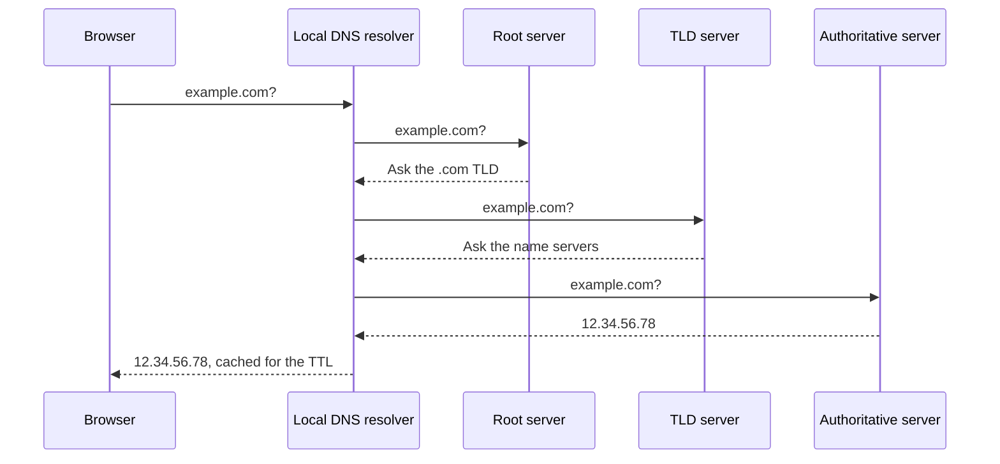
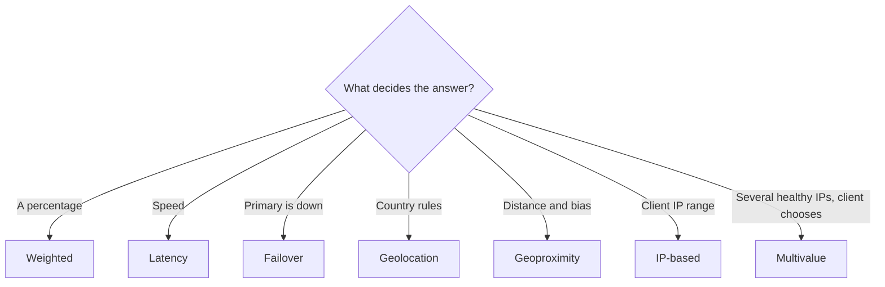
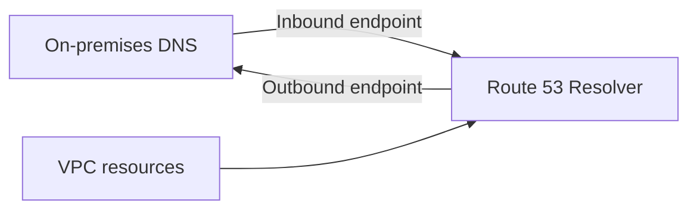

# Route 53

> [!info] Why this matters
> Route 53 is how you steer users between Regions and fail over between sites. Most questions ask which routing policy matches a requirement, or how to point a domain at an AWS resource.
>
> **Covers:** [[Domain 2 Design Resilient Architectures#Task 2.2|Task 2.2]], DNS in [[Domain 4 Design Cost-Optimized Architectures#Task 4.4|Task 4.4]].
> **Study time:** about 2 hours.

## DNS in brief

The Domain Name System translates names into IP addresses.

| Term | Meaning |
| --- | --- |
| **Domain registrar** | Where you buy a domain, such as Route 53 or GoDaddy |
| **Zone file** | The records for a domain |
| **Name server** | Answers DNS queries |
| **Top-level domain (TLD)** | `.com`, `.org`, `.uk` |
| **Second-level domain** | `amazon.com` |
| **Zone apex** | The bare domain, such as `example.com` with nothing in front |
| **TTL** | How long resolvers may cache an answer |

## Amazon Route 53

**Route 53** is a highly available, authoritative DNS service and a domain registrar. "Authoritative" means that you control the records. It is global.

### Record types

| Type | Purpose |
| --- | --- |
| **A** | Name to IPv4 address |
| **AAAA** | Name to IPv6 address |
| **CNAME** | Name to another name. Not allowed at the zone apex |
| **NS** | The name servers for the zone |
| **MX** | Mail servers |
| **TXT** | Free text, often for verification |
| **Alias** | Route 53 extension. Points to AWS resources |

### Hosted zones

A **hosted zone** is a container for records.

- A **public hosted zone** answers queries from the internet.
- A **private hosted zone** answers queries only from within associated VPCs. The VPC must have both DNS settings on.

A zone costs $0.50 per month for each of the first 25 zones.

**Using a domain registered elsewhere:** create a public hosted zone in Route 53, then update the **NS records** at the third-party registrar to use Route 53's name servers.

### TTL

Resolvers cache answers for the TTL.

- A **short TTL** (around 60 seconds) means changes spread quickly, at the cost of more queries.
- A **long TTL** (such as 24 hours) means fewer queries and lower cost, but slow changes.

Lower the TTL in advance of a planned migration. TTL is required on all records except Alias records.

### CNAME versus Alias

This comparison is tested repeatedly.

| | CNAME | Alias |
| --- | --- | --- |
| Works at the zone apex | **No** | **Yes** |
| Points to | Any hostname | Selected AWS resources, and records in the same zone |
| Query cost | Charged | **Free** for AWS resources |
| TTL | You set it | Route 53 sets it |
| Record type | CNAME | A or AAAA |

**Alias targets** include load balancers, CloudFront distributions, API Gateway, Elastic Beanstalk environments, S3 website endpoints, VPC interface endpoints, Global Accelerator and AppSync. An Alias **cannot** point to an EC2 DNS name.

To serve a website from S3 through Route 53 directly, the bucket name must match the domain name.

## Routing policies

| Policy | Use it for | Health checks |
| --- | --- | --- |
| **Simple** | One resource | No |
| **Weighted** | Percentage split, canary releases | Yes |
| **Latency** | Lowest latency Region | Yes |
| **Failover** | Active-passive disaster recovery | Yes, required on primary |
| **Geolocation** | By user's country or continent | Yes |
| **Geoproximity** | By distance, with an adjustable bias | Yes |
| **IP-based** | By client IP range | Yes |
| **Multivalue answer** | Up to 8 healthy records | Yes |

### Simple

Returns one or more values. If there are several, the client picks one at random. It cannot use health checks. With Alias, it can name only one resource.

### Weighted

Each record gets a share equal to its weight divided by the sum of all weights. Weights run from 0 to 255.

- A weight of 0 stops traffic to that record.
- If all weights are 0, all records are returned equally.
- Use it for canary releases and for moving traffic gradually.

### Latency

Sends users to the Region with the lowest measured latency. Latency is based on traffic between users and AWS Regions, so it is not the same as the nearest Region. Combine it with health checks for failover.

### Failover

A primary and a secondary record for active-passive disaster recovery. If the health check on the primary fails, Route 53 returns the secondary.

### Geolocation

Routes by where the **user** is: continent, country, or US state. It is a rule, not a performance choice. Use it for language, licensing and compliance. Always create a **default record** for users who do not match.

### Geoproximity

Routes by the distance between users and resources, with a **bias** to shift traffic. A bias from 1 to 99 expands a resource's area, and from -1 to -99 shrinks it. Resources can be AWS Regions, or non-AWS locations given by latitude and longitude. You can set it on records directly, or through Route 53 Traffic Flow.

### IP-based

Routes based on the client's IP range, which you list as CIDR blocks. It suits sending an ISP's users to a specific endpoint, for performance or cost reasons.

### Multivalue answer

Returns up to 8 healthy records, and the client chooses one. It offers simple client-side load balancing, but it does **not replace a load balancer**.

## Health checks

Health checks give you automated DNS failover. They can notify through CloudWatch.

| Type | Monitors |
| --- | --- |
| **Endpoint** | An IP or domain, over HTTP, HTTPS or TCP, from about 15 global checkers |
| **Calculated** | Other health checks, combined with AND, OR and NOT |
| **CloudWatch alarm** | The state of an alarm. This is how you check **private** resources |
| **ARC routing controller** | Manual on-off switches for failover, part of Application Recovery Controller |

For endpoint checks:

- An endpoint is healthy if more than 18% of checkers report it healthy.
- Only 2xx and 3xx responses pass. A check can also look for text in the first 5,120 bytes of the response.
- Your firewall must allow requests from the Route 53 health checkers.

Health checkers are outside your VPC and cannot reach private IPs. To check a private resource, create a CloudWatch metric and alarm, and have the health check watch the alarm.

Failover by DNS is limited by the TTL, because clients cache old answers. If failover must be near-instant, use [[12 CloudFront and Global Accelerator#AWS Global Accelerator|Global Accelerator]], which works in the network path.

## Hybrid DNS with Route 53 Resolver

**Route 53 Resolver** is the DNS server in every VPC. **Resolver endpoints** connect it to on-premises DNS.

| Endpoint | Direction | Example |
| --- | --- | --- |
| **Inbound** | On-premises to AWS | On-premises servers resolve names in a private hosted zone |
| **Outbound** | AWS to on-premises | VPC resources resolve `corp.example.com` through forwarding rules |

Rules can be shared across accounts with AWS RAM. **DNS Firewall** filters outbound DNS queries, such as blocking known bad domains.

## Other features

- **Traffic Flow** is a visual editor for complex routing policies, which can be saved and reused.
- **Subdomain delegation** lets another hosted zone, even in another account, manage a subdomain. Add NS records for the subdomain to the parent zone.
- **Application Recovery Controller** provides routing controls that act as on-off switches for failover, and **zonal shift** moves traffic away from an impaired AZ.
- Route 53 can register domains and **transfer** them from other registrars, but that is not needed in order to use it as your DNS service.
- **Resolver query logging** records the DNS queries made from your VPCs.

## DNSSEC

DNSSEC signs DNS records, so that resolvers can detect tampering. Route 53 supports signing for public hosted zones and validation through Resolver.

## Exam patterns

| If the question says | Think | Why |
| --- | --- | --- |
| Point `example.com` at an ALB | Alias | CNAME is forbidden at the apex |
| Point `app.example.com` at a non-AWS name | CNAME | Not an AWS target |
| Active-passive, send traffic to standby only if the primary fails | Failover routing | Plus health check |
| Send 10% of users to a new version | Weighted | Canary |
| Users in Germany must see the German site | Geolocation | A rule, with a default record |
| Best performance for global users | Latency | |
| Gradually shift traffic share between Regions using a bias | Geoproximity | |
| Route a known ISP's IP ranges to one endpoint | IP-based | |
| Several healthy IPs with no load balancer | Multivalue | Up to 8 |
| Health-check a private endpoint | CloudWatch alarm check | Checkers are outside the VPC |
| Combine several checks | Calculated | |
| Instant failover, DNS caching not acceptable | Global Accelerator | In the path |
| DNS only inside a VPC | Private hosted zone | |
| On-premises must resolve private AWS names | Inbound Resolver endpoint | |
| VPC must resolve on-premises names | Outbound Resolver endpoint | |
| Domain bought elsewhere, use Route 53 | Update NS records at the registrar | |
| Reduce failover time | Lower the TTL | Before you need it |

## Check yourself

**1.** A company wants `example.com`, with no subdomain, to resolve to an Application Load Balancer. Which record should it use?

- A. A CNAME record
- B. An Alias record
- C. An MX record
- D. An NS record

> [!success]- Answer
> **B.** CNAME records are not allowed at the zone apex. Alias works, and the queries are free.

**2.** An application runs in us-east-1 with a standby in eu-west-1. Traffic should go to the standby only if the primary is unhealthy. Which policy fits?

- A. Weighted
- B. Latency
- C. Failover
- D. Multivalue

> [!success]- Answer
> **C.** Failover routing with a health check on the primary implements active-passive.

**3.** A team wants 5% of users to test a new version in a separate environment. Which policy fits?

- A. Geolocation
- B. Weighted
- C. Simple
- D. Failover

> [!success]- Answer
> **B.** Weights control the percentage of responses sent to each record.

**4.** A streaming service must show users in France the French catalogue because of licensing rules. Users elsewhere see the default catalogue. Which policy fits?

- A. Latency
- B. Geoproximity
- C. Geolocation with a default record
- D. IP-based

> [!success]- Answer
> **C.** Geolocation is a rule based on where the user is. Latency could send a French user elsewhere.

**5.** A database in a private subnet must influence DNS failover, but Route 53 health checkers cannot reach it. What should the architect do?

- A. Give the database a public IP
- B. Publish a CloudWatch metric and alarm, and use an alarm-based health check
- C. Use a calculated health check only
- D. Open port 3306 to the internet

> [!success]- Answer
> **B.** This is the supported way to check private resources.

**6.** On-premises servers need to resolve records in a Route 53 private hosted zone over a VPN. What is required?

- A. An inbound Resolver endpoint
- B. An outbound Resolver endpoint
- C. A public hosted zone
- D. DNSSEC

> [!success]- Answer
> **A.** Inbound means queries coming into AWS. Outbound is for the opposite direction.

**7.** A company bought its domain from another registrar, and wants Route 53 to manage DNS. What must it do?

- A. Transfer the domain, which is the only way
- B. Create a hosted zone and update the NS records at the registrar
- C. Create a VPC endpoint
- D. Create an Alias record at the registrar

> [!success]- Answer
> **B.** A domain does not have to be transferred. Pointing NS records to Route 53 is enough.

**8.** A multi-Region application needs failover in seconds, but clients cache DNS results for several minutes. What should the architect use?

- A. A shorter failover health check interval
- B. AWS Global Accelerator
- C. Multivalue answer routing
- D. Simple routing

> [!success]- Answer
> **B.** Global Accelerator keeps the same static IPs and shifts traffic in the network, so DNS caching is not a factor.

**9.** A company wants to return up to eight healthy web server IPs for a small site with no load balancer. Which policy fits?

- A. Multivalue answer
- B. Simple
- C. Weighted
- D. Failover

> [!success]- Answer
> **A.** Unlike simple routing, multivalue checks health and returns only healthy records.

---
**Previous:** [[10 VPC Connectivity and Hybrid Networking]] · **Next:** [[12 CloudFront and Global Accelerator]] · **Plan:** [[Study Guide]]
