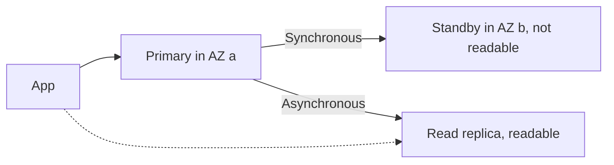
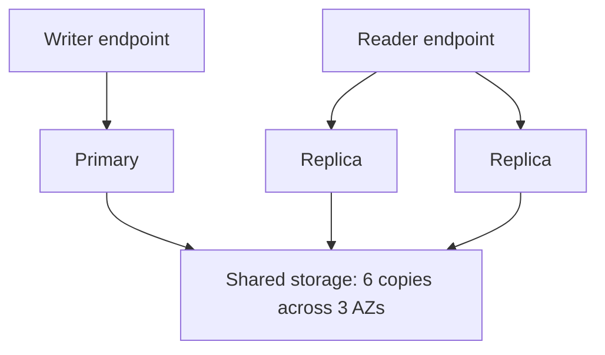

# RDS and Aurora

> [!info] Why this matters
> The most frequently tested distinction in the whole exam may be **Multi-AZ versus read replicas**. One gives availability, and the other gives read scaling. Get this right and many database questions answer themselves.
>
> **Covers:** [[Domain 3 Design High-Performing Architectures#Task 3.3|Task 3.3]], [[Domain 4 Design Cost-Optimized Architectures#Task 4.3|Task 4.3]], replicas and proxies in [[Domain 2 Design Resilient Architectures|Domain 2]].
> **Study time:** about 4 hours.

## Amazon RDS

**Amazon Relational Database Service (RDS)** runs relational databases as a managed service. Engines are PostgreSQL, MySQL, MariaDB, Oracle, Microsoft SQL Server, IBM Db2 and Aurora.

Compared with running a database yourself on EC2, RDS gives you:

- Automated provisioning and OS patching
- Continuous backups and point-in-time restore
- Monitoring dashboards
- Read replicas and Multi-AZ
- Maintenance windows for upgrades
- Vertical scaling of the instance and automatic scaling of storage

The trade-off is that **you cannot SSH into an RDS instance**, except on RDS Custom. If an application needs OS-level access, use RDS Custom for Oracle or SQL Server, or install the database on EC2.

Choosing an engine usually follows the application or licences you already have. MySQL and PostgreSQL are both open source. Oracle and SQL Server need a licence, either included in the price or brought yourself, so licence costs apply.

### Instance and storage

You choose an instance class and EBS-based storage: General Purpose SSD, or Provisioned IOPS SSD for sustained high I/O.

**Parameter groups** hold engine settings, and **option groups** enable engine features.

**Storage Auto Scaling** grows storage automatically, up to a maximum threshold that you set. It acts when:

- Free space is 10% of allocated storage or less
- That has lasted at least 5 minutes
- Any earlier storage optimisation has finished, and there have been fewer than four storage modifications in the past 24 hours

It suits unpredictable growth, and it avoids the outage of running out of space.

## Multi-AZ versus read replicas

| | Multi-AZ instance | Multi-AZ DB cluster | Read replicas | Aurora Global Database |
| --- | --- | --- | --- | --- |
| Purpose | **Availability** | Availability and reads | **Read scaling** | Global reads and DR |
| Replication | Synchronous | Semi-synchronous | Asynchronous | Asynchronous, storage-based |
| Readable standby | **No** | Yes, 2 | Yes, up to 15 | Yes |
| Scope | One Region | One Region, 3 AZs | Same AZ, cross-AZ or cross-Region | Up to 10 secondary Regions |
| Failover | Automatic | Automatic | **Manual promotion** | Managed |

### Multi-AZ

A **Multi-AZ instance deployment** keeps a synchronous standby in another AZ. If the primary fails, RDS flips the DNS name to the standby, typically in one to two minutes. The application reconnects with no change.

- It protects against AZ loss, network loss, and instance or storage failure.
- It is **not** for scaling. The standby serves no traffic.
- Moving from Single-AZ to Multi-AZ needs no downtime, although latency can rise while the standby syncs. RDS takes a snapshot, restores it in a new AZ, and then starts synchronising.

A **Multi-AZ DB cluster** has one writer and **two readable standbys** across three AZs, using semi-synchronous replication. Failover is faster, typically under a minute, and it is available for MySQL and PostgreSQL. So "standby can't be read" is true only of the instance deployment.

### Read replicas

A **read replica** is a read-only copy, updated asynchronously. Up to 15 are available for most engines, and AWS recommends no more than 5 for Oracle.

- Replication is asynchronous, so reads are **eventually consistent** and can be stale.
- Replicas can be in the same AZ, across AZs or across Regions.
- Applications must be pointed at the replica. Connection strings have to change.
- A replica can be **promoted** to a standalone database, manually.
- A replica can itself be Multi-AZ, for disaster recovery.
- The source must have automated backups turned on.
- For Db2, Oracle and SQL Server you cannot create a replica from a replica.

Cost: normally AWS charges for data moving between AZs, but **cross-AZ replication for RDS read replicas in the same Region is free**. Cross-Region replication is charged.

Use a replica for **reporting and analytics**, so that they do not slow production. If the problem is the **same queries repeated many times**, a cache is the better answer. See [[15 ElastiCache and Other Databases#Caching strategies|caching]].

## Backups and restore

| | Automated backups | Manual snapshots |
| --- | --- | --- |
| Trigger | Daily, plus transaction logs every 5 minutes | You |
| Retention | 0 to 35 days. Setting 0 disables them on RDS | Until you delete them |
| Restore | Any point in time, to about 5 minutes ago | The moment of the snapshot |

**Restoring always creates a new database.** It is never an in-place change, so applications need the new endpoint.

Automated backups can also be replicated to another Region, for disaster recovery.

For retention longer than 35 days, use manual snapshots or [[28 High Availability and Disaster Recovery#AWS Backup|AWS Backup]].

A stopped RDS instance still bills for storage, and it restarts automatically after seven days. For a database that sits unused for a long time, **take a snapshot and delete it**, then restore when needed.

**Migrating from on-premises through S3:**

- MySQL to RDS: back up on-premises, store the file in S3, restore to a new RDS instance.
- MySQL to Aurora: back up with Percona XtraBackup, store it in S3, restore to a new Aurora cluster.

For live migrations with minimal downtime, use [[27 Migration and Data Transfer#AWS DMS|AWS DMS]].

**Copying and sharing snapshots:**

- Copy a snapshot to another Region, for disaster recovery or migration.
- Share a manual snapshot with other accounts.
- To share an encrypted snapshot, use a **customer managed key**, and give the other account access to it. Snapshots encrypted with the AWS managed key cannot be shared.
- Automated backups cannot be shared directly. Copy them to a manual snapshot first.

## Security

| Control | Detail |
| --- | --- |
| **Encryption at rest** | KMS, chosen at creation. Covers storage, backups, snapshots and replicas |
| **Encryption in transit** | TLS. Root certificates are used on the client. It can be required through a parameter |
| **IAM database authentication** | Short-lived tokens rather than passwords, for MariaDB, MySQL and PostgreSQL |
| **Credentials** | Store in Secrets Manager, with rotation |
| **Network** | Private subnets, and security groups allowing only the app tier |
| **Audit** | Database logs can go to CloudWatch Logs for long retention |

If the primary is unencrypted, its replicas cannot be encrypted. **You cannot encrypt an existing database in place.** Instead:

1. Snapshot the database.
2. Copy the snapshot with encryption on.
3. Restore a new database from the encrypted snapshot.
4. Move the application to it.

## RDS Proxy

**RDS Proxy** is a managed, highly available connection pool that sits between applications and the database.

- It **pools and shares connections**, reducing stress on the database.
- It is ideal for **Lambda**, where many short-lived functions would otherwise exhaust connections.
- It reduces RDS and Aurora failover time by up to 66%, because applications stay connected to the proxy.
- It can enforce IAM authentication, and it reads credentials from Secrets Manager.
- It needs no code changes for most applications.
- It is **never publicly accessible**, and must be reached from within the VPC.

The exam guide mentions proxies explicitly under high availability, so this is a likely topic.

## Other RDS features

**Blue/Green Deployments** create a synchronised staging copy of production, so that you can upgrade engines or change schemas and then switch over with little downtime. They are supported for RDS MariaDB, MySQL and PostgreSQL, and for Aurora.

**RDS Custom** gives access to the underlying OS and database for Oracle and SQL Server. Pause automation before you customise, and back up your data first. RDS Custom for Oracle reaches end of support on 31 March 2027.

**Monitoring:**

- **CloudWatch** provides standard metrics, such as `DatabaseConnections` and `FreeStorageSpace`.
- **Enhanced Monitoring** gives real-time OS metrics.
- **CloudWatch Database Insights** replaced Performance Insights, which ended on 31 July 2026. Older questions may use the old name for finding slow queries.

**Event notifications** report on the database instance itself, such as failover or snapshot events, through SNS or EventBridge. They say nothing about the data.

**Invoking Lambda from the database** is supported for RDS for PostgreSQL and Aurora MySQL, to process data events. The database needs outbound network access to Lambda, and permission to invoke it.

## Amazon Aurora

**Aurora** is AWS's cloud-native relational database, compatible with MySQL and PostgreSQL. AWS positions it as faster than standard MySQL and PostgreSQL.

### Architecture

Compute and storage are separate. All instances share one storage volume.

- Storage grows automatically in 10 GB steps, up to 256 TiB on recent versions.
- Data is kept in **6 copies across 3 AZs**. Writes need 4 of 6, and reads need 3 of 6.
- Storage is self-healing.
- There is one writer and up to **15 replicas**, which share the storage, so replica lag is low.
- Failover is typically **under 60 seconds**, and often under 30. If replicas exist, one is promoted. You can set failover priority tiers.

### Endpoints

| Endpoint | Purpose |
| --- | --- |
| **Writer (cluster) endpoint** | Always points at the primary, even after failover |
| **Reader endpoint** | Balances connections across replicas |
| **Custom endpoint** | A subset of instances, such as larger ones for analytics |
| **Instance endpoint** | One specific instance |

**Aurora Replicas Auto Scaling** adds and removes replicas in response to load. Because the reader endpoint spreads connections, applications need no change.

### Storage configurations

**Aurora Standard** charges per I/O. **Aurora I/O-Optimized** has no I/O charges and a higher storage and instance price. It pays off when I/O is about 25% or more of the Aurora bill.

### Aurora Serverless v2

**Aurora Serverless v2** scales capacity automatically in small steps of Aurora capacity units (ACUs), and can scale to zero with automatic pause. There is no capacity planning, and you pay per second. It suits variable, intermittent or unpredictable workloads, and development databases that sit idle. Version 1 has been retired.

### Aurora Global Database

A **Global Database** spans Regions: one primary Region for writes, and up to 10 secondary read-only Regions, each with up to 16 read replicas. Replication happens at the storage layer, with typical lag under a second.

| Event | Use | Recovery |
| --- | --- | --- |
| Planned move | **Switchover** | No data loss (RPO 0) |
| Outage | **Managed failover** | RPO measured in seconds, a new primary within minutes |

AWS's marketing and older exam material quote an **RPO of about 1 second and an RTO of about 1 minute**. Expect those numbers in questions, though the current documentation is more cautious. **Write forwarding** lets secondary Regions send writes on to the primary.

### Cloning

**Aurora cloning** creates a new cluster from an existing one, using copy-on-write. It starts by sharing storage, so it is much faster and cheaper than restoring a snapshot. It is ideal for creating a staging copy of production.

### Backtrack

**Backtrack** rewinds an Aurora MySQL cluster in place, up to 72 hours, without a restore. It undoes a mistake such as a bad `DELETE` quickly. It must be enabled when the cluster is created or restored.

### Backups

Aurora automated backups have a retention of 1 to 35 days and cannot be disabled, and they allow point-in-time recovery.

### Aurora Machine Learning

Aurora machine learning lets a cluster use Amazon Bedrock, Amazon Comprehend or SageMaker AI. It is not on the in-scope list, so treat it as background.

## Choosing RDS or Aurora

| Need | Choose |
| --- | --- |
| Oracle, SQL Server or Db2 | RDS |
| A small MySQL or PostgreSQL database that does not need Aurora features | RDS |
| Fast failover, many low-lag replicas, automatic storage growth | Aurora |
| Global database with one writer | Aurora Global Database |
| Unpredictable or idle workload, relational | Aurora Serverless v2 |
| Instant copy for staging | Aurora cloning |

## Exam patterns

| If the question says | Think | Why |
| --- | --- | --- |
| Survive AZ failure automatically | Multi-AZ | Synchronous standby |
| Standby should serve reads | Trap, unless it is a Multi-AZ DB cluster | Instance standby is not readable |
| Reporting slows the production database | Read replica | Different queries |
| Same reads repeated, overloading the database | ElastiCache | Cached |
| Replica should fail over automatically | Trap | Promotion is manual |
| Lambda is exhausting connections | RDS Proxy | Connection pooling |
| Reduce failover time for applications | RDS Proxy or Aurora | |
| Encrypt an existing database | Snapshot, copy encrypted, restore | |
| Keep backups for 7 years | Manual snapshots or AWS Backup | Automated stops at 35 days |
| Restore to 10 minutes ago | Point-in-time restore | Creates a new DB |
| Undo a bad DELETE quickly, Aurora MySQL | Backtrack | In place |
| Full copy of production for testing, quick and cheap | Aurora cloning | Copy-on-write |
| Cross-Region DR, RPO typically seconds | Aurora Global Database | |
| Dev database idle at night | Aurora Serverless v2 | Scales to zero |
| OS-level access | RDS Custom or EC2 | Plain RDS has none |
| Storage runs out unpredictably | Storage Auto Scaling | Set a maximum |
| Passwordless database login | IAM database authentication | |
| Long-unused database, avoid cost | Snapshot and delete | Stopped DB still bills storage |
| Upgrade with minimal downtime | Blue/Green Deployments | |
| Aurora writes are I/O heavy, bill is high | I/O-Optimized | |

## Check yourself

**1.** A production PostgreSQL database on RDS must fail over automatically if an AZ goes down. There are no read scaling problems. What should the architect enable?

- A. Read replicas
- B. Multi-AZ deployment
- C. RDS Proxy
- D. Cross-Region snapshots

> [!success]- Answer
> **B.** Multi-AZ provides a synchronous standby and automatic failover. Replicas need manual promotion.

**2.** Business analysts run heavy reports against the production MySQL database during the day, which slows the application. What should the architect do with the least impact on the application?

- A. Enable Multi-AZ and point the reports at the standby
- B. Create a read replica and point the reports at it
- C. Increase the backup retention
- D. Use storage autoscaling

> [!success]- Answer
> **B.** A read replica takes the read load off the primary. The Multi-AZ standby of an instance deployment cannot be read.

**3.** A Lambda function under heavy load causes "too many connections" errors on an Aurora database. What is the best solution?

- A. Increase the Lambda timeout
- B. Use RDS Proxy
- C. Use provisioned concurrency only
- D. Add an internet gateway

> [!success]- Answer
> **B.** RDS Proxy pools connections, so that many short-lived functions share a few database connections.

**4.** A team must encrypt an existing unencrypted RDS instance. What is the correct process?

- A. Enable encryption in the console and reboot
- B. Snapshot the instance, copy the snapshot with encryption, and restore a new instance
- C. Create an encrypted read replica of the unencrypted instance
- D. Use SSE-S3

> [!success]- Answer
> **B.** Encryption is set at creation, so a new encrypted database is needed.

**5.** A global application needs a relational database with low-latency reads on three continents, and recovery in about a minute if a Region fails. Which option fits?

- A. RDS Multi-AZ
- B. Aurora Global Database
- C. RDS with cross-Region snapshots
- D. DynamoDB global tables

> [!success]- Answer
> **B.** It offers fast storage-based replication and managed failover. DynamoDB is not relational.

**6.** QA needs a full copy of a 5 TB production Aurora database every morning. It must be quick to create and cheap. What should it use?

- A. Restore a snapshot
- B. Aurora cloning
- C. AWS DMS
- D. Export to S3

> [!success]- Answer
> **B.** Clones share storage through copy-on-write, so creation is fast, and you pay only for data that changes.

**7.** A developer accidentally runs a bad `DELETE` on an Aurora MySQL cluster with Backtrack enabled. What is the fastest recovery?

- A. Restore from a snapshot
- B. Backtrack the cluster to before the statement
- C. Promote a replica
- D. Fail over to the secondary Region

> [!success]- Answer
> **B.** Backtrack rewinds in place without creating a new cluster. A replica would have received the same delete.

**8.** Regulators require database backups to be kept for 10 years. Which approach meets this? (Choose the best answer.)

- A. Set automated backup retention to 10 years
- B. Use manual snapshots or AWS Backup with a long retention policy
- C. Use Multi-AZ
- D. Use a read replica

> [!success]- Answer
> **B.** Automated backups are limited to 35 days.

**9.** A development database runs for only a few hours each week, at unpredictable times. Which is the most cost-effective option that needs no capacity management?

- A. Aurora Serverless v2
- B. A large RDS instance with RIs
- C. Aurora Global Database
- D. RDS Multi-AZ

> [!success]- Answer
> **A.** It scales with demand and can pause when idle.

**10.** An application must keep running through an AZ failure and also send reads to the standby instances. It runs on MySQL. Which option meets both needs with a single feature?

- A. Multi-AZ instance deployment
- B. Multi-AZ DB cluster
- C. A cross-Region read replica
- D. Storage Auto Scaling

> [!success]- Answer
> **B.** A Multi-AZ DB cluster has two readable standbys and automatic failover.

---
**Previous:** [[12 CloudFront and Global Accelerator]] · **Next:** [[14 DynamoDB]] · **Plan:** [[Study Guide]]
