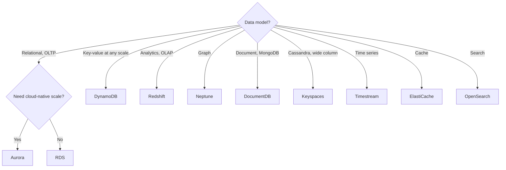

# ElastiCache and Other Databases

> [!info] Why this matters
> "Use the right database for the job" is a theme of the exam. Caching appears by name in [[Domain 2 Design Resilient Architectures#Task 2.1|Task 2.1]], [[Domain 3 Design High-Performing Architectures#Task 3.3|Task 3.3]] and [[Domain 4 Design Cost-Optimized Architectures#Task 4.3|Task 4.3]]. For the other databases you mostly need to match a keyword to a service.
>
> **Study time:** about 2 hours.

## Choosing a database

| Keyword | Service | Compatible with |
| --- | --- | --- |
| Relational, SQL, transactions | RDS, Aurora | PostgreSQL, MySQL and others |
| Key-value, serverless, any scale | DynamoDB | |
| Sub-millisecond cache | ElastiCache | Valkey, Redis OSS, Memcached |
| Durable in-memory primary database | MemoryDB | Redis OSS, Valkey |
| Documents, JSON | DocumentDB | MongoDB |
| Wide column | Keyspaces | Apache Cassandra |
| Graph, relationships, fraud rings | Neptune | Gremlin, openCypher, SPARQL |
| Time series, IoT metrics | Timestream | |
| Data warehouse | [[22 Data Lakes and Analytics#Amazon Redshift\|Redshift]] | PostgreSQL-style SQL |
| Full-text search, log analytics | [[22 Data Lakes and Analytics#Amazon OpenSearch Service\|OpenSearch]] | |

The in-scope list includes Aurora, Aurora Serverless, DocumentDB, DynamoDB, ElastiCache, Keyspaces, Neptune, RDS and Redshift. Timestream and MemoryDB are on neither list, but they are useful to recognise.

## Caching strategies

A cache stores results in memory, so that reads avoid the database. This lowers latency and load, and it can allow a smaller database.

| Strategy | How it works | Good | Bad |
| --- | --- | --- | --- |
| **Lazy loading** (cache-aside) | App checks the cache. On a miss, it reads the database and writes the cache | Only requested data is cached. A failed cache is not fatal | First read is slow. Data can go stale |
| **Write-through** | App writes to the cache whenever it writes to the database | Data is never stale | Every write costs more. Cache holds unread data |
| **TTL** | Each entry expires after a set time | Limits staleness, and cleans up | Choosing the right TTL is a trade-off |

Use lazy loading with a TTL as a default. Add write-through for data that must be current.

A cache needs an **invalidation strategy**, so that only current data is used. A cache also needs application code changes, unlike a read replica's simple connection string change or DAX's client change.

### Where caches fit

| Layer | Service | Caches |
| --- | --- | --- |
| Edge | CloudFront | HTTP responses |
| API | API Gateway caching | API responses |
| Application | ElastiCache | Query results, sessions |
| Database | DAX, Aurora and RDS read replicas | Reads |

### Common patterns

- **Database cache:** reduce latency and load on RDS or DynamoDB by caching frequent reads.
- **Session store:** the application writes session data to ElastiCache, with a TTL, so that any instance can serve the user. This makes the web tier stateless.
- **Leaderboard:** Redis or Valkey **sorted sets** keep elements unique and ordered, so rankings update in real time.

## Amazon ElastiCache

**ElastiCache** is a managed in-memory data store, giving sub-millisecond latency. It runs as a serverless cache, with no capacity planning, or as a node-based cluster.

| | Valkey or Redis OSS | Memcached |
| --- | --- | --- |
| Data types | Rich: lists, sets, sorted sets | Simple key-value |
| Replication and failover | Yes, Multi-AZ | **No** |
| Backups and persistence | Yes | **No** |
| Threads | Mostly single | **Multi-threaded** |
| Publish and subscribe | Yes | No |
| Use | Leaderboards, sessions, durability needs | Simple cache, scale out, loss is acceptable |

**Valkey** is the open-source fork of Redis. It shares Redis OSS's features, and it is the option AWS promotes for new work.

### Cluster modes

| | Cluster mode disabled | Cluster mode enabled |
| --- | --- | --- |
| Shards | 1 | Many, data is partitioned |
| Replicas | Up to 5 per shard | Up to 5 per shard |
| Scales | Reads | Reads and **writes** |

Enable cluster mode when data will not fit on one node, or when writes must scale.

### High availability

A **replication group** has one primary node for writes and replica nodes for reads. Multi-AZ with automatic failover promotes a replica if the primary fails.

**Append-only file (AOF)** persistence logs writes to disk, but it only protects against node restarts, not hardware or AZ failure. For resilience, use Multi-AZ replication groups.

**Global Datastore** replicates across Regions. **Auto Discovery** lets clients find all the nodes in a cluster.

### Security

- Security groups control network access. Caches live in private subnets.
- **IAM policies** control management APIs, such as creating a cluster.
- **IAM authentication** is available for Valkey and Redis.
- **Redis AUTH** adds a password or token, set with `--auth-token`, on top of security groups. Encryption in transit is available.
- Memcached supports SASL-based authentication.

## Amazon MemoryDB

**MemoryDB** is a durable in-memory database compatible with Redis and Valkey. Use it as a **primary database**, whereas ElastiCache is a cache in front of one.

## Amazon DocumentDB

**DocumentDB** is AWS's MongoDB-compatible document database. It is fully managed, has an architecture like Aurora's with replication across three AZs, and its storage grows automatically in 10 GB steps. "MongoDB" in a question points here.

## Amazon Keyspaces

**Keyspaces** is a serverless, managed database compatible with Apache Cassandra.

- It uses Cassandra Query Language (CQL).
- It delivers single-digit millisecond latency at any scale.
- Tables are replicated three times across AZs.
- It offers on-demand or provisioned capacity with auto scaling.

"Cassandra" in a question points here. Typical uses are IoT device data and time-series data.

## Amazon Neptune

**Neptune** is a managed graph database, built for highly connected data.

- It is available across three AZs, with up to 15 read replicas.
- It stores billions of relationships, and it queries them with millisecond latency.
- **Neptune Streams** provides a real-time ordered sequence of changes.

Use it for social networks, recommendations, knowledge graphs and fraud detection, where the question is about **relationships**.

## Amazon Timestream

**Timestream** is a serverless time series database. It keeps recent data in memory and older data in cheaper storage, with built-in time-series functions.

> [!warning] Lifecycle and scope
> Timestream for LiveAnalytics has been closed to new customers since 20 June 2025, and AWS suggests Timestream for InfluxDB instead. It is not on the in-scope list, but older questions use it for IoT metrics. Task 4.3 mentions "time series format" as a database type.

## Services that have gone

**Amazon QLDB** was a ledger database that provided an immutable, cryptographically verifiable transaction log. It ended on 31 July 2025. Older practice questions may mention it. AWS suggests a relational database with audit tables.

**Amazon Managed Blockchain** ran Hyperledger Fabric and Ethereum networks. It reaches end of support on 29 September 2027 and is not on either exam list.

## Exam patterns

| If the question says | Think | Why |
| --- | --- | --- |
| Identical reads overload RDS | ElastiCache | Repeated reads belong in memory |
| Real-time leaderboard | Redis or Valkey sorted sets | Rankings are built in |
| Users logged out when instances terminate | Sessions in ElastiCache or DynamoDB | Stateless tier |
| Cache must survive node failure | Valkey or Redis | Replication and failover |
| Simplest multi-threaded cache, loss is acceptable | Memcached | The only time it wins |
| Cached data must never be stale | Write-through | Cache updated on every write |
| Cache only what is requested, staleness acceptable | Lazy loading with TTL | |
| Diverse analytical queries slow the database | Read replica or Redshift | They would miss the cache |
| Speed up DynamoDB with no app changes | DAX | Not ElastiCache |
| Pub/sub through the cache layer | Valkey or Redis | |
| Friend-of-friend or fraud rings | Neptune | Graph |
| Time-window IoT readings | Timestream | Time series |
| MongoDB migration | DocumentDB | Keyword |
| Cassandra migration | Keyspaces | Keyword |
| Fuzzy text search | OpenSearch | |
| Analytics are slowing an OLTP database | Move them to Redshift | |
| Data warehouse, petabyte scale | Redshift | |

## Check yourself

**1.** A product page generates thousands of identical database reads per second, and RDS CPU is high. What is the most effective improvement?

- A. Add ElastiCache in front of the database
- B. Enable Multi-AZ
- C. Increase backup retention
- D. Add storage

> [!success]- Answer
> **A.** Repeated reads can be answered from memory. Multi-AZ adds no read capacity.

**2.** A mobile game needs a real-time leaderboard of millions of players. Which option fits best?

- A. Memcached
- B. ElastiCache for Valkey or Redis, using sorted sets
- C. Redshift
- D. S3 with Athena

> [!success]- Answer
> **B.** Sorted sets keep members ordered as scores change.

**3.** A company caches product prices, which must never be out of date. Which strategy is best?

- A. Lazy loading with a 24-hour TTL
- B. Write-through
- C. No cache
- D. Memcached with no TTL

> [!success]- Answer
> **B.** Write-through updates the cache every time the database is written.

**4.** An architect needs a cache with automatic failover across AZs and support for backups. Which engine meets this?

- A. Memcached
- B. Valkey or Redis OSS
- C. DAX
- D. Neptune

> [!success]- Answer
> **B.** Memcached has no replication, failover or backups.

**5.** A social network must recommend friends of friends, and it runs queries over billions of relationships. Which database fits?

- A. DynamoDB
- B. Neptune
- C. RDS for MySQL
- D. Keyspaces

> [!success]- Answer
> **B.** Graph databases are designed to traverse relationships efficiently.

**6.** A team wants to move an application from self-managed MongoDB to a managed service with minimal change. Which service fits?

- A. Amazon DocumentDB
- B. Amazon Keyspaces
- C. Amazon Neptune
- D. Amazon Aurora

> [!success]- Answer
> **A.** DocumentDB is MongoDB compatible.

**7.** A company runs Apache Cassandra on EC2 and wants a serverless alternative that uses CQL. Which service fits?

- A. DynamoDB
- B. Amazon Keyspaces
- C. Amazon Redshift
- D. ElastiCache

> [!success]- Answer
> **B.** Keyspaces is Cassandra compatible.

**8.** Why might a read-heavy application that uses a read replica still benefit from a cache?

- A. Replicas cannot serve reads
- B. A cache can answer repeated queries in sub-millisecond time, and reduce the load on all database nodes
- C. Caches replace the need for backups
- D. Caches make writes faster in all cases

> [!success]- Answer
> **B.** Replicas spread reads, but each read still runs on a database. Repeated reads served from memory never reach it.

---
**Previous:** [[14 DynamoDB]] · **Next:** [[16 Lambda and Serverless]] · **Plan:** [[Study Guide]]
