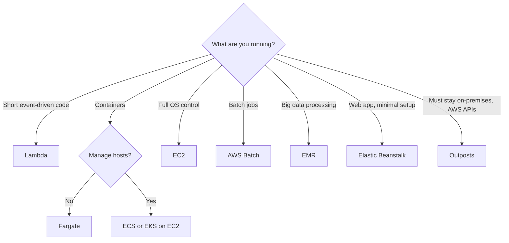
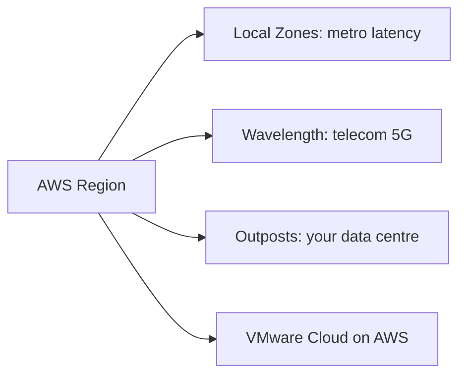

# Other Compute Services

> [!info] Why this matters
> These services tend to be the correct answer when a scenario contains one specific phrase. Learn the phrase for each, and how to choose between compute options.
>
> **Covers:** compute choices in [[Domain 3 Design High-Performing Architectures#Task 3.2|Task 3.2]], hybrid and edge options in [[Domain 4 Design Cost-Optimized Architectures#Task 4.2|Task 4.2]].
> **Study time:** about 1.5 hours.

## Choosing compute

## AWS Elastic Beanstalk

**Elastic Beanstalk** is a platform as a service for deploying web and non-web applications. You upload code, and it handles capacity, load balancing, scaling and monitoring, while you keep **full control of the underlying resources**. Beanstalk is free, and you pay for the resources it creates. It can deploy Docker containers.

| Concept | Meaning |
| --- | --- |
| **Application** | A collection of environments, versions and configurations |
| **Application version** | One iteration of your code |
| **Environment** | The AWS resources running one version at a time |
| **Web server tier** | Handles HTTP traffic behind a load balancer |
| **Worker tier** | Processes jobs from an SQS queue |

**Health monitoring** tracks environment health, and it pushes metrics to CloudWatch.

Environments are either a **single instance** for development and testing, or **load balanced and scalable** (a load balancer plus ASG) for production. A worker environment pulls tasks from an SQS queue.

### Deployment policies

| Policy | Downtime | Capacity during deployment | Extra cost | Rollback |
| --- | --- | --- | --- | --- |
| **All at once** | **Yes** | None for a short time | None | Manual redeploy |
| **Rolling** | No | Reduced by a batch | None | Manual redeploy |
| **Rolling with additional batch** | No | **Full** | An extra batch of instances | Manual redeploy |
| **Immutable** | No | Full, on a new group of instances | A full set of new instances | Quick: delete the new group |
| **Traffic splitting** | No | Full | Higher | Quick: reroute traffic. ALB only |
| **Blue/green** | No | Full, on a separate environment | A full second environment | Swap the CNAME back |

Single-instance environments support only All at once and Immutable.

### Good practice

- **Keep the database outside the environment.** An RDS database created inside the environment is deleted with it. Create RDS separately, and connect with environment variables.
- To move a database out of an existing environment, snapshot it and restore it as a standalone instance.
- **`.ebextensions`** configuration files in the source bundle customise instances.

### Beanstalk or CloudFormation?

| | Elastic Beanstalk | CloudFormation |
| --- | --- | --- |
| Aimed at | Developers deploying an application | Teams defining any infrastructure |
| You provide | Code | A template for every resource |
| Control | Common settings, with options to customise | Everything |

Beanstalk uses CloudFormation behind the scenes. It supports common platforms such as Java, .NET, Node.js, Python, PHP, Ruby, Go and Docker.

## AWS Batch

**AWS Batch** runs batch jobs at any scale, up to hundreds of thousands of jobs. Batch computing is the execution of a series of programs (jobs) without manual intervention.

- Jobs are defined as container images.
- Batch launches the right amount of EC2, Spot or Fargate capacity, and it can run on ECS or EKS.
- It uses job queues and compute environments, and it supports array jobs.
- There is no additional charge for Batch. You pay for the compute.

| | Lambda | AWS Batch |
| --- | --- | --- |
| Time limit | 15 minutes | None |
| Runtime | Managed or custom runtimes, or a container image | Any Docker container |
| Storage | Limited `/tmp` | Depends on the compute environment |
| Compute | Serverless | Managed EC2, Spot or Fargate |

## Running AWS closer to users

| Service | Where it runs | Use when | Trigger phrase |
| --- | --- | --- | --- |
| **Local Zones** | AWS-run location near a large city | Single-digit millisecond latency to one metro area | "Latency-sensitive users in one city" |
| **Wavelength** | Inside a telecom operator's 5G network | Ultra-low latency to mobile devices | "5G", "mobile edge" |
| **Outposts** | AWS racks in **your** data centre | Data must stay on-premises, with the same AWS APIs | "Must remain on-premises" |
| **Snow Family** | A portable device | Disconnected or remote sites. For existing customers | "No connectivity" |
| **VMware Cloud on AWS** | VMware stack on AWS hardware | Extend or migrate VMware environments. No longer resold by AWS | "Keep using VMware tools" |

### AWS Local Zones

Local Zones extend a VPC to a location near a large city. You enable the zone, and add a subnet to it.

### AWS Wavelength

**Wavelength Zones** host compute and storage inside 5G networks, with telecom partners. You extend a VPC into a Wavelength Zone. A **carrier gateway** connects the VPC to devices on the 5G network. This gives low latency to mobile devices and end users.

### AWS Outposts

**Outposts** are AWS-managed racks or servers in your data centre, running AWS services with the same APIs and tools. Use them for data residency or low latency to on-premises systems. AWS maintains the hardware, and you are responsible for the facility, including physical security.

### VMware Cloud on AWS

Companies that use VMware can extend data centre capacity to AWS and keep using their existing VMware software. As of 30 April 2024 it is no longer resold by AWS, but it remains available through Broadcom.

### Edge processing

Edge processing moves compute close to where data is created. This reduces latency, and it can reduce the data sent to the cloud.

- **CDN logic:** [[12 CloudFront and Global Accelerator#Edge functions|CloudFront Functions and Lambda@Edge]]
- **Telecom 5G:** Wavelength
- **Metro latency:** Local Zones
- **On-premises:** Outposts
- **Disconnected sites:** Snow Family, for existing customers

## Exam patterns

| If the question says | Think | Why |
| --- | --- | --- |
| Deploy code quickly, no infrastructure work, but keep control | Elastic Beanstalk | Its identity phrase |
| Fastest deployment, brief downtime is fine | All at once | |
| No downtime, no extra cost | Rolling | |
| No downtime, keep full capacity | Rolling with additional batch | |
| Safest deployment, quick rollback | Immutable | |
| Test on a separate URL, then switch with instant rollback | Blue/green CNAME swap | |
| Database lost when the environment was terminated | Create RDS outside the environment | |
| Background jobs from a queue alongside a web app | Worker environment | |
| Customise instances | `.ebextensions` | |
| Thousands of batch jobs, no cluster to manage | AWS Batch | |
| Must stay on-premises, use AWS APIs | Outposts | |
| Ultra-low latency to 5G devices | Wavelength | |
| Low latency to one city | Local Zones | |
| Keep existing VMware tools | VMware Cloud on AWS (no longer resold by AWS) | |
| Fine-grained infrastructure as code | CloudFormation | Not Beanstalk |

## Check yourself

**1.** Developers want to deploy a web app quickly, with AWS handling load balancing and scaling, while they keep access to the underlying resources. Which service fits?

- A. Elastic Beanstalk
- B. AWS Batch
- C. Amazon Lightsail
- D. AWS Outposts

> [!success]- Answer
> **A.** Beanstalk handles the infrastructure while leaving it accessible. Lightsail is out of scope.

**2.** An application must have no downtime during deployment and must keep full capacity at all times, with minimal extra cost. Which Beanstalk policy fits?

- A. All at once
- B. Rolling
- C. Rolling with additional batch
- D. Blue/green

> [!success]- Answer
> **C.** The extra batch maintains full capacity, without a full duplicate of the instances.

**3.** A team wants the safest deployment, with the fastest rollback if health checks fail on new instances, inside the same environment. Which policy fits?

- A. Rolling
- B. Immutable
- C. All at once
- D. Rolling with additional batch

> [!success]- Answer
> **B.** Immutable creates new instances in a temporary group. If they fail, they are simply removed.

**4.** A company's RDS database was deleted when a Beanstalk environment was terminated. How can it prevent this in production?

- A. Take a daily snapshot
- B. Create the RDS instance outside the environment, and pass connection details in environment variables
- C. Use a worker tier
- D. Use Multi-AZ

> [!success]- Answer
> **B.** A database inside an environment has the same lifecycle as the environment. Decouple them.

**5.** A bank must process data on-premises, because of data residency rules, but it wants to use the same AWS APIs and tools as in the cloud. What should it use?

- A. AWS Outposts
- B. AWS Local Zones
- C. AWS Wavelength
- D. Amazon CloudFront

> [!success]- Answer
> **A.** Outposts brings AWS infrastructure into the customer's data centre.

**6.** A company is building an app for 5G devices, which needs the lowest possible latency to phones on a telecom network. What should it use?

- A. Local Zones
- B. Wavelength
- C. Outposts
- D. Global Accelerator

> [!success]- Answer
> **B.** Wavelength Zones sit inside the telecom network.

**7.** Researchers need to run hundreds of thousands of containerised simulation jobs, each lasting hours, with capacity scaling automatically and Spot used where possible. Which service fits?

- A. Lambda
- B. AWS Batch
- C. Elastic Beanstalk
- D. API Gateway

> [!success]- Answer
> **B.** Batch manages job queues and compute, and it uses Spot well.

---
**Previous:** [[18 Containers]] · **Next:** [[20 Messaging and Integration]] · **Plan:** [[Study Guide]]
