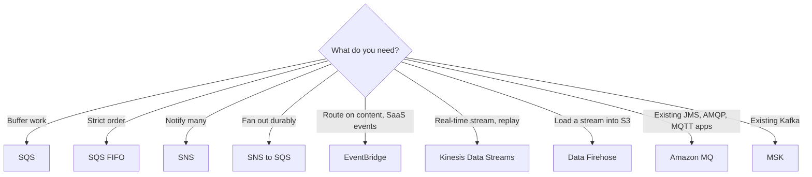
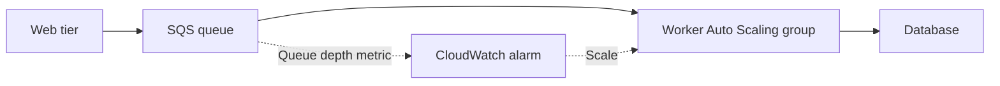
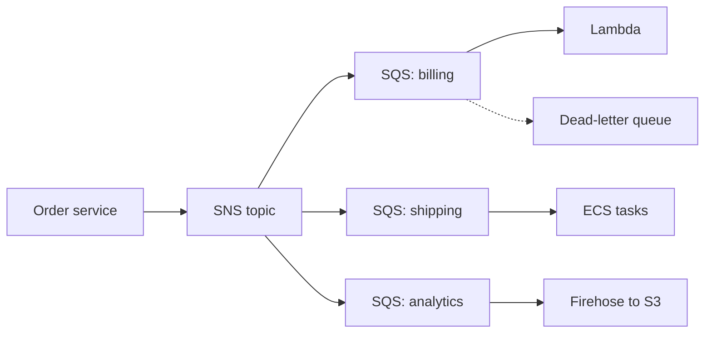

# Messaging and Integration

> [!info] Why this matters
> Loose coupling is at the centre of [[Domain 2 Design Resilient Architectures#Task 2.1|Task 2.1]]. If a scenario mentions spikes, lost orders, tiers failing together, or "one event, many systems", the answer is in this chapter.
>
> **Study time:** about 4 hours.

## Why decouple

In a **synchronous** design, one component calls another and waits. If the second is slow or down, the first fails too. In an **asynchronous** design, a middle layer holds the work, so that each side can scale and fail independently.

| Model | Service | How it works |
| --- | --- | --- |
| **Queue** | SQS | One message goes to one consumer. Consumers pull |
| **Publish and subscribe** | SNS | One message goes to all subscribers. SNS pushes |
| **Event bus** | EventBridge | Rules route events to targets, based on content |
| **Stream** | Kinesis, MSK | Many consumers read the same ordered data, and can replay |
| **Workflow** | Step Functions | Coordinates steps, with retries and branching |

| | Amazon SQS | Amazon SNS | Kinesis Data Streams | Amazon EventBridge |
| --- | --- | --- | --- | --- |
| Model | Queue, consumers pull | Pub/sub, pushes | Stream, consumers pull | Event bus, pushes by rule |
| Consumers | Compete, each message handled once | Every subscriber gets a copy | Many independent readers | Rule targets |
| Persistence | Up to 14 days | None | 1 to 365 days | Optional archive |
| Replay | No | No, except FIFO topics with archiving | Yes | Yes, from an archive |
| Ordering | FIFO queues | FIFO topics | Per shard | Not by default |
| Scaling | Automatic | Automatic | Shards, or on-demand | Automatic |
| Maximum message | 1 MiB | 256 KiB by default, up to 1 MiB | 10 MiB record | 1 MB per `PutEvents` request |
| Use for | Buffering, worker pools | Notifications, fan-out | Real-time analytics | SaaS and AWS event routing |

## Amazon SQS

**Simple Queue Service** is a fully managed message queue. Producers send messages, and consumers poll for them, process them and delete them. A message stays until a consumer deletes it or the retention period ends.

| Setting | Value |
| --- | --- |
| Message size | Up to 1 MiB. Up to 2 GB with the Extended Client Library, which stores the payload in S3 |
| Retention | 1 minute to 14 days, default 4 days |
| Visibility timeout | 0 seconds to 12 hours, default 30 seconds |
| Delay | 0 to 15 minutes |
| Long polling wait | Up to 20 seconds |
| Throughput (standard) | Nearly unlimited |
| Queue size | No limit on stored messages |

**Standard queues** give at-least-once delivery and best-effort ordering. A message can occasionally arrive twice or out of order, so consumers should be **idempotent**, meaning that processing twice does no harm.

### Visibility timeout

After a consumer receives a message, it is hidden from other consumers for the visibility timeout. If the consumer finishes, it deletes the message. If it does not, the message reappears, and another consumer gets it.

- Messages processed twice usually mean the timeout is **too short** for the work.
- A consumer can call `ChangeMessageVisibility` to ask for more time.
- A timeout that is too long delays reprocessing after a crash.

### Long polling

With **long polling**, a consumer waits for up to 20 seconds for a message, rather than returning immediately. This reduces empty responses, API calls and cost, and it lowers latency. Enable it on the queue, or per request with `WaitTimeSeconds`.

### Dead-letter queues

A **dead-letter queue (DLQ)** catches messages that fail repeatedly, so that one bad message does not block processing. `maxReceiveCount` sets how many tries are allowed. Inspect the DLQ, fix the bug and redrive the messages.

### Delay queues

A delay hides new messages for up to 15 minutes before they can be received.

### FIFO queues

**FIFO queues** preserve order and provide exactly-once processing.

- The queue name must end in `.fifo`.
- **Message group ID** defines ordering. Messages in one group are in strict order, and different groups can be processed in parallel.
- **Deduplication** removes duplicates within a 5-minute window, using a deduplication ID or a hash of the content.
- Throughput is 300 messages per second per API action, or 3,000 with batching. High-throughput mode reaches up to 70,000 in the largest Regions.

If a question needs order and also very high throughput, use several message groups or consider Kinesis.

### Security

Security is similar to other services: HTTPS in flight, KMS at rest, IAM policies for API access, and **queue access policies**, similar to bucket policies, for cross-account access or to let SNS or S3 write to the queue.

### Scaling workers on queue depth

This is **queue-based load levelling**. The queue absorbs spikes and protects the database. Scale workers on `ApproximateNumberOfMessagesVisible`, or better, on backlog per instance.

The same idea appears in other forms:

- **Buffer database writes.** Writes go to SQS first, and workers write at a safe rate, so that a spike cannot overload the database or lose transactions.
- **Decouple tiers.** The front end queues jobs, and a separate back-end ASG processes them, so that each tier scales alone.

## Amazon SNS

**Simple Notification Service** is a publish and subscribe service. A publisher sends one message to a **topic**, and SNS pushes a copy to every subscriber.

- Subscribers can be SQS, Lambda, HTTP or HTTPS endpoints, email, SMS, mobile push and Data Firehose.
- SNS does **not store** messages for later. An offline subscriber misses them, unless a queue sits in between.
- Standard topics support up to 12,500,000 subscriptions per topic, and FIFO topics 100.
- The maximum message is 256 KiB by default, and it can be raised to 1 MiB per topic.

**Publishing:** applications usually publish to a topic. Mobile apps can also use **direct publish** to a single platform endpoint.

**Message filtering:** a filter policy on a subscription means that the subscriber only receives matching messages. Without a filter, it gets everything.

**FIFO topics** give ordering and deduplication, like SQS FIFO. Both FIFO and standard SQS queues can subscribe.

**Security:** HTTPS in flight, KMS at rest, IAM, and **topic access policies** for cross-account use.

### Fan-out

**SNS to multiple SQS queues** is one of the most important patterns in the exam.

Each consumer has its own durable queue, so that a slow or failed consumer does not affect the others, and you can add more subscribers later. Configure each queue's access policy to allow SNS to write.

Related designs:

- **S3 events to many queues:** S3 allows one rule per event type and prefix combination, so send it to SNS and fan out.
- **SNS to S3:** subscribe a Data Firehose stream, which delivers to S3.
- **FIFO fan-out:** SNS FIFO to SQS FIFO, when you need ordering and deduplication.

## Amazon EventBridge

**EventBridge** is a serverless event bus that connects AWS services, your own applications and SaaS products.

- **Rules** match events on their content and send them to targets, such as Lambda, SQS, SNS, Step Functions and ECS tasks.
- **Scheduler** runs one-off or recurring tasks, such as serverless cron jobs.
- **Pipes** connect a source to a target, with filtering and enrichment.
- **Archive and replay** keeps events, so that you can reprocess them after a bug fix.
- **Schema Registry** discovers event structures and generates code.

**Event buses:**

| Bus | Events from |
| --- | --- |
| **Default** | AWS services in the account |
| **Partner** | SaaS products such as Zendesk or Datadog |
| **Custom** | Your own applications |

AWS's current documentation also describes a newer type of custom event bus that retains events, and supports ordered delivery and replay. Rules and targets as described here are what the exam has traditionally tested.

A **resource-based policy** lets other accounts send events to a bus, which is how you gather all the events of an organisation in one account. Permissions to reach targets work as described in [[02 IAM and Federation#Cross-account access|IAM and Federation]].

**EventBridge or SNS?** Use EventBridge for routing on event content, and for AWS and SaaS sources. Use SNS for high-volume fan-out, and for SMS, email or mobile push.

## AWS Step Functions

**Step Functions** is a serverless workflow service. You define a state machine in JSON, and it coordinates Lambda functions and many other services.

| | Standard | Express |
| --- | --- | --- |
| Maximum duration | **1 year** | **5 minutes** |
| Execution model | Exactly once | At least once (asynchronous), at most once (synchronous) |
| Pricing | Per state transition | Executions, duration and memory |
| History | Full, retrievable for 90 days | Through CloudWatch Logs |
| Use | Long, auditable workflows | High-volume, short, idempotent work |

Express workflows do not support the job-run (`.sync`) or callback (`.waitForTaskToken`) patterns, Distributed Map or activities.

Useful features:

- **Error handling:** `Retry` and `Catch` fields handle failures, including exponential backoff, with no custom code.
- **Task** states do work, and **Choice** states branch.
- **Parallel** states run branches at the same time.
- **Wait** states pause.
- **Human approval:** a task can wait for a callback token, so that a person can approve.
- **Map** states loop over a list. **Inline** mode runs inside the parent execution. **Distributed** mode runs very large jobs as child executions, such as processing millions of S3 objects. `MaxConcurrency` limits parallelism.

Step Functions solves a common Lambda problem: chaining functions together in code is fragile. An orchestrated workflow can run for far longer than the 15 minutes allowed for one function.

## Amazon MQ

**Amazon MQ** is a managed message broker for **RabbitMQ** and **ActiveMQ**. When moving an application that uses standard protocols such as **AMQP, MQTT, STOMP, OpenWire or JMS**, you can use Amazon MQ, rather than rewrite it for SQS and SNS.

It runs on servers, so it does not scale like SQS and SNS. It can run in Multi-AZ with failover. It offers both queues and topics.

If the question names a protocol or RabbitMQ, the answer is Amazon MQ. If it says "new application" and "least overhead", the answer is SQS.

## Other integration services

**Amazon AppFlow** transfers data securely between SaaS applications, such as Salesforce, SAP, Zendesk and Slack, and AWS services, such as S3 and Redshift. It runs on a schedule, on events or on demand, and it can use PrivateLink. It needs no integration code.

**Amazon SES** sends and receives email at scale, using the console, APIs or SMTP. It provides reputation dashboards and supports DKIM and SPF. It is not on the in-scope list, but it appears in architectures that send email.

**Amazon Pinpoint** was a marketing communications service. Support ended on 30 October 2026.

**Amazon SWF** is an older workflow service. Step Functions is the right answer for new designs, and SWF is not on the in-scope list.

## Exam patterns

| If the question says | Think | Why |
| --- | --- | --- |
| Web tier overwhelmed, orders being lost | SQS with an Auto Scaling worker group | The queue buffers spikes |
| Strict order, no duplicates | SQS FIFO | Check the throughput |
| One event must reach several systems, and none may miss it | SNS to multiple SQS queues | Queues hold messages |
| Some messages are processed twice | Increase the visibility timeout | |
| Repeatedly failing messages block processing | DLQ with `maxReceiveCount` | |
| Reduce the cost of polling an empty queue | Long polling | |
| Message payloads of 5 MB | Extended Client Library or S3 pointer | 1 MiB limit |
| Existing RabbitMQ, AMQP, JMS or MQTT | Amazon MQ | |
| Each subscriber wants only some messages | SNS message filtering | |
| Nightly job with no servers | EventBridge schedule | |
| Ingest Zendesk or Datadog events | EventBridge partner bus | SaaS |
| Route on a JSON field | EventBridge rule | |
| Reprocess last week's events | EventBridge archive and replay | |
| Workflow needs retries and a manual approval that takes days | Step Functions Standard | Up to a year |
| Lambda pipeline exceeds 15 minutes | Step Functions | Orchestrate steps |
| Process each item in a list | Map state | |
| Audit of every step's input and output | Step Functions Standard | Execution history |
| Millions of short workflows, cheapest | Step Functions Express | |
| Retry with backoff, no custom code | `Retry` | |
| Sync Salesforce data to S3 | AppFlow | |
| Workers scale with backlog | Queue depth metric | |
| Protect a database from a write surge | SQS buffer | |

## Check yourself

**1.** During traffic spikes, an order web tier cannot keep up, and orders are lost when the database is overloaded. How can the architect make this resilient, with the least change?

- A. Place an SQS queue between the web tier and workers that write to the database
- B. Increase the size of the web servers
- C. Add an SNS topic with email subscribers
- D. Use a NAT gateway

> [!success]- Answer
> **A.** The queue absorbs the spike and holds work until the workers catch up.

**2.** Workers sometimes process the same SQS message twice. Processing takes up to two minutes. The queue uses defaults. What should the team change first?

- A. Enable long polling
- B. Increase the visibility timeout to more than two minutes
- C. Reduce the retention period
- D. Add a delay

> [!success]- Answer
> **B.** The default is 30 seconds, so a message reappears while the first worker is still processing it.

**3.** An order event must reach billing, shipping and analytics systems. Each must process every event, even if it is down for a while. What should the architect use?

- A. One SQS queue shared by all three
- B. SNS with an SQS queue for each system
- C. SNS with direct HTTP subscribers
- D. One Kinesis shard with no consumers

> [!success]- Answer
> **B.** SNS sends a copy to each queue, and the queues hold messages while a system is down. In one shared queue, each message would go to only one consumer.

**4.** A bank needs messages for each account processed in order, while different accounts can be processed in parallel. Which feature fits?

- A. Standard SQS
- B. SQS FIFO with the account ID as the message group ID
- C. SNS standard topic
- D. Delay queues

> [!success]- Answer
> **B.** Message groups keep order within a group and allow parallel consumers across groups.

**5.** A company moving to AWS has an application that uses JMS with ActiveMQ, and it does not want to rewrite it. What should it use?

- A. SQS
- B. SNS
- C. Amazon MQ
- D. EventBridge

> [!success]- Answer
> **C.** Amazon MQ supports standard protocols, so existing code keeps working.

**6.** An order process has several steps, needs retries with backoff, and needs a manager's approval that can take days. Which service fits?

- A. Step Functions Standard
- B. Step Functions Express
- C. SQS delay queues
- D. Lambda alone

> [!success]- Answer
> **A.** Standard workflows run for up to a year and support waiting for a callback. Express stops at five minutes.

**7.** A company wants to route events from Datadog to different Lambda functions, based on a field in the event. Which service fits?

- A. Amazon SNS
- B. Amazon EventBridge
- C. Amazon SQS
- D. AWS AppFlow

> [!success]- Answer
> **B.** EventBridge has partner event sources and content-based rules.

**8.** A bug corrupted events processed last week. The team wants to run them again after a fix. Which feature would allow this, if it had been set up?

- A. EventBridge archive and replay
- B. SNS standard topic
- C. SQS long polling
- D. Lambda layers

> [!success]- Answer
> **A.** Archived events can be replayed to the bus. Kinesis with long retention can also replay, but SNS and a processed SQS queue cannot.

**9.** A single bad message keeps failing, and it is being retried forever. What should the team configure?

- A. A dead-letter queue with a `maxReceiveCount`
- B. A shorter retention period
- C. Long polling
- D. A larger visibility timeout

> [!success]- Answer
> **A.** After the set number of attempts, the message moves to the DLQ for inspection.

**10.** A company needs to send a mobile push notification and an SMS for the same event. Which service is the most direct fit?

- A. SQS
- B. SNS
- C. Step Functions
- D. Amazon MQ

> [!success]- Answer
> **B.** SNS supports mobile push and SMS subscribers directly.

---
**Previous:** [[19 Other Compute Services]] · **Next:** [[21 Streaming and Data Ingestion]] · **Plan:** [[Study Guide]]
