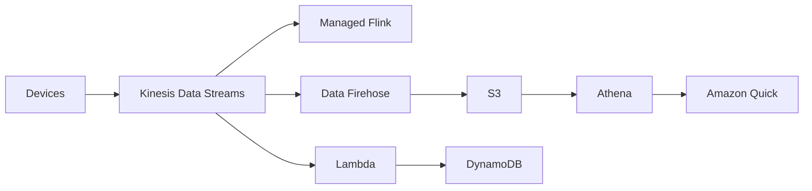

# Streaming and Data Ingestion

> [!info] Why this matters
> [[Domain 3 Design High-Performing Architectures#Task 3.5|Task 3.5]] is all about getting data in and transforming it. The central question is usually Kinesis Data Streams or Data Firehose, so learn the difference exactly.
>
> **Study time:** about 2 hours.

## Choosing an ingestion pattern

| Requirement | Pattern | Service |
| --- | --- | --- |
| Records need processing within a second, with replay | Real-time stream | Kinesis Data Streams |
| Load a stream into S3 or Redshift, with no code | Near real-time delivery | Data Firehose |
| Existing Kafka workloads | Managed Kafka | Amazon MSK |
| Video from cameras | Video stream | Kinesis Video Streams |
| Files arrive in batches | Batch | S3 upload, DataSync, Transfer Family |
| Data from a database | Change data capture | [[27 Migration and Data Transfer#AWS DMS\|AWS DMS]] |
| Data from SaaS apps | Scheduled flows | [[20 Messaging and Integration#Other integration services\|AppFlow]] |

## Kinesis Data Streams

**Kinesis Data Streams (KDS)** collects and stores streams of records for real-time processing.

| Term | Meaning |
| --- | --- |
| **Stream** | A collection of shards |
| **Shard** | The unit of capacity |
| **Record** | A data blob, a partition key and a sequence number |
| **Partition key** | Decides the shard for a record |
| **Producer** | Writes data: SDK, Kinesis Producer Library, Kinesis Agent |
| **Consumer** | Reads data: SDK, Kinesis Client Library, Lambda, Firehose, Flink |

Key numbers:

| Setting | Value |
| --- | --- |
| Retention | 24 hours by default, up to **365 days** |
| Record size | Up to 10 MiB |
| Write per shard (provisioned) | 1 MB/s or 1,000 records per second |
| Read per shard (provisioned) | 2 MB/s, shared between standard consumers |
| Enhanced fan-out | Dedicated throughput for each consumer |

Records are immutable. You cannot delete one, and they expire when the retention period ends. Several applications can read the same data independently, and **replay** it. That is what makes Kinesis different from SQS.

### Capacity modes

| Mode | How it works | Pay for |
| --- | --- | --- |
| **Provisioned** | You choose the number of shards, and reshard to scale | Per shard, per hour |
| **On-demand** | Scales automatically, starting at 4 MB/s of write capacity | Per stream, per hour, and per GB in and out |

### Ordering

Records with the same partition key go to the same shard, and they are read in order. So a `truck_id` partition key keeps each truck's readings in order. A poor partition key creates a **hot shard**.

| | Kinesis shard | SQS FIFO message group |
| --- | --- | --- |
| Ordering scope | Per partition key | Per message group |
| Consumers | One per shard, per application | One per group at a time |
| Throughput limit | Add shards | Quotas per queue |

For example, for 100 trucks with 5 shards and a truck ID key, each truck's data stays in order, and up to 5 consumers can work in parallel. With SQS FIFO and a group ID per truck, up to 100 consumers can work in parallel.

### Scaling and troubleshooting streams

| Symptom | Cause | Fix |
| --- | --- | --- |
| `ProvisionedThroughputExceededException` | A shard is over its limit | Retry with backoff, add shards, or choose a better partition key |
| One shard is much busier | Hot partition key | Use a key with more distinct values, or split that shard |
| Consumers fall behind | Too few consumers, or slow processing | Enhanced fan-out, more shards, or faster consumers. Watch `IteratorAge` |
| Paying for idle shards | Too many shards | Merge cold shards, or use on-demand mode |

**Resharding** means splitting a shard to add capacity, or merging two shards to save money. The **Kinesis Producer Library** batches records to increase throughput. The **Kinesis Client Library** shares shards among workers, with each shard processed by one worker at a time.

### Security

IAM controls access. Data is encrypted in flight using HTTPS, and at rest using KMS. A VPC interface endpoint provides private access. CloudTrail records API calls.

## Amazon Data Firehose

**Amazon Data Firehose** (formerly Kinesis Data Firehose) loads streaming data into destinations, with no code to write and no servers to manage.

| | Kinesis Data Streams | Amazon Data Firehose |
| --- | --- | --- |
| Purpose | Stream storage for custom consumers | Delivery into a destination |
| Latency | Real time | **Near real time**, because it buffers |
| Replay | **Yes** | **No** |
| Stores data | Yes, up to 365 days | No |
| Scaling | Shards, or on-demand | Automatic |
| Code | You write consumers | None, for delivery |

- **Destinations:** S3, Redshift (through S3 and `COPY`), OpenSearch, Splunk, Snowflake, Apache Iceberg tables and HTTP endpoints.
- **Buffering:** by size or time. A shorter buffer means lower latency, and more frequent, smaller writes.
- **Transformation:** Lambda can transform records, and Firehose can convert formats to Parquet and compress data.
- **Failures:** failed or all records can go to a backup S3 bucket.

The cost-effective choice for "stream IoT data to S3, no custom code" is Firehose. If the question says "real time", "replay", or "multiple consumers", it is Kinesis Data Streams.

KDS and Firehose are often used together:

## Amazon Managed Service for Apache Flink

This service runs **Apache Flink** applications for real-time stream processing, such as windows and aggregations, with automatic scaling and backups. It reads from KDS or MSK, but not from Firehose.

It is the former Kinesis Data Analytics for Apache Flink. AWS started deleting applications of the SQL version of Kinesis Data Analytics on 27 January 2026, so older questions that mention "Kinesis Data Analytics" should be read as this service. It is not on the in-scope list by name, but "Amazon Kinesis" is.

## Amazon MSK

**Amazon Managed Streaming for Apache Kafka (MSK)** runs Apache Kafka as a managed service. It creates and manages brokers and the metadata layer, in your VPC, across AZs. Data is stored on EBS for as long as you like. **MSK Serverless** removes capacity management.

| | Kinesis Data Streams | Amazon MSK |
| --- | --- | --- |
| API | AWS proprietary | Open-source Apache Kafka |
| Unit | Shards | Topics and partitions on brokers |
| Retention | Up to 365 days | As long as storage allows |
| Choose when | You want the simplest AWS-native stream | You are migrating Kafka, or need its ecosystem |

Consumers include Managed Flink, Glue streaming ETL, Lambda, and applications on EC2, ECS or EKS.

## Amazon Kinesis Video Streams

**Kinesis Video Streams** ingests, stores and processes video from cameras, for playback and machine learning. Pair it with Rekognition for video analysis.

A stream can durably store media for a retention period you set, and the data is encrypted at rest. It can also carry non-video, time-serialized data such as audio, thermal imagery and RADAR. Applications can process the video live, or batch-process stored video later.

## Securing ingestion

The exam guide lists "secure access to ingestion access points". In practice:

- Use IAM roles for producers, not access keys.
- Use VPC endpoints for private access from VPCs, and VPN or Direct Connect from on-premises.
- Encrypt in transit with TLS, and at rest with KMS.
- Limit S3 buckets with policies, and use Lake Formation for the data lake.

## Sizes and speeds

The exam guide also lists "sizes and speeds needed to meet business requirements". Work out how much data arrives per second, and how fresh it needs to be.

| Requirement | Think about |
| --- | --- |
| Total MB/s | Number of shards, at 1 MB/s each for writes |
| Fresh within a second | KDS, not Firehose |
| Fresh within a minute or so | Firehose is fine |
| Hourly or daily files | Batch, which is usually cheapest |
| Very large one-off datasets | [[27 Migration and Data Transfer#Choosing a transfer method\|Network versus physical transfer]] |

> [!example] Worked example
> 5,000 sensors each send a 1 KB record per second. That is 5,000 KB/s, or about 5 MB/s, and also 5,000 records per second. A shard takes 1 MB/s or 1,000 records per second, so you need at least 5 shards.

## Exam patterns

| If the question says | Think | Why |
| --- | --- | --- |
| Two applications read the same real-time data, and can reprocess yesterday | Kinesis Data Streams | Multiple consumers and replay |
| Stream IoT data to S3, least overhead, no code | Data Firehose | |
| Convert a stream to Parquet in S3 | Firehose | Format conversion |
| Load streaming data into Redshift or OpenSearch | Firehose | |
| Ordered per device | KDS partition key | |
| Hot shard | Better partition key | |
| Keep stream data for a year | KDS retention | Up to 365 days |
| Stream capacity is unpredictable | KDS on-demand | |
| Existing Kafka applications | MSK | |
| Real-time windowed aggregations | Managed Service for Apache Flink | |
| Video from cameras for analysis | Kinesis Video Streams with Rekognition | |
| Each consumer needs guaranteed throughput | Enhanced fan-out | |
| Lowest latency delivery to a custom consumer | KDS | Firehose buffers |

## Check yourself

**1.** Clickstream data must be read by two different applications in real time, and the team must be able to reprocess yesterday's data. Which service fits?

- A. Amazon SQS
- B. Amazon Data Firehose
- C. Kinesis Data Streams
- D. Amazon SNS

> [!success]- Answer
> **C.** KDS supports many independent consumers, with retention and replay.

**2.** A company must store IoT telemetry in S3 as Parquet, with the least operational overhead. A delay of a minute or so is acceptable. Which service fits?

- A. Kinesis Data Streams with custom consumers
- B. Amazon Data Firehose
- C. Amazon MSK
- D. AWS DataSync

> [!success]- Answer
> **B.** Firehose delivers to S3 with no code, and it can convert to Parquet.

**3.** Readings from each vehicle must be processed in order, but vehicles are independent. How should the stream be designed?

- A. Use the vehicle ID as the partition key
- B. Use a random partition key
- C. Use a single shard for each Region
- D. Use a timestamp as the partition key

> [!success]- Answer
> **A.** Records with the same key go to the same shard, in order. A random key would break ordering.

**4.** A team needs 8 MB/s of writes to a provisioned Kinesis stream. How many shards are needed, at minimum?

- A. 2
- B. 4
- C. 8
- D. 16

> [!success]- Answer
> **C.** Each shard accepts 1 MB/s, so 8 shards are needed. Spare capacity for peaks is sensible.

**5.** A company runs Apache Kafka on EC2, and wants to remove broker management without changing its applications. What should it use?

- A. Kinesis Data Streams
- B. Amazon MSK
- C. Amazon SQS
- D. EventBridge

> [!success]- Answer
> **B.** MSK runs the same Kafka API.

**6.** Three consumers read a Kinesis stream, and they compete for the shared 2 MB/s per shard. Latency is rising. What should the team use?

- A. Enhanced fan-out
- B. Firehose
- C. A shorter retention period
- D. SQS FIFO

> [!success]- Answer
> **A.** Enhanced fan-out gives each consumer its own dedicated throughput.

**7.** An application needs real-time windowed aggregations over a stream, such as a five-minute moving average. Which service fits?

- A. Amazon Managed Service for Apache Flink
- B. Amazon Athena
- C. AWS Glue crawlers
- D. S3 Select

> [!success]- Answer
> **A.** Flink is built for stateful stream processing.

---
**Previous:** [[20 Messaging and Integration]] · **Next:** [[22 Data Lakes and Analytics]] · **Plan:** [[Study Guide]]
