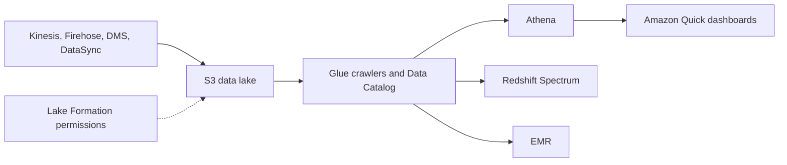
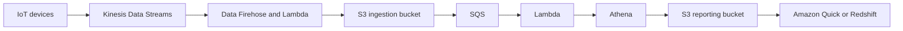

# Data Lakes and Analytics

> [!info] Why this matters
> [[Domain 3 Design High-Performing Architectures#Task 3.5|Task 3.5]] expects you to choose between Athena, Redshift and EMR, to build and secure a data lake, and to convert formats. These questions can usually be decided by keywords.
>
> **Study time:** about 3 hours.

## OLTP and OLAP

| | OLTP | OLAP |
| --- | --- | --- |
| Workload | Many small transactions on current data | Few large queries over history |
| Storage | Row-oriented | Columnar |
| Services | RDS, Aurora, DynamoDB | Redshift, Athena |

Running heavy analytics on an OLTP database slows it down. Move analytics to a read replica, a warehouse or a data lake.

## Data lakes

A **data lake** is a central store of raw and processed data in any format, normally on S3. A **data warehouse** stores structured, cleaned data for fast analytics.

### Data formats

| Kind | Examples | Traits |
| --- | --- | --- |
| Row-based | CSV, JSON | Easy to produce, slow and costly to scan |
| Columnar | **Parquet**, **ORC** | Compress well. Queries read only the columns they need |

Converting CSV or JSON to Parquet is a common exam task. **Glue jobs** do this in batch, and **Firehose** does it as a stream.

**Partition** data by date or key, as in `year=2026/month=11/day=01`, so that queries read only the relevant files. Compression and larger files (over about 128 MB) also reduce cost.

## AWS Glue

**AWS Glue** is a serverless extract, transform and load (ETL) service.

| Component | Purpose |
| --- | --- |
| **Data Catalog** | Central metadata store, used by Athena, Redshift Spectrum and EMR |
| **Crawlers** | Scan data and infer schemas, filling the catalogue |
| **Glue jobs** | ETL scripts, often in PySpark, that transform data |
| **Glue Studio** | Visual creation of ETL jobs |
| **DataBrew** | Clean and normalise data with pre-built transformations and no code |
| **Job bookmarks** | Track what has been processed, to avoid processing it again |
| **Streaming ETL** | Run jobs continuously on KDS or Kafka |

If a question says "convert CSV to Parquet with no servers", the answer is Glue.

## AWS Lake Formation

**Lake Formation** builds and secures a data lake in days. It sits on top of Glue.

- **Blueprints** ingest data from S3, relational and NoSQL sources.
- **Centralised permissions** give fine-grained, **row and column level** access control.
- Data from multiple accounts can be consolidated.
- It works with Athena, Redshift Spectrum and EMR.

If the question asks for column-level or row-level security across a data lake, the answer is Lake Formation. S3 policies work only at the object level.

### Securing a data lake

- Lake Formation permissions for row and column control
- S3 bucket policies, and Block Public Access
- KMS encryption at rest, and TLS in transit
- VPC endpoints for private ingestion
- CloudTrail for audit, and Macie for discovering sensitive data

## Amazon Athena

**Athena** runs standard SQL directly on data in S3. It is serverless, and you pay per query, based on data scanned.

- It supports CSV, JSON, ORC, Avro and Parquet.
- It uses the Glue Data Catalog.
- **Federated Query** runs SQL across relational, non-relational and custom sources, using connectors that run on Lambda. Results are stored in S3.
- It is used with Amazon Quick for dashboards.
- Typical uses are ad-hoc analysis, and querying VPC Flow Logs, CloudTrail logs and ALB logs.

**To reduce Athena cost and increase speed:**

1. Use columnar formats such as Parquet or ORC.
2. Compress the data.
3. Partition datasets.
4. Use larger files, because many small files add overhead.

All of these reduce the amount of data scanned, which is what you pay for.

**CTAS** (`CREATE TABLE AS SELECT`) can convert data to Parquet using SQL alone. **Workgroups** separate teams, and they can set limits on the data that a query may scan, which controls cost.

## Amazon Redshift

**Redshift** is a petabyte-scale, columnar **data warehouse** for OLAP. It is based on PostgreSQL, but it is not used for OLTP. It uses massively parallel processing (MPP) across nodes.

| Concept | Meaning |
| --- | --- |
| **Leader node** | Plans queries and combines results |
| **Compute nodes** | Run the queries |
| **Sort and distribution keys** | Organise data for performance. Redshift has no traditional indexes |

### Deployment

- **Provisioned clusters:** choose node types in advance. Reserved Instances give savings.
- **RA3 nodes** separate compute from managed storage, so that each can scale independently.
- **Redshift Serverless:** runs without managing clusters.

### Loading data

- The **`COPY` command** from S3 is the fastest bulk load.
- **Firehose** loads streams through S3 and `COPY`.
- Large batches work far better than many small inserts.
- **Zero-ETL integrations** load data from Aurora and other sources with no pipeline.

### Redshift Spectrum

**Spectrum** queries data **already in S3**, without loading it. It needs a Redshift cluster to start the query. This is the answer when a warehouse must also reach data lake files.

### Performance features

| Feature | What it does |
| --- | --- |
| **Concurrency Scaling** | Adds temporary capacity for bursts of queries |
| **Enhanced VPC Routing** | Forces `COPY` and `UNLOAD` traffic through your VPC, so that VPC controls apply |
| **Materialized views** | Speed up repeated queries |
| **Workload Management** | Prioritises query queues |

### Snapshots and disaster recovery

- Snapshots are point-in-time and incremental, stored internally in S3.
- **Automated** snapshots run every 8 hours, or every 5 GB, or on a schedule, with a set retention.
- **Manual** snapshots stay until deleted.
- Redshift can **automatically copy snapshots to another Region** for disaster recovery.
- Multi-AZ deployments are available.

## Choosing an analytics service

| | Amazon Athena | Amazon Redshift | Amazon EMR |
| --- | --- | --- | --- |
| What | Serverless SQL on S3 | Data warehouse | Managed Hadoop and Spark |
| Pay for | Data scanned | Nodes or serverless use | Cluster time |
| Use | Ad-hoc queries, logs | Complex, frequent BI | Custom big data jobs |
| Keyword | "Occasional", "no infrastructure" | "Data warehouse", "joins", "BI" | "Hadoop", "Spark", "HBase" |

## Amazon EMR

**Amazon EMR** creates clusters for Hadoop, Spark, HBase, Presto and Flink. It can use hundreds of EC2 instances, and it handles provisioning and configuration. It supports auto scaling and Spot.

| Node | Role | Purchase guidance |
| --- | --- | --- |
| **Primary** (formerly master) | Coordinates the cluster | On-Demand or reserved |
| **Core** | Runs tasks and stores data | On-Demand or reserved |
| **Task** (optional) | Runs tasks only | **Spot** |

Task nodes hold no data, so losing them is safe, which makes them ideal for Spot.

| Cluster type | Use |
| --- | --- |
| **Long-running** | Ongoing jobs, with reserved capacity |
| **Transient** | Created for one job and terminated, usually the cheapest |

EMR also offers serverless and EKS options.

## Amazon OpenSearch Service

**OpenSearch** provides search on any field, including partial matches, plus log analytics with OpenSearch Dashboards. It is usually a complement to a primary database. It runs as a managed cluster or serverless.

| Pattern | How |
| --- | --- |
| Search DynamoDB data | Streams to Lambda to OpenSearch, with DynamoDB as the source of truth |
| Search CloudWatch Logs | A subscription filter to Lambda or Firehose |
| Search a stream | Firehose loads directly. KDS needs Lambda or Firehose |

## Amazon Quick

**Amazon Quick** includes **Quick Sight**, the serverless business intelligence service formerly known as QuickSight. The exam guide now uses the name Amazon Quick.

- It creates interactive dashboards, and connects to Athena, Redshift, RDS and others.
- **SPICE** is its in-memory engine.
- The Enterprise edition has **column-level security**.
- Users and groups exist in Quick, and are separate from IAM.
- A **dashboard** is a read-only snapshot of an analysis, which can be shared.

"Visualisation", "dashboards" and "BI" in a question point here.

## Other services

**AWS Data Exchange** lets you find and subscribe to third-party datasets, delivered into AWS.

**AWS Data Pipeline** moved and transformed data on a schedule. It is on the in-scope list, but it is closed to new customers and in maintenance. AWS points to Glue, Step Functions and Amazon MWAA.

## Case study: a big data ingestion pipeline

Requirements: fully serverless, collect and transform in real time, query with SQL, store reports in S3, and load into a warehouse with dashboards.

Each stage has a clear job:

1. **Streaming:** devices send data to Kinesis, and Firehose transforms it with Lambda and delivers it to S3.
2. **Processing:** S3 events trigger processing through SQS and Lambda. Athena queries the data, and results go to a reporting bucket.
3. **Analytics:** Quick visualises the reporting bucket, or the data is loaded into Redshift.

## Exam patterns

| If the question says | Think | Why |
| --- | --- | --- |
| Query logs in S3 occasionally, minimal setup | Athena | |
| Reduce Athena cost | Parquet, compression, partitioning | Scan less |
| Convert CSV to Parquet, no servers | Glue job | |
| Discover the schema of S3 data | Glue crawler | |
| Petabyte data warehouse for complex BI | Redshift | |
| Query S3 from an existing Redshift cluster, no loading | Redshift Spectrum | |
| Fastest bulk load into Redshift | `COPY` from S3 | |
| Burst of many BI users | Concurrency Scaling | |
| Force Redshift traffic through the VPC | Enhanced VPC Routing | |
| Redshift DR to another Region | Automatic snapshot copy | |
| Existing Hadoop or Spark jobs | EMR | |
| Cheapest EMR with fault-tolerant work | Spot task nodes, transient clusters | |
| Row or column level security on a data lake | Lake Formation | |
| Set up a data lake quickly | Lake Formation | |
| Fuzzy search or log dashboards | OpenSearch | |
| Dashboards for business users | Amazon Quick | |
| Buy third-party datasets | Data Exchange | |
| SQL across S3 and RDS together | Athena Federated Query | |

## Check yourself

**1.** Security analysts occasionally need to run SQL over VPC Flow Logs stored in S3. They want no infrastructure. Which service fits?

- A. Amazon Redshift
- B. Amazon Athena
- C. Amazon EMR
- D. Amazon RDS

> [!success]- Answer
> **B.** Athena is serverless SQL on S3, charged per query.

**2.** Athena queries over large CSV files are slow and expensive. Which actions improve this? (Choose two.)

- A. Convert files to Parquet
- B. Partition the data by date
- C. Move files to Glacier
- D. Split data into very small files
- E. Enable S3 versioning

> [!success]- Answer
> **A and B.** Columnar files and partitions reduce the data scanned. Many small files add overhead.

**3.** A business intelligence team needs fast, complex joins and aggregations over petabytes, used all day by many analysts. Which service fits?

- A. Amazon Athena
- B. Amazon Redshift
- C. Amazon DynamoDB
- D. Amazon S3 Select

> [!success]- Answer
> **B.** Redshift is a data warehouse for frequent, complex analytics.

**4.** A company has a Redshift cluster and years of older data in S3. It wants to query both without loading the older data. What should it use?

- A. Redshift Spectrum
- B. Redshift Concurrency Scaling
- C. AWS DMS
- D. AWS Glue DataBrew

> [!success]- Answer
> **A.** Spectrum queries S3 data from Redshift.

**5.** Analysts in one team must see only some columns of a table in the data lake. What is the simplest way to do this?

- A. S3 bucket policies
- B. AWS Lake Formation permissions
- C. S3 ACLs
- D. Security groups

> [!success]- Answer
> **B.** Lake Formation gives column and row level permissions. S3 policies work only at the object level.

**6.** A company runs nightly Spark jobs, and it wants to reduce cost. The jobs can tolerate lost workers. What is the best approach?

- A. Long-running EMR cluster with On-Demand task nodes
- B. Transient EMR clusters with Spot task nodes
- C. Lambda
- D. A larger primary node

> [!success]- Answer
> **B.** The cluster exists only during the job, and task nodes hold no data, so Spot is safe for them.

**7.** Which service automatically discovers the schema of new files in S3, and adds them to a central catalogue?

- A. AWS Glue crawlers
- B. Amazon Macie
- C. AWS Config
- D. Amazon Inspector

> [!success]- Answer
> **A.** Crawlers infer schemas and fill the Glue Data Catalog.

**8.** Users of a shop need typo-tolerant search over a catalogue stored in DynamoDB. What is the best design?

- A. Use DynamoDB scans
- B. Stream changes to Amazon OpenSearch Service, and search there
- C. Use Athena on the table
- D. Add a GSI on every attribute

> [!success]- Answer
> **B.** OpenSearch handles full-text and fuzzy search, while DynamoDB stays the source of truth.

**9.** Executives want interactive dashboards built on Athena queries, with the least operational overhead. What should the team use?

- A. Amazon Quick
- B. Amazon EMR
- C. AWS Glue
- D. Amazon Managed Grafana

> [!success]- Answer
> **A.** Quick is the serverless BI service for business dashboards. Grafana suits operational metrics.

---
**Previous:** [[21 Streaming and Data Ingestion]] · **Next:** [[23 Encryption and Secrets]] · **Plan:** [[Study Guide]]
