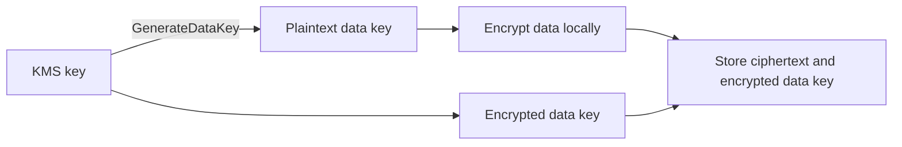

# Encryption and Secrets

> [!info] Why this matters
> [[Domain 1 Design Secure Architectures#Task 1.3|Task 1.3]] tests encryption at rest, encryption in transit, key policies, key rotation and certificate renewal. [[Domain 1 Design Secure Architectures#Task 1.2|Task 1.2]] tests credential security.
>
> **Study time:** about 2.5 hours.

## Encryption in brief

| Type | Protects | AWS tools |
| --- | --- | --- |
| **At rest** | Stored data | KMS backs encryption for EBS, S3, RDS, DynamoDB and others |
| **In transit** | Data moving over a network | TLS, with certificates from ACM |
| **Client-side** | Data before it reaches AWS | The application encrypts, and AWS only sees ciphertext |

| Need | Use |
| --- | --- |
| Simple default for S3 | SSE-S3 |
| Audit key use, control rotation | SSE-KMS |
| Reduce KMS calls | S3 Bucket Key |
| Two layers of encryption | DSSE-KMS |
| AWS must never see plaintext | Client-side encryption |
| Single-tenant hardware | CloudHSM |
| Keys kept outside AWS | External key store |
| Same key across Regions | KMS Multi-Region keys |
| TLS certificates | ACM |

An unencrypted RDS instance or EBS volume cannot be encrypted in place. Copy a snapshot with encryption on, and restore it.

## AWS KMS

**AWS Key Management Service** creates and controls encryption keys, and it integrates with most AWS services. Keys never leave KMS unencrypted, and every use is logged in CloudTrail. That audit trail is one of its main advantages.

### Types of key

| Who controls it | Created by | Rotation | Cost | Can you see or manage it? |
| --- | --- | --- | --- | --- |
| **Customer managed key** | You | Optional, automatic or on demand | Monthly fee per key, plus API calls | Yes. You set the policy |
| **AWS managed key** | AWS, for a service (`aws/service`) | Automatic, yearly | No monthly fee, API calls charged | View only |
| **AWS owned key** | AWS | AWS decides | Free | No |

| Key material | Use |
| --- | --- |
| **Symmetric** (AES-256) | The default, and what AWS services use. A single key encrypts and decrypts, and you must call KMS to use it |
| **Asymmetric** (RSA, ECC) | A public and private key pair. Used for signing, or for encryption outside AWS by users who cannot call KMS |
| **HMAC** | Generating and verifying message authentication codes |

### Rotation

| Key type | Automatic rotation |
| --- | --- |
| AWS managed | Every year, always on |
| Customer managed, symmetric | Optional. Every 365 days by default, with a custom period from 90 to 2,560 days, plus on-demand rotation |
| Imported key material | Not automatic. Import new material on demand, or rotate manually with a new key and an alias |
| Asymmetric and HMAC | No automatic or on-demand rotation |

Rotation keeps old key material, so old data can still be decrypted, and the key ID stays the same.

### Key policies

Every KMS key has a **key policy**, and it is the primary way of controlling access. IAM policies only work if the key policy allows them.

- The **default key policy** gives the account full access, which allows IAM policies to grant use of the key.
- A **custom key policy** can set who administers and who uses the key. It is needed for cross-account access.
- **Grants** give temporary permission to AWS services or principals.
- `kms:ViaService` limits a key to use through a specific service.

If a user with full IAM KMS permissions gets `AccessDenied`, the key policy does not allow it.

**Sharing an encrypted snapshot across accounts:**

1. Encrypt the snapshot with a customer managed key, because AWS managed keys cannot be shared.
2. Add the target account to the key policy, and share the snapshot.
3. In the target account, copy the snapshot, encrypted with a key that account owns.
4. Create a volume from the copy.

### Deleting keys

Keys cannot be deleted at once. There is a mandatory **waiting period of 7 to 30 days**, because deleting a key makes its data permanently unreadable. If a key is compromised, **disable it now**, and schedule deletion later.

### Envelope encryption

KMS can directly encrypt only small amounts of data, up to 4 KB. For anything larger, it uses **envelope encryption**:

1. Ask KMS for a data key. You receive it in plaintext and encrypted form.
2. Encrypt the data locally with the plaintext key, then discard that key.
3. Store the encrypted data key with the ciphertext.
4. To decrypt, ask KMS to decrypt the data key.

This reduces calls to KMS, and allows large data to be encrypted quickly.

KMS has **request quotas per Region**. When services hit them, you get throttling. Fixes include data key caching and [[07 S3 Security and Data Protection#Encryption at rest|S3 Bucket Keys]].

### Regional scope

KMS keys are Regional. To move an encrypted EBS volume to another Region, snapshot it, copy the snapshot to the new Region, re-encrypt it with a key there, and create a volume.

**Multi-Region keys** are identical keys in different Regions, with the same key ID and material. You can encrypt in one Region and decrypt in another, with no re-encryption. They are not global. There is a primary and replicas, and each is managed independently.

Use them with **client-side encryption**, so that clients in each Region can decrypt locally without a cross-Region call.

### Custom key stores

| Option | Keys live in | Use when |
| --- | --- | --- |
| **KMS default** | KMS HSMs | Almost always |
| **CloudHSM key store** | Your CloudHSM cluster | You want KMS integration and single-tenant HSMs |
| **External key store (XKS)** | Your own key manager outside AWS, through a proxy | Keys must stay outside AWS |

**Importing key material** ("bring your own key") lets you supply the key material, and you can delete it on demand.

## AWS CloudHSM

**CloudHSM** provides **single-tenant** hardware security modules in your VPC.

| | AWS KMS | AWS CloudHSM |
| --- | --- | --- |
| Tenancy | Multi-tenant managed service | Single-tenant HSM in your VPC |
| Who controls keys | AWS operates it, you control use | **You alone** |
| FIPS | 140-3 Level 3 HSMs | 140-2 or 140-3 Level 3 in FIPS mode |
| Integration | Most AWS services | Custom key store, or your own applications |
| Effort | Low | High, because you run the cluster |

- Deploy at least two HSMs, across AZs, for availability.
- AWS cannot access your keys. If you lose your credentials, AWS cannot recover them.
- It suits SSL offload, and Oracle Transparent Data Encryption.

> [!warning] An old rule
> Older material says "FIPS 140-2 Level 3 means CloudHSM". KMS HSMs are now validated at FIPS 140-3 Level 3, so that no longer separates them. Look for **single-tenant**, **dedicated hardware** or **exclusive key control**. Older practice questions may still expect CloudHSM on the FIPS wording alone.

## AWS Certificate Manager

**ACM** provisions, manages and deploys TLS certificates.

- Public certificates are free, when used with integrated services.
- It integrates with **ELB, CloudFront and API Gateway**.
- Certificates are Regional. **CloudFront needs them in us-east-1.** API Gateway needs them in us-east-1 for edge-optimised endpoints, and in the API's Region for Regional endpoints.

### Renewal

| Certificate | Renewal |
| --- | --- |
| ACM-issued, DNS validated | **Automatic**, while it is in use |
| ACM-issued, email validated | ACM sends reminders, and you must act |
| **Imported** | **Not renewed.** You must import a new one before it expires |

For imported certificates, ACM sends daily expiry events to EventBridge, starting 45 days before expiry. The AWS Config managed rule `acm-certificate-expiration-check` also flags them.

**AWS Private CA** runs your own private certificate authority, for internal users, devices and services. Its certificates are trusted only inside your organisation.

The **IAM certificate store** holds server certificates in IAM for Regions where ACM is not available. It cannot issue or auto-renew certificates, so prefer ACM.

## Secrets Manager and Parameter Store

Applications should never contain passwords. They should fetch them at runtime, using an IAM role.

| | AWS Secrets Manager | SSM Parameter Store |
| --- | --- | --- |
| Purpose | Secrets | Configuration and secrets |
| **Automatic rotation** | **Yes**, managed or through Lambda | No native rotation |
| Cost | Per secret, per month | Standard tier is free |
| Cross-Region replication | Yes | Parameters are configured per Region |
| Cross-account sharing | Resource policy | Limited |
| Size limit | 64 KB | 4 KB standard, 8 KB advanced |
| Pick for | Database credentials that rotate | App configuration and low-cost strings |

### AWS Secrets Manager

- It can **rotate secrets automatically**, with native integration for RDS, Aurora, Redshift and DocumentDB.
- Rotation is either managed by AWS or done by a Lambda function.
- Secrets are always encrypted with KMS.
- **Replication** keeps read replicas of a secret in other Regions, useful for multi-Region databases. A replica can be promoted to a standalone secret.
- Applications fetch the current value at connection time, so rotation does not need downtime.

### SSM Parameter Store

- Stores configuration and secrets, with IAM-controlled access.
- **SecureString** parameters are encrypted with KMS, at no extra cost on the standard tier.
- **Hierarchies** such as `/prod/db/url` and `/dev/db/url` let you scope IAM by path.
- **Parameter policies** (advanced tier) assign a TTL, to force updating or deleting sensitive data.
- Parameters are versioned, and all access is logged in CloudTrail.

## Exam patterns

| If the question says | Think | Why |
| --- | --- | --- |
| Audit every use of a key | KMS with CloudTrail | |
| Encrypt a 100 MB file with KMS | Envelope encryption | Direct limit is 4 KB |
| A compromised key must be deleted immediately | Disable it. Deletion has a 7 to 30 day wait | |
| User has IAM rights but `AccessDenied` on a key | Key policy | Both must allow |
| Share an encrypted snapshot with another account | Customer managed key and key policy | AWS managed keys cannot be shared |
| Encrypt in one Region, decrypt in another | Multi-Region keys | |
| Rotate yearly under your own control | Customer managed key with rotation | |
| Key material must be yours | Imported key material, or CloudHSM | |
| Single-tenant HSM, exclusive control | CloudHSM | |
| Keys inaccessible even to AWS | CloudHSM | |
| Keys must stay outside AWS | External key store | |
| KMS costs explode on S3 | S3 Bucket Key | |
| Rotate the RDS password every 30 days | Secrets Manager | |
| Store config cheaply | Parameter Store standard | |
| Separate config by environment | Parameter Store hierarchies | |
| Secret shared with another account | Secrets Manager resource policy | |
| Hardcoded password | Secrets Manager and an IAM role | Fetch at runtime |
| Secret must exist in several Regions | Secrets Manager replication | |
| Public TLS certificate for an ALB, auto-renewed | ACM | DNS validation |
| Certificate for CloudFront | ACM in us-east-1 | |
| Imported certificate expired without warning | EventBridge or Config rule | Imported certificates do not renew |
| Internal certificates for private services | AWS Private CA | |

## Check yourself

**1.** A security team must control who can use an encryption key, rotate it yearly, and see a log of each use. Which option fits?

- A. AWS owned key
- B. Customer managed KMS key with rotation enabled
- C. SSE-S3
- D. A key stored in an environment variable

> [!success]- Answer
> **B.** You control the key policy, can enable rotation, and CloudTrail logs each use.

**2.** A user with an IAM policy allowing all KMS actions receives `AccessDenied` when using a customer managed key. What is the likely cause?

- A. The key is in a different AZ
- B. The key policy does not allow it
- C. KMS needs a VPC endpoint
- D. The user needs an access key

> [!success]- Answer
> **B.** Access needs the key policy as well as IAM. With a custom key policy that omits the user or the account, IAM alone is not enough.

**3.** An application must encrypt 500 MB files using KMS. What is the correct approach?

- A. Call the KMS Encrypt API on the file
- B. Use `GenerateDataKey` and encrypt locally
- C. Split the file into 4 KB pieces and call Encrypt on each
- D. Use an AWS owned key directly

> [!success]- Answer
> **B.** Envelope encryption encrypts locally with a data key. KMS Encrypt handles up to 4 KB.

**4.** A customer managed key may have been compromised. What should be done first?

- A. Delete it immediately
- B. Disable it, then investigate
- C. Rotate the alias
- D. Move it to another Region

> [!success]- Answer
> **B.** Deletion has a 7 to 30 day waiting period, and it can make data unreadable. Disabling stops use at once.

**5.** A regulator requires that encryption keys be held on hardware dedicated to the company, with no AWS access to them. What should it use?

- A. AWS KMS default key store
- B. AWS CloudHSM
- C. AWS Secrets Manager
- D. SSE-S3

> [!success]- Answer
> **B.** CloudHSM is single-tenant, and only the customer can access the keys.

**6.** RDS credentials must rotate every 30 days, with no application downtime or custom scheduling code. What should the team use?

- A. Parameter Store standard tier
- B. Secrets Manager with rotation
- C. A text file in S3
- D. A Lambda environment variable

> [!success]- Answer
> **B.** Secrets Manager has built-in rotation for RDS, and applications fetch the current value at runtime.

**7.** An application needs non-sensitive configuration, separated by environment, at the lowest cost. What should it use?

- A. Secrets Manager
- B. Parameter Store with hierarchical paths
- C. KMS
- D. CloudHSM

> [!success]- Answer
> **B.** Standard parameters are free, and paths such as `/prod/` allow IAM scoping.

**8.** A company uses an imported TLS certificate on an ALB, which expired without anyone noticing. How can it avoid this? (Choose two.)

- A. Use an ACM-issued, DNS-validated certificate, which renews automatically
- B. Use an EventBridge rule on ACM expiry events, or the Config expiry rule, for alerts
- C. Move the ALB to another Region
- D. Enable S3 versioning
- E. Use a NAT gateway

> [!success]- Answer
> **A and B.** Imported certificates do not renew. Either switch to an ACM-issued certificate, or get alerts in advance.

**9.** A global app uses DynamoDB global tables and encrypts specific fields on the client. Clients in each Region must decrypt with low latency. Which feature helps?

- A. KMS Multi-Region keys
- B. S3 Bucket Keys
- C. AWS Private CA
- D. SSE-C

> [!success]- Answer
> **A.** Replicated keys let clients decrypt using KMS in their own Region.

---
**Previous:** [[22 Data Lakes and Analytics]] · **Next:** [[24 Threat Protection and Security Services]] · **Plan:** [[Study Guide]]
