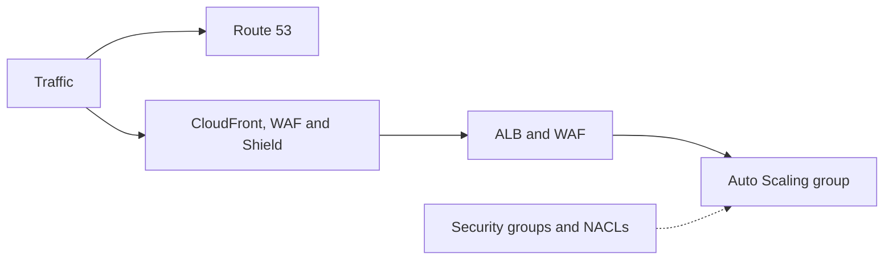
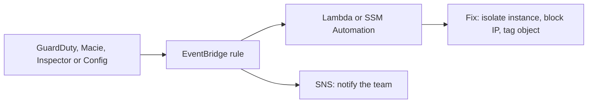

# Threat Protection and Security Services

> [!info] Why this matters
> [[Domain 1 Design Secure Architectures#Task 1.2|Task 1.2]] names threats such as DDoS and SQL injection, and it names GuardDuty, Macie, Shield and WAF. These services sound alike, but each has one clear job. If you can match the job to the name, you will earn easy marks.
>
> **Study time:** about 2 hours.

## Who does what

| Service | One-line job | Trigger words |
| --- | --- | --- |
| **AWS WAF** | Filter malicious web requests at layer 7 | SQL injection, XSS, rate limiting |
| **AWS Shield** | DDoS protection | DDoS, layer 3 and 4, attack cost protection |
| **AWS Firewall Manager** | Apply security rules across an organisation | Across all accounts, including future ones |
| **AWS Network Firewall** | Filter traffic for a whole VPC | Stateful inspection, domain filtering. See [[09 VPC Fundamentals#AWS Network Firewall\|VPC Fundamentals]] |
| **Amazon GuardDuty** | Find threats in logs | Cryptomining, compromised credentials, anomalies |
| **Amazon Inspector** | Find software vulnerabilities | CVEs, patching, ECR images |
| **Amazon Macie** | Find sensitive data in S3 | PII |
| **Amazon Detective** | Find the root cause of a finding | Investigate, root cause |
| **AWS Security Hub** | One view of all findings | Single pane of glass, CIS, PCI DSS checks |
| **AWS Artifact** | Download AWS's compliance reports | SOC, PCI, ISO reports, BAA |

## AWS WAF

**AWS WAF** is a web application firewall at **layer 7**. It can be attached to **CloudFront, ALB, API Gateway, AppSync and Cognito user pools**, among others. It cannot be attached to an NLB or directly to EC2.

A **web ACL** holds rules that are evaluated in priority order.

| Rule type | Use |
| --- | --- |
| **AWS Managed Rules** | Common threats, such as SQL injection and cross-site scripting |
| **IP sets** | Allow or block address ranges |
| **Geo-match** | Act by country |
| **Rate-based rules** | Limit requests per IP. A common defence against layer 7 floods |
| **Rule groups** | Reusable bundles of rules |
| **Bot Control** | Manage bots |

- Rules can inspect IP addresses, HTTP headers, the body and URI strings.
- Rules can **Allow, Block or Count**. Count lets you test a rule without blocking anything.
- Web ACLs are Regional, except for CloudFront, which uses the global scope, in us-east-1.
- WAF Classic reached end of support on 7 October 2026.

To get a fixed IP with WAF on an ALB, put Global Accelerator in front of the ALB, and keep WAF on the ALB.

## AWS Shield

| | Shield Standard | Shield Advanced |
| --- | --- | --- |
| Cost | Free, automatic | $3,000 per month per organisation, plus data transfer fees |
| Protection | Common layer 3 and 4 attacks | Larger attacks, plus layer 7 through WAF |
| Support | None | Shield Response Team, 24/7 (needs Business or Enterprise Support) |
| Cost protection | No | Credits for scaling charges during attacks |
| Protects | All AWS customers | CloudFront, Route 53, ELB, Global Accelerator, Elastic IPs |

Shield Advanced can create and apply WAF rules automatically, to mitigate layer 7 attacks.

## DDoS protection in layers

A design that resists DDoS combines several services.

| AWS best practice area | Technique |
| --- | --- |
| **Edge** | CloudFront and Global Accelerator absorb traffic away from your origin. Route 53 has built-in protection |
| **Application** | WAF filters malicious requests, and CloudFront caches static content |
| **Scale** | ELB and Auto Scaling absorb surges, including flash crowds |
| **Reduce the attack surface** | Hide back-end resources, and use security groups and NACLs. Allow only the load balancer into instances |
| **APIs** | Use edge-optimised endpoints, or CloudFront in front of Regional APIs, with WAF |

## AWS Firewall Manager

**Firewall Manager** applies security rules across all accounts in an organisation. Rules are applied automatically to new accounts and resources, which is good for compliance. It needs Organizations and AWS Config.

It can manage VPC security groups, WAF rules, Shield Advanced protections, Network Firewall and Route 53 Resolver DNS Firewall.

## Amazon GuardDuty

**GuardDuty** is an intelligent threat detection service. It uses machine learning, anomaly detection and threat intelligence, with **no agents and no impact on performance**.

Its foundational data sources are:

- **CloudTrail management events:** unusual API calls and unauthorised deployments
- **VPC Flow Logs:** unusual traffic and known bad IP addresses
- **Route 53 Resolver DNS query logs:** for example, compromised instances sending data inside DNS queries

Optional protection plans extend it to S3 data events, EKS audit logs, EBS malware scanning, RDS login activity, Lambda network activity and runtime monitoring.

Findings can go to **EventBridge**, which can trigger Lambda or SNS. It is good at detecting **cryptocurrency mining** and compromised credentials.

GuardDuty detects threats. It does not block them. To respond automatically, use an EventBridge rule that runs a remediation.

## Amazon Inspector

**Amazon Inspector** continuously scans workloads for software vulnerabilities (CVEs) and unintended network exposure.

| Target | How it scans |
| --- | --- |
| **EC2 instances** | Through the Systems Manager agent, or agentless. Checks OS vulnerabilities and network reachability |
| **ECR container images** | As they are pushed |
| **Lambda functions** | Function code and package dependencies, as they are deployed |

Findings go to Security Hub and EventBridge. Inspector Classic shut down on 20 May 2026, so everything here refers to the current version.

## Amazon Macie

**Macie** uses machine learning and pattern matching to find sensitive data, such as personally identifiable information (PII), in **S3 buckets**. It can run automated discovery across your buckets, or one-off and recurring jobs. Findings go to EventBridge and Security Hub.

## Amazon Detective

**Detective** analyses and visualises security data to find the **root cause** of a finding. It builds a graph from CloudTrail, VPC Flow Logs and GuardDuty data. GuardDuty detects, and Detective investigates.

## AWS Security Hub

**Security Hub** gathers findings from GuardDuty, Inspector, Macie and partner tools into one view, and it checks accounts against standards such as CIS, PCI DSS, NIST and AWS Foundational Security Best Practices. AWS now calls the posture management product **AWS Security Hub CSPM**. The exam guide says AWS Security Hub. It needs AWS Config for most of its checks. Findings can trigger EventBridge rules for automated response.

## AWS Artifact

**Artifact** is a self-service portal for AWS's own compliance reports, such as SOC and PCI, and for agreements such as a Business Associate Addendum. Pick it whenever a question asks for proof of **AWS's** compliance. AWS Config, by contrast, checks **your** resources.

## Automating a response

Detection services find problems, and EventBridge connects them to a fix. The exam likes this pattern because it needs no one to be watching.

| Finding | Automated response |
| --- | --- |
| GuardDuty reports a compromised instance | Lambda replaces its security group with one that allows no traffic, and takes a snapshot for forensics |
| GuardDuty reports a bad IP | Lambda adds it to a WAF IP set or a NACL |
| Macie finds PII in a bucket | Lambda moves the object to a restricted bucket |
| Config finds an open security group | SSM Automation removes the rule |
| Inspector finds a critical CVE | Systems Manager patches the instance |

## Compliance in practice

"Aligning AWS technologies to meet compliance requirements" in [[Domain 1 Design Secure Architectures#Task 1.3|Task 1.3]] usually means combining services.

| Requirement | Services |
| --- | --- |
| Prove AWS's compliance to an auditor | Artifact |
| Continuously check your own configuration | AWS Config, Security Hub |
| Record who did what | CloudTrail |
| Find sensitive data | Macie |
| Keep data unchangeable | S3 Object Lock, Backup Vault Lock |
| Keep data in a country | Region choice, SCP on Regions |
| Encrypt everything | KMS, ACM |

## Exam patterns

| If the question says | Think | Why |
| --- | --- | --- |
| Block SQL injection on an app behind an ALB | WAF on the ALB | Layer 7 |
| Limit each IP to 2,000 requests in 5 minutes | WAF rate-based rule | |
| Test a rule without blocking | WAF Count mode | |
| WAF on an NLB | Not possible | Use an ALB or CloudFront |
| Fixed IP plus WAF | Global Accelerator in front of the ALB | |
| Free protection from common DDoS attacks | Shield Standard | |
| Expert help and refunds for attack costs | Shield Advanced | |
| WAF rules across 50 accounts, including future ones | Firewall Manager | |
| Find PII in S3 | Macie | |
| Cryptomining or compromised credentials | GuardDuty | No agents |
| Scan for CVEs on EC2, ECR and Lambda | Inspector | |
| One view of all security findings | Security Hub | |
| Root cause of a finding | Detective | |
| Auditor wants AWS's SOC 2 report | Artifact | |
| Check your own config against CIS | Security Hub | Or Config |
| React to a GuardDuty finding automatically | EventBridge rule | |

## Check yourself

**1.** An application behind an ALB is being targeted with SQL injection. What should the architect add?

- A. AWS Shield Standard
- B. AWS WAF on the ALB, with managed rules
- C. Amazon Inspector
- D. A larger instance

> [!success]- Answer
> **B.** WAF inspects HTTP requests at layer 7. Shield focuses on DDoS.

**2.** A company suffered a major DDoS attack, and it wants expert help during attacks and protection from the scaling costs. What should it use?

- A. Shield Standard
- B. Shield Advanced
- C. GuardDuty
- D. Network ACLs

> [!success]- Answer
> **B.** Shield Advanced adds the response team and cost protection.

**3.** A company wants to make sure WAF rules apply to all ALBs in 50 accounts, including accounts created later. What should it use?

- A. AWS Config alone
- B. AWS Firewall Manager
- C. IAM policies
- D. AWS Artifact

> [!success]- Answer
> **B.** Firewall Manager centrally applies rules across the organisation.

**4.** A security team must identify buckets that contain personal data, such as passport numbers. Which service fits?

- A. Amazon Inspector
- B. Amazon Macie
- C. Amazon GuardDuty
- D. AWS Shield

> [!success]- Answer
> **B.** Macie finds sensitive data in S3.

**5.** The team wants an alert if an EC2 instance starts cryptocurrency mining, with no agents. Which service fits?

- A. Amazon GuardDuty
- B. Amazon Inspector
- C. AWS Config
- D. Amazon Macie

> [!success]- Answer
> **A.** GuardDuty analyses Flow Logs and DNS logs to detect this.

**6.** A team must continuously scan EC2 instances and container images for known software vulnerabilities. Which service fits?

- A. Amazon Detective
- B. Amazon Inspector
- C. AWS Trusted Advisor
- D. AWS Artifact

> [!success]- Answer
> **B.** Inspector scans for CVEs on EC2, ECR and Lambda.

**7.** After a GuardDuty finding, an analyst needs to investigate what led to it, and what else was involved. Which service fits best?

- A. Amazon Detective
- B. AWS Security Hub
- C. AWS WAF
- D. AWS Artifact

> [!success]- Answer
> **A.** Detective builds a graph to help find the root cause.

**8.** An auditor asks for evidence of AWS's PCI DSS compliance. Where does the company get it?

- A. AWS Config
- B. AWS Artifact
- C. CloudTrail
- D. Security Hub

> [!success]- Answer
> **B.** Artifact provides AWS's compliance reports.

**9.** Which combination gives the strongest protection for a global public web app against DDoS and web attacks? (Choose two.)

- A. CloudFront in front of the application
- B. WAF on the CloudFront distribution
- C. Public IPs on all instances
- D. Open security groups for faster access
- E. A single large instance

> [!success]- Answer
> **A and B.** CloudFront absorbs traffic at the edge with Shield Standard, and WAF filters malicious requests.

---
**Previous:** [[23 Encryption and Secrets]] · **Next:** [[25 Monitoring and Auditing]] · **Plan:** [[Study Guide]]
