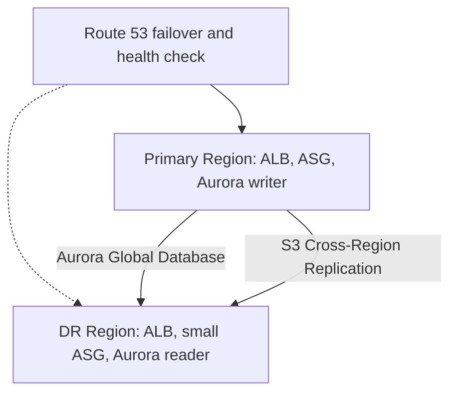

# High Availability and Disaster Recovery

> [!info] Why this matters
> [[Domain 2 Design Resilient Architectures#Task 2.2|Task 2.2]] is about surviving failure, and the DR strategy names are given in the exam guide itself. Expect questions that give you an RPO, an RTO and a budget, and ask for a strategy.
>
> **Study time:** about 2.5 hours.

## RPO and RTO

| Term | Question | Measured back from |
| --- | --- | --- |
| **Recovery point objective (RPO)** | How much **data** can we lose? | The moment of the failure, looking backwards |
| **Recovery time objective (RTO)** | How long can we be **down**? | The moment of the failure, looking forwards |

An hourly backup gives an RPO of up to one hour. Lower numbers cost more.

## Disaster recovery strategies

| Strategy | RPO and RTO | Cost | What runs in the DR Region |
| --- | --- | --- | --- |
| **Backup and restore** | Hours | Lowest | Backups only |
| **Pilot light** | Tens of minutes | Low | Core data replication. Compute is off |
| **Warm standby** | Minutes | Higher | A scaled-down but working copy |
| **Multi-site active-active** | Near zero | Highest | The full stack, serving traffic |

Moving right lowers RPO and RTO, and raises cost.

- **Backup and restore:** data is backed up to AWS, and the environment is rebuilt from code after a disaster. It suits non-critical systems.
- **Pilot light:** like a pilot light in a boiler, the critical core, such as replicated data, is always on, and the rest is started when needed. Servers are off or not yet created.
- **Warm standby:** a smaller, fully functional copy runs all the time, and it scales up to production size on failover.
- **Multi-site active-active:** both sites serve traffic at the same time. There is no real "recovery".

**To tell pilot light from warm standby:** in pilot light, the application servers are **not running**. In warm standby, they **are running**, at a smaller size.

The right strategy is the cheapest one that meets the RPO and RTO. A question that gives an RTO of a few minutes rules out backup and restore, and it may rule out pilot light too. A question with "hours of downtime acceptable" and "lowest cost" means backup and restore.

### Building blocks for each layer

| Layer | Within a Region | Across Regions |
| --- | --- | --- |
| DNS and routing | Elastic Load Balancing | Route 53 failover, Global Accelerator |
| Compute | Auto Scaling across AZs | AMIs copied, or an ASG in the second Region |
| Relational data | RDS Multi-AZ, Aurora | Cross-Region read replicas, Aurora Global Database |
| NoSQL data | DynamoDB is Multi-AZ by default | DynamoDB global tables |
| Objects | S3 is Multi-AZ by default | Cross-Region Replication |
| Files | EFS Regional, FSx Multi-AZ | EFS Replication, FSx replication or backups |
| Block | Snapshots | Snapshot copies |
| Backups | AWS Backup | Cross-Region copy |

### Multi-Region active-passive

### Quotas in a standby Region

Service quotas are per Region. A standby Region starts with default limits, so raise them **before** a disaster. For example, an Auto Scaling group that must grow to 200 instances needs the EC2 quota in that Region to allow it. Do not rely on getting an increase during an event.

The same applies to anything else a failover depends on: AMIs, KMS keys, Secrets Manager replicas, and ACM certificates must all exist in the DR Region.

### Choosing from an RPO and RTO

| RPO | RTO | Budget | Likely strategy | Likely data services |
| --- | --- | --- | --- | --- |
| Hours | Hours or a day | Low | Backup and restore | AWS Backup, S3 CRR |
| Minutes | Tens of minutes | Moderate | Pilot light | Cross-Region replica or Aurora Global Database |
| Seconds | Minutes | Higher | Warm standby | Aurora Global Database, DynamoDB global tables |
| Near zero | Near zero | Highest | Active-active | DynamoDB global tables |

### Failover mechanisms

| Mechanism | Speed | Depends on |
| --- | --- | --- |
| Load balancer health checks | Seconds | Targets in other AZs |
| RDS Multi-AZ | About a minute or two | DNS flip |
| Aurora replica promotion | Under 60 seconds, often under 30 | A replica existing |
| Route 53 failover | Minutes, including the TTL | Health checks and client caching |
| Global Accelerator | Usually under a minute | Health checks, no DNS change |
| Application Recovery Controller | Fast, and under your control | Routing controls set up in advance |

### Test your recovery

A plan that has never been run is only a theory. The Reliability pillar says to test recovery procedures. Run scheduled drills, and practise failing over and back.

## Removing single points of failure

Check each layer for one thing whose loss stops the workload.

| Layer | Fix |
| --- | --- |
| One instance | Auto Scaling across AZs behind a load balancer |
| One database | RDS Multi-AZ or Aurora |
| One NAT gateway | One per AZ, or a regional NAT gateway |
| One VPN or Direct Connect link | A second link, or a VPN backup |
| One Region | A DR strategy from above |

**Static stability:** a design that keeps working during a failure without needing to make changes is more reliable. For example, run enough capacity in each AZ to absorb the loss of one AZ. A group in 3 AZs with capacity for 100% in any 2 survives losing one, without needing to launch anything.

## Distributed design patterns

The exam guide lists "distributed design patterns" and "failover strategies". These are the ones to know.

| Pattern | What it does | On AWS |
| --- | --- | --- |
| **Retry with backoff and jitter** | Avoids overwhelming a struggling service | SDK defaults, Step Functions `Retry` |
| **Idempotency** | Processing twice has no extra effect | Needed for SQS standard consumers |
| **Queue-based load levelling** | Absorbs spikes | SQS |
| **Fan-out** | Sends one event to many | SNS to SQS |
| **Timeouts** | Stops waiting on a failed dependency | Set in clients, and on Lambda |
| **Circuit breaker** | Stops calling something that keeps failing | Application logic |
| **Health checks** | Remove failed targets automatically | ELB, Route 53 |
| **Graceful degradation** | Keeps core functions when a dependency fails | Serve cached content |

## Making legacy applications more reliable

The exam guide asks about improving reliability "when application changes are not possible". You can add resilience around an application without touching it.

| Problem | Service | No code change because |
| --- | --- | --- |
| Single EC2 instance fails | Auto Scaling group with a minimum of 1, or automatic recovery | It replaces the instance |
| Single database | RDS Multi-AZ | DNS flips on failover |
| Database connections and failover time | RDS Proxy | The app connects to the proxy |
| Files on a local disk | EFS or FSx | Mounted like a normal file system |
| Fixed IP needed | Global Accelerator, or an NLB | Static entry point |
| TLS handling on old servers | Terminate at an ALB | The app stays HTTP |
| Web attacks | WAF on an ALB or CloudFront | Filtered before the app |
| Slow reads | CloudFront or a read replica | Sits in front, or a small config change |

## AWS Backup

**AWS Backup** centrally manages and automates backups across services, with no custom scripts.

- **Backup plans** set frequency, retention, and lifecycle to cold storage.
- It supports EC2, EBS, S3, EFS, FSx, RDS, Aurora, DynamoDB, DocumentDB, Neptune, Redshift, Storage Gateway volumes, Timestream and VMware, among others.
- It supports on-demand and scheduled backups, and point-in-time recovery for some services.
- Resources are added to a backup plan by tag or by resource ID, so tagging resources is how new ones are picked up automatically. Continuous backups of S3 can restore to any point in time within the last 35 days, while periodic backups can be kept indefinitely.
- **Cross-Region backup** copies to another Region for disaster recovery.
- **Cross-account backup** copies to a central vault, which protects against a compromised account. Copy support varies by resource type.
- **AWS Organizations** backup policies apply plans across accounts.

**Backup Vault Lock** enforces write-once-read-many on backups.

| Mode | Who can remove it |
| --- | --- |
| **Compliance** | Nobody after the grace period, not even root |
| **Governance** | Users with sufficient IAM permissions |

**Logically air-gapped vaults** add isolation, and can be shared across accounts for recovery.

### Backup strategy

| Requirement | Choice |
| --- | --- |
| Central backups across services | AWS Backup |
| Backups that nobody can delete | Vault Lock, compliance mode |
| Survive a Region outage | Cross-Region copy |
| Survive a compromised account | Cross-account copy |
| Long-term, low-cost retention | Lifecycle to cold storage, or S3 Glacier classes |
| Snapshot frequency | Set from the RPO. An RPO of 1 hour needs backups at least hourly, or continuous backup |

## AWS Elastic Disaster Recovery

**Elastic Disaster Recovery (DRS)** continuously replicates servers into a low-cost staging area in AWS, and it launches them within minutes during a disaster. It gives a pilot-light style setup, with an RPO of seconds, for on-premises or cloud servers. It supports point-in-time recovery, drills and failback. It is not on the in-scope list, but it is the best-fit name for "cost-effective DR for on-premises servers".

## Exam patterns

| If the question says | Think | Why |
| --- | --- | --- |
| Maximum data loss | RPO | |
| Maximum downtime | RTO | |
| Cheapest DR, hours of downtime acceptable | Backup and restore | |
| RTO of 10 minutes, RPO of seconds, reasonable cost | Warm standby | |
| Database replicated, EC2 launched only in a disaster | Pilot light | |
| Survive a Region failure with no downtime or data loss | Multi-site active-active | |
| Central backups of EBS, RDS and DynamoDB | AWS Backup | |
| Backups must be undeletable | Vault Lock compliance mode | |
| Cost-effective DR for 200 on-premises servers | Elastic Disaster Recovery | |
| Relational RPO about 1 second across Regions | Aurora Global Database | |
| NoSQL active-active across Regions | DynamoDB global tables | |
| Route users to the standby automatically | Route 53 failover | |
| Failover must not depend on DNS caching | Global Accelerator | |
| Standby cannot launch enough instances | Quotas in that Region | |
| Improve reliability with no code change | RDS Multi-AZ, RDS Proxy, ASG, ALB | |
| Keep working if an AZ fails, without scaling | Static stability | Spare capacity in each AZ |

## Check yourself

**1.** An application has an RPO of 1 hour and an RTO of 24 hours, and the company wants the lowest possible DR cost. Which strategy fits?

- A. Backup and restore
- B. Pilot light
- C. Warm standby
- D. Multi-site active-active

> [!success]- Answer
> **A.** Those relaxed targets can be met by hourly backups and rebuilding when needed.

**2.** A company replicates its database to a second Region at all times. Application servers are defined as AMIs, and are launched only if there is a disaster. Which strategy is this?

- A. Backup and restore
- B. Pilot light
- C. Warm standby
- D. Multi-site

> [!success]- Answer
> **B.** The core data is live, and the compute is off.

**3.** An application has an RTO of 5 minutes and an RPO of seconds. Budget matters, but users must not wait for servers to be built. Which strategy fits best?

- A. Backup and restore
- B. Pilot light
- C. Warm standby
- D. Manual rebuild from templates

> [!success]- Answer
> **C.** A running scaled-down copy can take traffic in minutes. Active-active would work too, but it costs more.

**4.** A bank must keep all backups for seven years, with protection against deletion even by an administrator. What should it use?

- A. AWS Backup with Vault Lock in compliance mode
- B. AWS Backup with governance mode
- C. Manual snapshots
- D. S3 Standard

> [!success]- Answer
> **A.** Once the grace period ends, compliance mode cannot be removed by anyone.

**5.** During a DR test, an Auto Scaling group in the second Region fails to reach its desired size, with a limit error. The same size works in the primary Region. What should the team do?

- A. Raise the service quotas in the second Region before any failover
- B. Use a smaller AMI
- C. Change the RTO
- D. Use a NAT gateway

> [!success]- Answer
> **A.** Quotas are per Region, and must be raised in advance.

**6.** A legacy application cannot be changed. Which additions improve its reliability without any code changes? (Choose two.)

- A. Put the database on RDS Multi-AZ
- B. Run the instance in an Auto Scaling group with a minimum of 1, behind an ALB
- C. Rewrite the app as microservices
- D. Add retry logic in the code
- E. Move to Lambda

> [!success]- Answer
> **A and B.** Both add resilience around the application.

**7.** A company wants a design that keeps full capacity if an AZ fails, without launching anything during the failure. It runs in three AZs. What should it do?

- A. Run enough instances in each AZ that any two can carry the full load
- B. Run all instances in one AZ
- C. Use Spot Instances only
- D. Rely on Auto Scaling to replace capacity

> [!success]- Answer
> **A.** This is static stability. Scaling takes time, and it may be affected by the same event.

**8.** Which pair of services gives the lowest RPO for relational and NoSQL data, across Regions? (Choose two.)

- A. Aurora Global Database
- B. DynamoDB global tables
- C. Daily snapshots
- D. S3 Standard-IA
- E. RDS Multi-AZ

> [!success]- Answer
> **A and B.** Multi-AZ works within one Region, and daily snapshots give an RPO of up to a day.

---
**Previous:** [[27 Migration and Data Transfer]] · **Next:** [[29 Cost Optimisation]] · **Plan:** [[Study Guide]]
