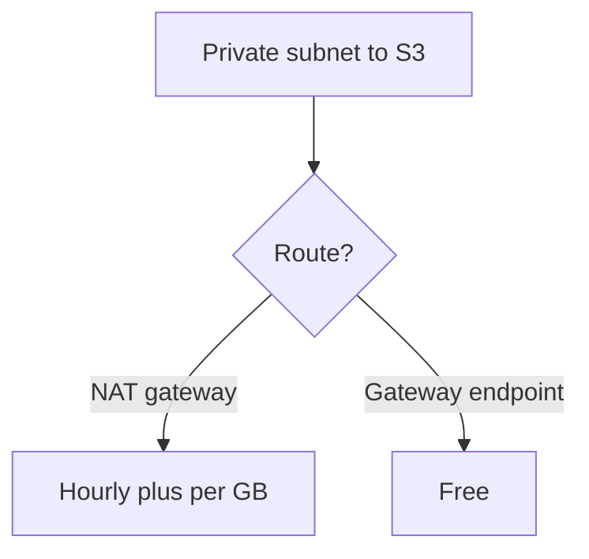

# Cost Optimisation

> [!info] Why this matters
> [[Domain 4 Design Cost-Optimized Architectures|Domain 4]] is 20% of the exam, and "most cost-effective" appears in questions in every domain. This chapter pulls the cost levers together, so that you can see them in one place.
>
> **Study time:** about 3 hours.

## How to think about cost

The right answer is the **cheapest option that meets every requirement**. An option that is cheaper but breaks a requirement is wrong. Read the requirements first, remove the options that fail them, and only then compare prices.

Cost has four main levers:

1. **Use less:** rightsizing, scaling down, deleting unused resources.
2. **Pay less for the same thing:** Savings Plans, Reserved Instances, Spot.
3. **Use a cheaper type:** storage tiers, Graviton, serverless.
4. **Move data less:** VPC endpoints, caching, same-AZ traffic.

## Cost tools

| Tool | Job | Trigger words |
| --- | --- | --- |
| **AWS Cost Explorer** | Visualise and analyse spending, forecast, get RI and Savings Plan recommendations | "Analyse", "forecast", "which service" |
| **AWS Budgets** | Alerts on actual or forecasted cost and usage | "Notify at 80% of budget" |
| **Cost and Usage Report** | The most detailed billing data | "Line items", "SQL" |
| **Cost Anomaly Detection** | Machine learning finds unusual spending, with no thresholds | "Unexpected spikes" |
| **Cost allocation tags** | Group costs by team or project | "Chargeback" |
| **Compute Optimizer** | Rightsizing recommendations | "Overprovisioned" |
| **Trusted Advisor** | Finds idle resources | "Unattached Elastic IPs" |
| **Pricing Calculator** | Estimates cost **before** you build | "Estimate" |
| **Consolidated billing** | One bill, volume discounts, shared RIs | "Organisation" |
| **Cost categories** | Group costs by your own business rules | "Map costs to teams" |
| **Billing Conductor** | Custom billing views, for internal chargeback or resale | "Custom rates" |

### AWS Cost Explorer

Cost Explorer visualises costs and usage over time, and lets you build custom reports. It can forecast usage up to 12 months ahead, based on previous usage, and it recommends a Savings Plan commitment based on your history.

### AWS Budgets

Budgets set targets for cost, usage, or for RI and Savings Plan utilisation and coverage. They alert when **actual or forecasted** values cross a threshold. **Budget actions** can respond automatically, for example by applying an IAM policy that denies provisioning, and they can apply SCPs or stop instances. Budget information updates up to three times a day, so it is not real time.

### Cost and Usage Report

The **CUR** is the most detailed billing data available, down to hourly line items. It is delivered to S3, now through AWS Data Exports, and it can be queried with **Athena**, or loaded into Redshift or Amazon Quick.

### Cost Anomaly Detection

It monitors costs with machine learning, and learns your normal pattern, so that you do not need to set thresholds. It reports root causes, and it notifies through SNS. It can monitor services, accounts, tags or cost categories.

### Cost allocation tags

Tags activated in the Billing console appear in cost reports, so that spending can be grouped by team or project. **Activate them first.** They do not apply to past costs. Combine them with consolidated billing for multi-account views.

### AWS Compute Optimizer

**Compute Optimizer** uses machine learning on CloudWatch history to recommend sizes for EC2 instances, Auto Scaling groups, EBS volumes, Lambda functions and ECS on Fargate.

### AWS Pricing Calculator

Estimates the cost of an architecture before you build it. Cost Explorer analyses what you have already spent.

## How services charge

Knowing what you pay for tells you how to pay less.

| Service | You pay for |
| --- | --- |
| EC2 | Running time, by instance type |
| EBS | Provisioned GB, plus any extra IOPS and throughput on gp3, and snapshots |
| S3 | GB stored, requests, retrievals, and data transfer out |
| EFS | GB used, plus throughput or data access charges in some modes |
| Lambda | Requests and GB-seconds |
| Fargate | vCPU and memory per second |
| DynamoDB | Requests or provisioned capacity, plus storage |
| RDS | Instance hours, storage, I/O on some types, and backups beyond the free allowance |
| Aurora | Instance hours, storage, and I/O unless using I/O-Optimized |
| NAT gateway | Hours and GB processed |
| ALB and NLB | Hours and load balancer capacity units |
| Transit Gateway | Attachment hours and GB processed |
| Interface endpoints | Hours per AZ and GB processed |
| Direct Connect | Port hours and data transfer out |
| CloudFront | Requests and data transfer out, or a flat-rate plan |
| Kinesis Data Streams | Shard hours or stream hours, and data |
| Athena | Data scanned |

## Compute costs

| Lever | Use when |
| --- | --- |
| **Savings Plans or RIs** | Steady, long-term use. See [[04 Amazon EC2#Purchasing options\|purchasing options]] |
| **Spot** | Interruptible work |
| **Rightsize** | CPU or memory is under-used |
| **Graviton** | The software runs on Arm |
| **Auto Scaling** | Demand varies |
| **Scheduled stops** | Dev environments that are idle overnight |
| **Hibernate** | Long start-up times, and idle periods |
| **Fargate or Lambda** | Spiky or low-use workloads |
| **Containers** | Better utilisation of each host |

### Load balancer costs

Choose the simplest load balancer that meets the need. An ALB is right for HTTP routing, and an NLB for TCP or static IPs. Do not add a load balancer that a Lambda function URL could replace. Cross-zone traffic is charged on NLB and GWLB if enabled.

### Availability for each class of workload

Task 4.2 asks about the "required availability for different classes of workloads". Do not pay for resilience that a workload does not need.

| Workload | Reasonable design |
| --- | --- |
| Production, critical | Multi-AZ, On-Demand or Savings Plan base, possibly multi-Region |
| Production, internal | Multi-AZ, Savings Plans |
| Non-production | Single-AZ, stopped out of hours, Spot where possible |
| Batch and analysis | Spot, with retries |

## Storage costs

| Service | Lever |
| --- | --- |
| **S3** | Lifecycle rules, Intelligent-Tiering, deleting incomplete multipart uploads, Requester Pays |
| **S3 access** | S3 Gateway Endpoint rather than NAT |
| **EBS** | gp3 instead of gp2, deleting unattached volumes and old snapshots, Snapshot Archive |
| **EFS** | Lifecycle to Infrequent Access and Archive, One Zone where acceptable |
| **FSx** | HDD for general storage, ONTAP tiering, Lustre Scratch for short-term work |
| **Backups** | Retention that matches requirements, and lifecycle to cold storage |

**Batch uploads** to S3 are cheaper and more efficient than very large numbers of small individual requests, because S3 charges per request. Group small objects before uploading.

**Choosing a storage size:** provision EBS for what you need, because you pay for what you provision. Use auto scaling for storage where the growth is unknown: RDS Storage Auto Scaling, EFS and S3 grow automatically.

## Database costs

| Lever | Use when |
| --- | --- |
| **Database Savings Plans or RIs** | Steady use |
| **Aurora Serverless v2 or DynamoDB on-demand** | Spiky or idle workloads |
| **DynamoDB provisioned with auto scaling** | Steady traffic |
| **DynamoDB Standard-IA table class** | Tables that hold a lot of rarely read data |
| **ElastiCache or DAX** | Repeated reads, allowing a smaller database |
| **Read replicas** | Offload reads, instead of a bigger primary |
| **RDS Proxy** | Reuse connections, instead of a larger instance |
| **Aurora I/O-Optimized** | I/O is 25% or more of Aurora spend |
| **Snapshots** | Delete old ones. Snapshot and delete unused databases |
| **Open-source engines** | Move away from commercial licences, using DMS and SCT |
| **Redshift or Athena** | Columnar analytics, rather than running them on OLTP |
| **Timestream** | Time-series data |

## Network costs

Data transfer is the cost that surprises people most. These rules cover most questions.

| Traffic | Cost |
| --- | --- |
| Into AWS from the internet | Generally free |
| Out to the internet | Most expensive |
| Within one AZ over private IPs | Generally free |
| Between AZs | Charged each way |
| Between Regions | Charged |
| AWS origin to CloudFront | Free |
| To S3 or DynamoDB through a gateway endpoint | Free |

Ways to reduce network cost:

- Use **gateway endpoints** for S3 and DynamoDB, in place of NAT.
- Use **interface endpoints** when NAT traffic to other AWS services is high.
- Keep **chatty traffic in one AZ**, where availability allows.
- Use **private IPs** rather than public IPs between instances.
- Use **CloudFront** to serve content, which reduces origin data transfer.
- Use **Direct Connect** for large, steady transfers.
- Use a **NAT gateway per AZ**, to avoid cross-AZ charges on NAT traffic.
- Keep traffic **in one Region** where you can.
- Remember that **public IPv4 addresses** have an hourly charge.

### Connection choices

| Option | Cost profile |
| --- | --- |
| VPC peering | No hourly charge, only data transfer. Best for a few VPCs |
| Transit Gateway | Per attachment per hour, plus per GB |
| Site-to-Site VPN | Per connection per hour, plus data transfer |
| Direct Connect | Port hours plus data transfer out, at lower rates |
| PrivateLink | Per hour plus per GB |

Choosing bandwidth: a single VPN gives 1.25 Gbps per tunnel. Multiple VPNs with ECMP on Transit Gateway add up. Direct Connect speeds step from 50 Mbps to 400 Gbps, so choose what you need, and scale later.

**Throttling** also controls cost: API Gateway usage plans and WAF rate limits stop clients driving up usage.

## A checklist for any cost question

1. Is anything running that does not need to be? Stop it, or schedule it.
2. Is it the right size? Rightsize it.
3. Is the use steady? Commit to it.
4. Can it be interrupted? Use Spot.
5. Is data going where it needs to? Tier it, and add lifecycle rules.
6. Is traffic crossing AZs, Regions or NAT? Reroute it.
7. Could a managed or serverless service replace it? Compare the total cost.

## Exam patterns

| If the question says | Think | Why |
| --- | --- | --- |
| Notify when forecasted spend reaches 80% | AWS Budgets | |
| Attribute costs to teams | Cost allocation tags | Activate them first |
| Most granular billing data, with SQL | CUR and Athena | |
| Overprovisioned EC2, sizing advice | Compute Optimizer | |
| Unexpected spikes, no thresholds | Cost Anomaly Detection | |
| Which service raised the bill, plus a forecast | Cost Explorer | |
| How much Savings Plan to buy | Cost Explorer recommendations | |
| Estimate a new architecture | Pricing Calculator | |
| One bill, shared RIs | Consolidated billing | |
| Idle resources and unattached Elastic IPs | Trusted Advisor | |
| Automatically stop provisioning at a budget limit | Budget action | |
| S3 traffic through NAT is expensive | Gateway endpoint | |
| Reduce data transfer out for global users | CloudFront | |
| Reduce cross-AZ charges | Same-AZ traffic, NAT per AZ | |
| Spiky database | Aurora Serverless or DynamoDB on-demand | |
| Steady database, long term | Reserved or Database Savings Plan | |

## Check yourself

**1.** Finance wants an email when forecasted monthly spending will exceed $10,000. What should it use?

- A. Cost Explorer
- B. AWS Budgets
- C. CloudTrail
- D. Trusted Advisor

> [!success]- Answer
> **B.** Budgets alert on actual or forecasted thresholds.

**2.** Analysts need line-item billing data at hourly detail, and they want to query it with SQL. What should they use?

- A. Cost and Usage Report with Athena
- B. Budgets
- C. Cost Explorer only
- D. CloudWatch

> [!success]- Answer
> **A.** The CUR is the most detailed, and Athena queries it in S3.

**3.** A company wants to charge each department for its own AWS use. All resources sit in a single account. What should it do?

- A. Create a Savings Plan
- B. Apply and activate cost allocation tags
- C. Create a new VPC
- D. Use Compute Optimizer

> [!success]- Answer
> **B.** Activated tags let you group costs by department in reports.

**4.** EC2 instances in private subnets send large volumes to DynamoDB through a NAT gateway. What is the best way to reduce cost?

- A. Add a DynamoDB gateway endpoint
- B. Use a larger NAT gateway
- C. Move to a public subnet with public IPs
- D. Use Direct Connect

> [!success]- Answer
> **A.** Gateway endpoints are free and remove the NAT processing charge.

**5.** Instances in two AZs exchange heavy traffic. Availability is not critical for this batch system. What is the simplest way to lower data transfer costs?

- A. Place them in the same AZ
- B. Use public IPs
- C. Use a NAT gateway
- D. Add a load balancer

> [!success]- Answer
> **A.** Traffic in one AZ over private IPs is generally free.

**6.** A company's dev and test instances run around the clock, but they are used only during office hours. What gives the largest quick saving?

- A. Stop them outside office hours with a schedule
- B. Buy three-year RIs
- C. Move them to larger instances
- D. Enable detailed monitoring

> [!success]- Answer
> **A.** Stopping unused compute removes the cost. RIs would commit you to paying for idle hours.

**7.** Which tool would recommend moving an m5.2xlarge with low CPU to a smaller size?

- A. AWS Compute Optimizer
- B. AWS Artifact
- C. AWS Budgets
- D. Amazon Macie

> [!success]- Answer
> **A.** It uses machine learning on historical metrics to recommend sizes.

**8.** A global company serves large static files directly from S3 and pays high data transfer charges. What is likely to help most?

- A. Use CloudFront in front of S3
- B. Move to S3 One Zone-IA
- C. Use a NAT gateway
- D. Enable versioning

> [!success]- Answer
> **A.** Transfer from S3 to CloudFront is free, and CloudFront's data-out pricing is lower.

**9.** A company's bill rose suddenly last week, and it does not know why. Which tools help it find the cause? (Choose two.)

- A. AWS Cost Explorer
- B. AWS Cost Anomaly Detection
- C. AWS Certificate Manager
- D. Amazon Inspector
- E. AWS Direct Connect

> [!success]- Answer
> **A and B.** Cost Explorer breaks spending down by service, and Anomaly Detection reports likely root causes.

---
**Previous:** [[28 High Availability and Disaster Recovery]] · **Next:** [[30 Machine Learning Services]] · **Plan:** [[Study Guide]]
