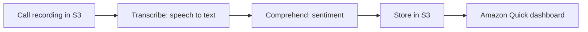

# Machine Learning Services

> [!info] Why this matters
> You will not build models on this exam. You only need to match a business need to a service. [[Domain 2 Design Resilient Architectures#Task 2.2|Task 2.2]] even gives Comprehend and Polly as examples of managed services. A few minutes with this page can earn easy marks.
>
> **Study time:** about 45 minutes.

## In-scope services

The memory aid is to think about what goes in and what comes out.

| Service | Input | Output | Example |
| --- | --- | --- | --- |
| **Amazon Rekognition** | Images, video | Objects, people, text, faces | Moderate user uploads, facial verification |
| **Amazon Textract** | Scanned documents | Text, forms, tables | Extract fields from invoices |
| **Amazon Transcribe** | Speech | Text | Subtitles, call transcripts |
| **Amazon Polly** | Text | Speech | Applications that talk |
| **Amazon Translate** | Text | Translated text | Localise a website |
| **Amazon Comprehend** | Text | Meaning: sentiment, key phrases, entities, topics | Analyse customer reviews |
| **Amazon Lex** | Speech or text from users | A conversation | Chatbots, call centre bots |
| **Amazon SageMaker AI** | Your data | Your own custom model | Build, train and deploy ML |

### More detail

**Amazon Rekognition** finds objects, people, text and scenes in images and videos. It supports facial analysis and facial search, for user verification and people counting. It can also flag inappropriate content. AWS listed its Streaming Events and batch image content moderation features as in maintenance on 31 March 2026. AWS also states that Streaming Video and Bulk Image Analysis close to new customers from 30 April 2026.

**Amazon Textract** extracts text, handwriting and data from scanned documents. It goes beyond plain text recognition, because it understands forms and tables. Use it for invoices and forms. Rekognition is not the right choice for those.

**Amazon Transcribe** converts speech to text, using automatic speech recognition. It can **redact personal data** automatically, and it supports audio with multiple languages.

It transcribes in real time (streaming) or in batch from files in S3.

**Amazon Polly** turns text into speech. **SSML** controls pronunciation, pauses and emphasis, and **lexicons** customise how words are said.

**Amazon Translate** gives natural language translation, for localising content such as websites and applications.

**Amazon Comprehend** performs natural language processing. It extracts key phrases, places and people, works out sentiment, and organises a collection of text files by topic. AWS listed topic modeling, event detection and prompt safety classification as in maintenance on 31 March 2026, so sentiment, entities and key phrases are the safest uses to learn. **Comprehend Medical** extracts medical information from clinical text.

Comprehend can also detect **personally identifiable information (PII)** in text, such as addresses, bank account numbers and phone numbers. Pre-trained models need no training data, and you can train custom models for classification and entity recognition.

**Amazon Lex** builds chatbots and voice bots, using the same technology as Alexa, with speech recognition and natural language understanding.

Lex works out the user's intent, then fulfils it by invoking a business function, typically a Lambda function.

**Amazon SageMaker AI** is a fully managed service for developers and data scientists to build, train and deploy custom ML models. Pick it when a pre-built service does not fit, and you need your own model.

## Other services you may see

These are not on the in-scope list. They are here so that you can recognise them and rule them out.

| Service | What it does | Status |
| --- | --- | --- |
| **Amazon Personalize** | Real-time recommendations | Out of scope |
| **Amazon Connect** | Cloud contact centre | Neither list |
| **Amazon Kendra** | ML-powered document search | In maintenance since 30 June 2026, closed to new customers since 30 July 2026 |
| **Amazon Forecast** | Time-series forecasting | Closed to new customers since 29 July 2024. AWS points to SageMaker Canvas |
| **Amazon Monitron** | Predictive maintenance for machinery | Closed to new customers since 31 October 2024 |
| **AWS Panorama** | Computer vision at the edge | Shut down on 20 May 2026 |

If an answer option names one of the out-of-scope or retired services, treat it with suspicion. An out-of-scope service should not be a correct answer.

## Combining services

Services are often chained in a pipeline:

| Need | Chain |
| --- | --- |
| Translate a podcast | Transcribe, Translate, Polly |
| Analyse customer calls | Transcribe, Comprehend |
| Extract then analyse documents | Textract, Comprehend |
| Moderate video | Kinesis Video Streams, Rekognition |

## Exam patterns

| If the question says | Think | Why |
| --- | --- | --- |
| Find objects or faces in images | Rekognition | |
| Extract fields and tables from scanned invoices | Textract | Not Rekognition |
| Convert speech to text | Transcribe | |
| Read text aloud | Polly | |
| Translate into other languages | Translate | |
| Sentiment of reviews | Comprehend | |
| Chatbot | Lex | |
| Build a custom ML model | SageMaker AI | |
| Mask personal data in transcripts | Transcribe redaction | |
| Video analysis from cameras | Kinesis Video Streams and Rekognition | |

## Check yourself

**1.** A company receives thousands of scanned invoices, and it must extract fields and tables automatically. Which service fits?

- A. Amazon Rekognition
- B. Amazon Textract
- C. Amazon Comprehend
- D. Amazon Polly

> [!success]- Answer
> **B.** Textract understands forms and tables in documents.

**2.** A retailer wants to know whether customer reviews are positive or negative. Which service fits?

- A. Amazon Comprehend
- B. Amazon Translate
- C. Amazon Transcribe
- D. Amazon Lex

> [!success]- Answer
> **A.** Comprehend performs sentiment analysis.

**3.** A company must create subtitles from recorded video, and remove personal information from them. Which service fits?

- A. Amazon Polly
- B. Amazon Transcribe
- C. Amazon Rekognition
- D. Amazon Kendra

> [!success]- Answer
> **B.** Transcribe converts speech to text and can redact personal data.

**4.** An app must read news articles aloud. Which service fits?

- A. Amazon Polly
- B. Amazon Transcribe
- C. Amazon Lex
- D. Amazon Textract

> [!success]- Answer
> **A.** Polly converts text to speech. Transcribe does the reverse.

**5.** A social site needs to detect inappropriate images in user uploads automatically. Which service fits?

- A. Amazon Macie
- B. Amazon Rekognition
- C. Amazon Comprehend
- D. Amazon Inspector

> [!success]- Answer
> **B.** Rekognition includes content moderation. Macie finds sensitive data in S3.

**6.** A data science team needs to train a custom fraud detection model, on the company's own data. Which service fits?

- A. Amazon SageMaker AI
- B. Amazon Lex
- C. Amazon Polly
- D. Amazon Translate

> [!success]- Answer
> **A.** SageMaker AI builds, trains and deploys custom models.

---
**Previous:** [[29 Cost Optimisation]] · **Next:** [[31 Architecture Patterns]] · **Plan:** [[Study Guide]]
