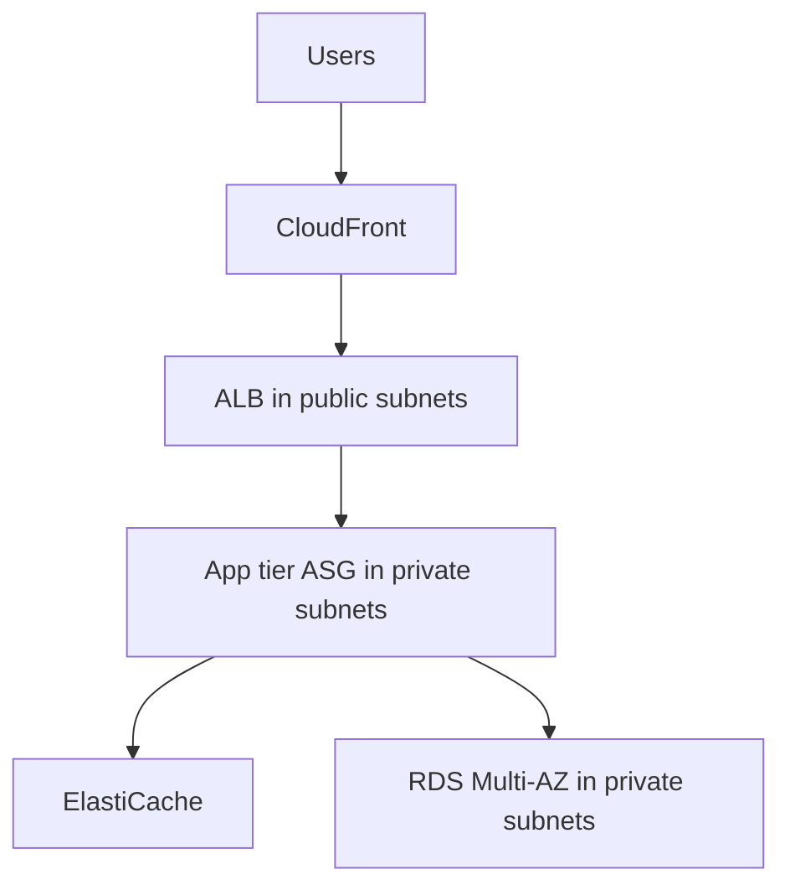
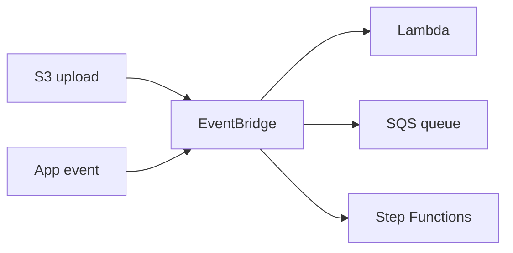
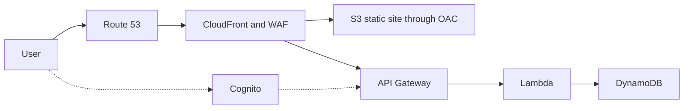
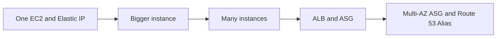
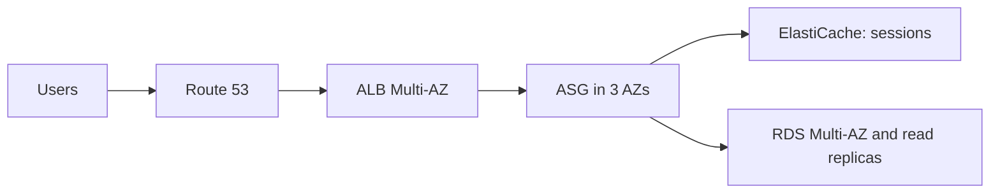
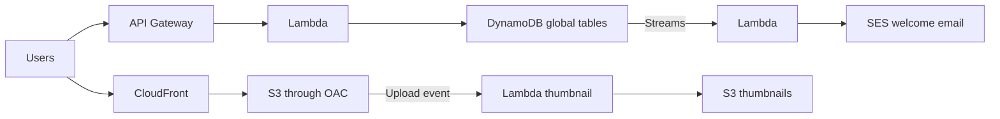
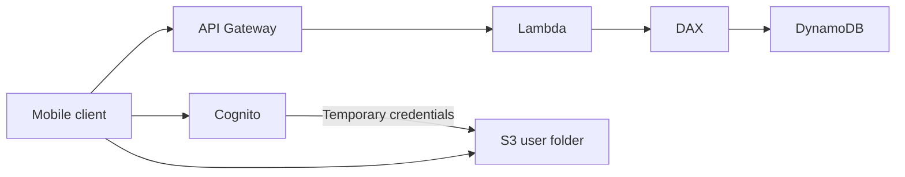

# Architecture Patterns

> [!info] Why this matters
> The exam tests design, not definitions. This chapter brings the services together into the patterns that keep appearing, and it is best read after all the others. Most of [[Domain 2 Design Resilient Architectures#Task 2.1|Task 2.1]] lives here.
>
> **Study time:** about 2.5 hours.

## Multi-tier architecture

A multi-tier design separates **presentation, application and data** layers.

Each tier's security group allows traffic only from the tier above. Spread every tier across at least two AZs.

## Stateless and stateful workloads

A **stateless** tier keeps no session data on the instance, so that any instance can serve any request, and horizontal scaling is simple. A **stateful** tier keeps data locally, which makes scaling and failover harder.

Move state out of the instance:

| State | Move it to |
| --- | --- |
| Sessions | ElastiCache or DynamoDB |
| Files | S3 or EFS |
| Relational data | RDS or Aurora |

Sticky sessions send a client's requests to the same target and are meant for servers that maintain state.

## Horizontal and vertical scaling

| | Vertical | Horizontal |
| --- | --- | --- |
| How | Bigger instance | More instances |
| Limit | Largest instance size | Almost none |
| Availability | Single point of failure | Survives instance loss |
| Downtime | Needs a stop and start | None when adding instances |
| Suits | Databases, legacy apps | Stateless web and worker tiers |

**Scaling each component:**

| Component | Scale with |
| --- | --- |
| Web tier | Auto Scaling behind a load balancer |
| Worker tier | Auto Scaling on queue depth |
| Containers | ECS Service Auto Scaling, or Kubernetes autoscalers |
| Reads | Read replicas, caches, CloudFront |
| Writes | A larger primary, sharding, DynamoDB |
| Serverless | Automatic, within concurrency limits |

## Loose coupling

Components interact through a buffer or an interface, so that one can fail or scale without affecting the others.

| Tool | How it decouples |
| --- | --- |
| **Amazon SQS** | A queue absorbs spikes, and workers scale on their own |
| **Amazon SNS** | Delivers to many subscribers |
| **Amazon EventBridge** | Routes events by content |
| **Kinesis Data Streams** | Ordered, replayable data |
| **Elastic Load Balancing** | Hides individual instances |
| **API Gateway** | Hides the implementation behind an API |

See [[20 Messaging and Integration]] for detail.

## Event-driven architecture

Producers emit events, and consumers react, without knowing about each other.

Typical sources are S3 event notifications, DynamoDB Streams and EventBridge. The benefits are independent scaling, easy addition of new consumers, and resilience to a slow consumer.

## Microservices

**Microservices** are small, independently deployable services, each owning its data and communicating through APIs or events.

| Aspect | Options |
| --- | --- |
| **Synchronous** communication | API Gateway, Application Load Balancer |
| **Asynchronous** communication | SQS, SNS, EventBridge, Kinesis |
| **Compute** | Fargate, Lambda, ECS, EKS |
| **Data** | One data store per service, chosen for that service |

Serverless patterns help: API Gateway and Lambda scale automatically and you pay per use.

## Serverless web application

Static content comes from S3 through CloudFront, dynamic calls go through API Gateway to Lambda and DynamoDB, and Cognito handles sign-in.

## Other patterns to recognise

| Pattern | Where it is explained |
| --- | --- |
| Queue-based load levelling | [[20 Messaging and Integration#Scaling workers on queue depth\|Messaging and Integration]] |
| Fan-out | [[20 Messaging and Integration#Fan-out\|Messaging and Integration]] |
| Streaming analytics | [[21 Streaming and Data Ingestion#Amazon Data Firehose\|Streaming and Data Ingestion]] |
| Data lake | [[22 Data Lakes and Analytics#Data lakes\|Data Lakes and Analytics]] |
| Hub-and-spoke network | [[10 VPC Connectivity and Hybrid Networking#AWS Transit Gateway\|VPC Connectivity]] |
| Private access to S3 | [[10 VPC Connectivity and Hybrid Networking#Private access to S3\|VPC Connectivity]] |
| Multi-Region active-passive | [[28 High Availability and Disaster Recovery#Multi-Region active-passive\|High Availability and DR]] |
| Layered DDoS protection | [[24 Threat Protection and Security Services#DDoS protection in layers\|Threat Protection]] |

## Must-know combinations

| Need | Combination |
| --- | --- |
| Serverless web app | CloudFront, S3, API Gateway, Lambda, DynamoDB |
| Reliable fan-out | SNS to multiple SQS queues |
| Global database | Aurora Global Database (SQL) or DynamoDB global tables (NoSQL) |
| Protect a web app | CloudFront, WAF, Shield, ALB |
| Real-time pipeline | Kinesis Data Streams, Lambda, then DynamoDB or S3 |
| Data lake analytics | S3, Glue, Athena, Amazon Quick |
| Migration toolkit | DataSync for files, DMS for databases, Direct Connect for transport |
| DR stack | Route 53 failover, Aurora Global Database, S3 Cross-Region Replication |
| App sign-in | Cognito user pools for login, identity pools for AWS credentials |

## Case studies

Read each one as a design exercise. Cover the solution, and sketch your own first.

### Case 1: WhatsTheTime, scaling a simple app

**Requirements:** a site that shows the time. No database. Start small, accepting some downtime, then scale with no downtime.

The design grows through these stages:

1. One instance with an Elastic IP. Simple, but a single point of failure.
2. Scale up. This needs downtime.
3. Add instances with Elastic IPs. Clients must track many addresses.
4. Add a load balancer and an Auto Scaling group. Clients use one DNS name.
5. Spread across AZs, with a Route 53 Alias at the apex.

**Lessons:** use a load balancer rather than managing IPs. Spread across AZs. Use reserved capacity for the baseline and On-Demand or Spot for peaks.

### Case 2: Clothes store, stateful web app

**Requirements:** people buy clothes online, the shopping cart must not be lost, hundreds of users at once, and horizontal scalability.

| Decision | Choice | Reason |
| --- | --- | --- |
| Session data | ElastiCache | Sticky sessions make instances stateful |
| User data | RDS | Relational |
| Read load | Read replicas, or lazy loading with ElastiCache | Hundreds of users |
| Availability | RDS Multi-AZ | Survives an AZ failure |
| Security | Tier-to-tier security groups | HTTP and HTTPS open only on the load balancer |

### Case 3: MyBlog, a global serverless website

**Requirements:** scale globally. Rarely written, often read. Partly static, partly a dynamic REST API. Cache where possible. Welcome email for new subscribers. Thumbnails for uploaded photos.

| Requirement | Solution |
| --- | --- |
| Static content, global and secure | S3 and CloudFront, with OAC and a bucket policy |
| REST API | API Gateway, Lambda, DynamoDB, with DAX for caching |
| Go global | DynamoDB global tables |
| Welcome email | DynamoDB Streams trigger Lambda, which calls SES |
| Thumbnails | Upload to S3 triggers Lambda, which writes the thumbnail |

### Case 4: MyTodoList, a serverless mobile app

**Requirements:** a REST API over HTTPS, serverless, users access their own S3 folder, managed sign-in, mostly reads, and high read throughput.

| Requirement | Solution |
| --- | --- |
| REST API | API Gateway, Lambda, DynamoDB |
| Sign-in | Cognito |
| Own folder in S3 | Temporary credentials from Cognito, with a policy per user |
| High read throughput | DAX, or API Gateway caching |

### Case 5: Software update distribution

**Situation:** an EC2 application distributes software updates. When a new version appears, demand spikes, and the transfer costs are high.

**Solution:** add CloudFront. Update files are static, so they cache well at the edge. **No architecture change** is needed, availability improves, and network cost falls.

### Case 6: Designing microservices

Use synchronous calls where a user is waiting, and asynchronous ones for background work. Give each service its own data store. Serverless services reduce repeated setup.

## How to approach any design question

1. **Find the priority.** Is the question about cost, performance, security, availability or operational overhead?
2. **List the hard requirements**, such as RPO, protocol, region, compliance or "no code changes".
3. **Remove options that break a requirement.**
4. **Prefer managed services** over self-managed, unless the scenario rules them out.
5. **Prefer the simplest option** that meets everything.

See [[Exam Technique]] for more.

## Check yourself

**1.** A web application stores session data on each instance. When an instance is replaced, users are logged out. How can the architect fix this and support horizontal scaling?

- A. Enable sticky sessions
- B. Store session data in ElastiCache
- C. Use bigger instances
- D. Store sessions on instance store

> [!success]- Answer
> **B.** External session state makes the tier stateless.

**2.** A monolith has an order module that slows the entire application during peaks. The company wants to scale it separately, with the least change. What should it do first?

- A. Move the order module behind an SQS queue, with separate workers
- B. Scale the whole application vertically
- C. Move to a larger Region
- D. Remove the order module

> [!success]- Answer
> **A.** Decoupling lets the slow part scale on its own and absorbs peaks.

**3.** A serverless application needs user sign-in, a REST API and a NoSQL database, with global static content. Which combination fits? (Choose two.)

- A. CloudFront and S3 for static content, API Gateway and Lambda for the API
- B. Cognito for sign-in, DynamoDB for data
- C. EC2 with a bastion host
- D. RDS with a public endpoint
- E. A NAT instance

> [!success]- Answer
> **A and B.** Together they form the standard serverless web app.

**4.** A company distributes large, unchanging software patches, and it sees big traffic spikes and high transfer costs from EC2. What is the simplest improvement?

- A. Use CloudFront in front of the origin
- B. Add more EC2 instances
- C. Use Direct Connect
- D. Use Kinesis

> [!success]- Answer
> **A.** Static content caches well at the edge, and no redesign is needed.

**5.** In a three-tier application, how should access to the database be restricted?

- A. Allow 0.0.0.0/0 on the database port
- B. The database security group allows the app tier's security group
- C. Put the database in a public subnet
- D. Use a NAT gateway

> [!success]- Answer
> **B.** A security group reference allows only the app tier, and it works as instances change.

**6.** A company wants new downstream systems to be able to react to orders in future, without changing the order service. Which design fits?

- A. Have the order service call each system directly
- B. Publish events to EventBridge or SNS, and subscribe new systems as needed
- C. Share a database between all systems
- D. Use cron jobs on each system

> [!success]- Answer
> **B.** Publishers do not need to know about consumers, so new ones can be added freely.

---
**Previous:** [[30 Machine Learning Services]] · **Next:** [[Exam Technique]] · **Plan:** [[Study Guide]]
