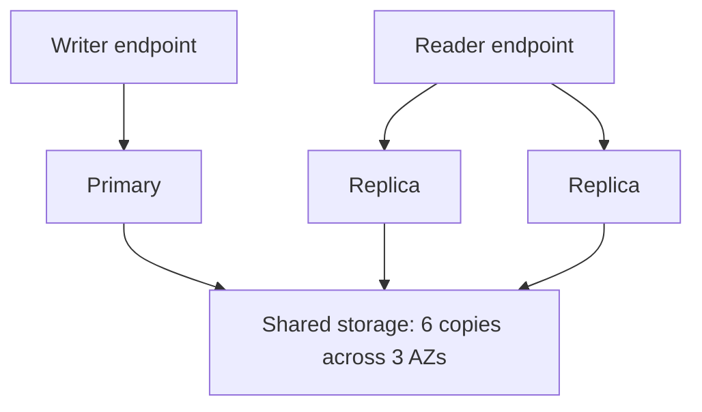

# Amazon Aurora

**Aurora** is a proprietary technology from AWS. It supports Postgres and MySQL. AWS quotes up to 3x the throughput of PostgreSQL and up to 5x that of MySQL. Aurora storage automatically grows in increments of 10GB, up to 256 TiB on recent engine versions (128 TiB on older ones).

Aurora stores 6 copies of our data across 3 AZ (4 copies out of 6 are needed for writes and 3 copies out of 6 are needed for reads). It **has self healing with peer-to-peer replication**.

Only one Aurora instance takes writes (**master**). Automated failover for master is less than 30s. We can have up to 15 Aurora [[RDS Read Replicas|read replicas]].

If we have an Aurora Replica in the same or a different AZ, when failing over, Aurora flips the canonical name record (CNAME) for our DB Instance to point at the healthy replica, which in turn is promoted to become the new primary. Start-to-finish failover typically completes within 30 seconds.

**Aurora Endpoints**

**Writer Endpoint** - used for all write operations to the Aurora database. This endpoint directs traffic to the primary instance within the Aurora cluster. In the event of a failure of the master instance, Aurora automatically promotes one of the replicas to be the new primary instance.

**Reader Endpoint** - allows applications to distribute read traffic across multiple Aurora replicas within the cluster, enhancing read scalability and performance. The reader endpoint automatically balances the read workload across all available replicas.

- Compatible API for Postgres & MySQL, separation of storage and compute.
- Data is stored in 6 replicas, across 3 AZ - highly available, self-healing, auto scaling.
- Cluster of DB instance across multiple AZ, auto scaling of Read Replicas.
- Custom endpoints for writer and reader DB instances.
- Same security/monitoring/maintenance features as [[Amazon RDS|RDS]].
- [[Aurora Serverless]] - unpredictable/intermittent workloads, no capacity planning.
- [[Aurora Global Database|Aurora Global]] - up to 16 DB Read Replicas in each region, < 1s storage replication.
- [[Aurora Machine Learning|Aurora ML]] - perform ML using [[Amazon SageMaker AI|SageMaker]] & [[Amazon Comprehend|Comprehend]] on Aurora.
- [[RDS and Aurora Restore and Cloning|Aurora Database Cloning]] - new cluster from existing one, faster than restoring a snapshot.
- Used for same as RDS, but with less maintenance/more flexibility/more performance/more features.

**Storage configurations:** Aurora Standard, or **I/O-Optimized**, which is best when I/O is 25% or more of Aurora spend.

## In this topic
- [[Aurora Auto Scaling and Custom Endpoints]]
- [[Aurora Global Database]]
- [[Aurora Machine Learning]]
- [[Aurora Serverless]]

## Exam tasks
- [[Task 2.2 Design highly available and or or fault-tolerant architectures]]
- [[Task 3.3 Determine high-performing database solutions]]
- [[Task 4.3 Design cost-optimized database solutions]]

---
**Map:** [[Database Map]]
