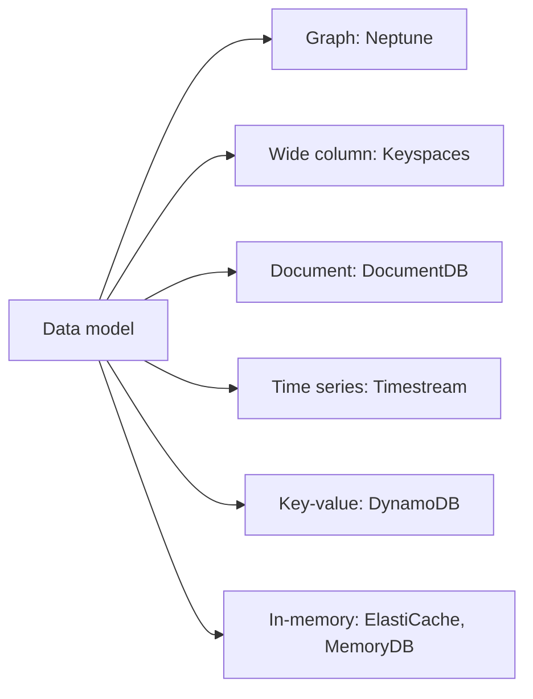

# Purpose-Built Databases

See [[Database Selection Guide]].

## In this topic
- [[Amazon DocumentDB]]
- [[Amazon Keyspaces]]
- [[Amazon Managed Blockchain]]
- [[Amazon MemoryDB]]
- [[Amazon Neptune]]
- [[Amazon QLDB]]
- [[Amazon Timestream]]

## Exam tasks
- [[Task 3.3 Determine high-performing database solutions]]

---
**Map:** [[Database Map]]
