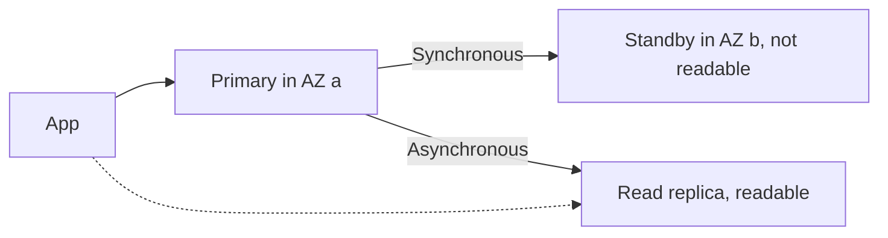

# RDS Multi-AZ

**Multi-AZ** deployments are designed to enhance the availability and durability of our database instances. This replication is **sync**. It is used for failover in case of loss of AZ, loss of network, instance or storage failure. Not used for scaling.

> Read replicas can be set too as Multi-AZ for DR.

It is possible to move [[Amazon RDS|RDS]] database from Single-AZ to Multi-AZ. No downtime is needed, although latency can rise while the standby syncs.

Snapshot of database will be taken. Then new database is restored from the snapshot in a new AZ. After that sync is established between the two databases.

**Multi-AZ DB Cluster Deployments** - [[Scalability and High Availability|high availability]] and durability by replicating data across multiple AZs and supporting automatic failover at both the instance and cluster levels.

A **Multi-AZ DB cluster** has one writer and two **readable** standbys across three AZs, using semi-synchronous replication.

## Exam tasks
- [[Task 2.2 Design highly available and or or fault-tolerant architectures]]

---
**Up:** [[Amazon RDS]] · **Map:** [[Database Map]]
