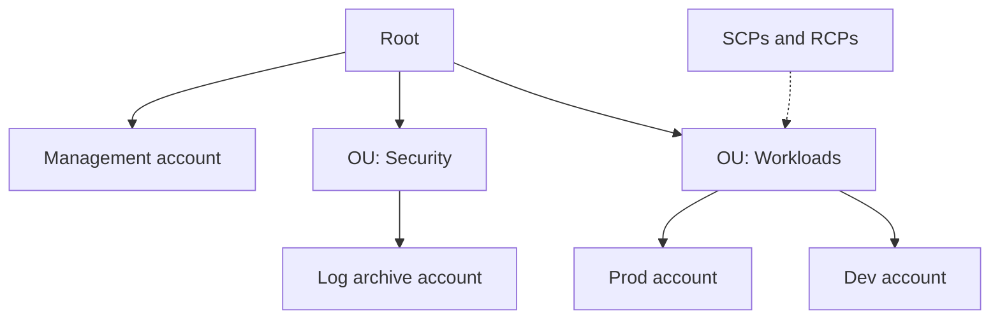

# AWS Organizations

**AWS Organizations** is a global service that allows us to manage multiple AWS accounts. The main account is called the management account. There is API which automates AWS account creation.

Cost benefits:

- Consolidated Billing across all accounts - we receive a single invoice for all the accounts in our organization, simplifying the billing process.
- Pricing benefits from aggregated usage - higher usage typically results in lower per-unit costs, providing significant savings.
- Pooling of reserved [[Amazon EC2|EC2 instances]] for optimal savings.

**Multi Account Strategies**

We can create accounts per department, per cost center, per dev/test/prod, for better resource isolation, to have separate per-account service limits, isolated account for logging …

Good practice is to enable [[AWS CloudTrail|CloudTrail]] on all accounts and send logs to central [[Amazon S3|S3]] account, also send [[Amazon CloudWatch|CloudWatch]] logs to central logging account.

**Tag Policies** allows us to define and manage tagging rules for our AWS resources.

## In this topic
- [[AWS Control Tower]]
- [[Resource Control Policies]]
- [[Service Control Policies]]
- [[aws PrincipalOrgID]]

## Exam tasks
- [[Task 1.1 Design secure access to AWS resources]]

---
**Map:** [[Management and Governance Map]]
