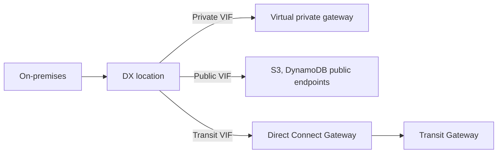

# AWS Direct Connect

**Direct Connect** provides a dedicated **private** connection from a remote network to our [[Amazon VPC|VPC]]. Dedicated connection must be setup between our data center and AWS DX locations. We need to setup a [[AWS Site-to-Site VPN|VGW]] on our VPC. With DX we can access both public and private resources on same connection.

Use cases:

- Increase bandwidth throughput (**working with large data sets**).
- More consistent network experience (applications using real-time data feeds).
- Hybrid environments.

Direct Connect uses **Virtual Interface** (VIFs) to logically separate different types of traffic. There are three primary types:

- **Private VIF**: Used to connect to our VPC for accessing resources like [[Amazon EC2|EC2 instances]], [[Amazon RDS|RDS]] databases, etc. Used when we want a private link between our on-premises environment and AWS.
- **Public VIF**: Used to access AWS public services (e.g., [[Amazon S3|S3]], [[Amazon DynamoDB|DynamoDB]], etc.) over a private connection. Public VIFs connect to AWS public endpoints and can be used to route traffic to multiple AWS Regions.
- **Transit VIF**: This allows us to connect multiple VPCs across different AWS Regions using a single connection and a transit gateway.

If we want to setup a DX to one or more VPC in many different regions (same account), we must use a **DX Gateway**.

**DX Connection Types**

- **Dedicated Connections**: 1, 10, 100 and 400 Gbps capacity. A physical ethernet port is dedicated to a customer. We make request to AWS first, then it will be completed by AWS DX partners.
- **Hosted Connections**: 50 Mbps up to 25 Gbps. Connection requests are made via AWS DX partners. Capacity can be added or removed on demand.

Lead times are often longer than one month to establish a new connection.

**DX Encryption**

Data in transit is not encrypted but is private. DX + VPN provides an IPsec-encrypted private connection.

- **Solution Architecture - DX Resiliency Patterns.** For high resiliency, use one connection at each of two locations. For maximum resiliency, use two connections at each of two locations.

- **Solution Architecture - Site-to-Site VPN as a Backup.**

    In case DX fails, we can set up a backup DX connection (expensive) or a Site-to-Site VPN connection (cheaper).

**MACsec** can encrypt dedicated connections at layer 2 on supported speeds. See [[Hybrid Connectivity Guide]].

## In this topic
- [[Sharing Direct Connect Across Accounts]]

## Exam tasks
- [[Task 1.2 Design secure workloads and applications]]
- [[Task 3.4 Determine high-performing and or or scalable network architectures]]
- [[Task 4.4 Design cost-optimized network architectures]]

---
**Map:** [[Networking and Content Delivery Map]]
