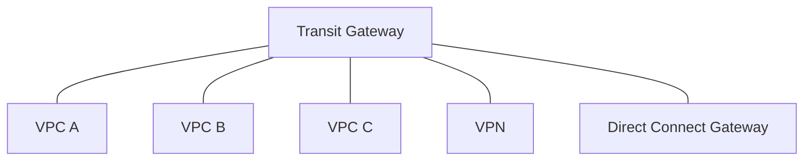

# AWS Transit Gateway

**Transit Gateway** is used for having transitive peering between thousands of [[Amazon VPC|VPC]] and on-premises. We need only one single gateway to provide this functionality. It works with [[AWS Direct Connect|DX]] Gateway and VPN connections. We must configure [[Internet Gateway and Route Tables|route tables]] to limit which VPC can talk with other VPC.

We can peer Transit Gateways across regions and share cross-account using RAM. It is the service to use for IP multicast between VPC subnets.

**ECMP** (*Equal-cost multi-path routing*) - routing strategy that allows to forward a packet over multiple best paths. It is used to create multiple [[AWS Site-to-Site VPN|Site-to-Site VPN]] connections to increase the bandwidth of our connection to AWS.

**Throughput with ECMP**

A standard VPN tunnel carries 1.25 Gbps. With ECMP on Transit Gateway, multiple connections add up, for example two connections of two tunnels each give up to 5 Gbps.

## Exam tasks
- [[Task 3.4 Determine high-performing and or or scalable network architectures]]
- [[Task 4.4 Design cost-optimized network architectures]]

---
**Map:** [[Networking and Content Delivery Map]]
