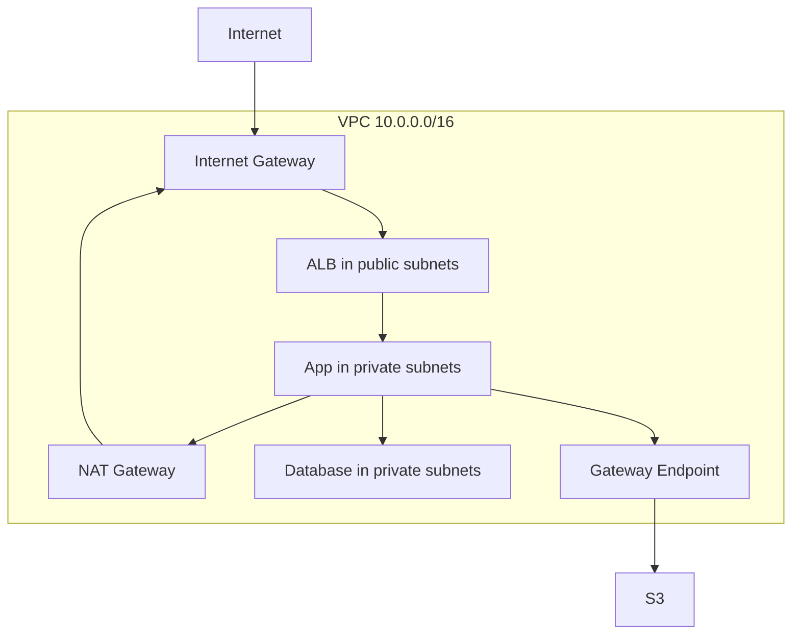

# Amazon VPC

**VPC (Virtual Private Cloud)** is a private network where we can deploy our resources (regional resource). All new AWS accounts have a default VPC. New [[Amazon EC2|EC2 instances]] are launched into the default VPC if no subnet is specified. Default VPC has internet connectivity and all EC2 instances inside it have public IPv4 addresses.

A VPC can have 5 IPv4 [[CIDR and IP Addressing|CIDR]] blocks by default (adjustable up to 50). For each CIDR:

- Min size is /28 (16 IP addresses)
- Max size is /16 (65536 IP addresses)

Our VPC CIDR should not overlap with our other networks (e.g. corporate).

**Subnets** allow us to partition our network inside our VPC (AZ resource).

- Public subnet - subnet that is accessible from the internet.
- Private subnet - subnet that is not accessible from internet

AWS reserves 5 IP addresses (first 4 and last 1) in each subnet. These IP addresses are not available for use and can't be assigned to an EC2 instance.

Example: If CIDR block is 10.0.0.0/24, then reserved IP addresses are:

| IP         | Description                                        |
| :--------- | :------------------------------------------------- |
| 10.0.0.0   | Network Address                                    |
| 10.0.0.1   | For the VPC router                                 |
| 10.0.0.2   | For mapping to Amazon-provided [[DNS Fundamentals\|DNS]]                 |
| 10.0.0.3   | For future use                                     |
| 10.0.0.255 | Network Broadcast (AWS does not support broadcast) |

**Newer controls:** VPC [[S3 Access Control|Block Public Access]] can block internet traffic across a VPC or account. Public IPv4 addresses carry an hourly charge.

## In this topic
- [[AWS PrivateLink]]
- [[Amazon VPC Lattice]]
- [[Bastion Hosts]]
- [[CIDR and IP Addressing]]
- [[Egress-Only Internet Gateway]]
- [[IPv6 in a VPC]]
- [[Internet Gateway and Route Tables]]
- [[NAT Gateways]]
- [[NAT Instances]]
- [[Network ACLs]]
- [[Networking Costs]]
- [[Security Groups]]
- [[VPC DNS Settings]]
- [[VPC Endpoints]]
- [[VPC Flow Logs]]
- [[VPC Peering]]
- [[VPC Traffic Mirroring]]

## Exam tasks
- [[Task 1.2 Design secure workloads and applications]]
- [[Task 3.4 Determine high-performing and or or scalable network architectures]]

---
**Map:** [[Networking and Content Delivery Map]]
