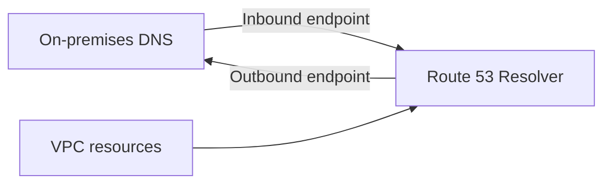

# Route 53 Resolver

Provides [[DNS Fundamentals|DNS]] in a [[Amazon VPC|VPC]] and connects it with on-premises DNS.

- **Inbound endpoint:** on-premises servers resolve names in AWS.
- **Outbound endpoint:** VPC resources resolve on-premises names through forwarding rules.

Rules can be shared with [[AWS Resource Access Manager]].

## Exam tasks
- [[Task 3.4 Determine high-performing and or or scalable network architectures]]

---
**Up:** [[Amazon Route 53]] · **Map:** [[Networking and Content Delivery Map]]
