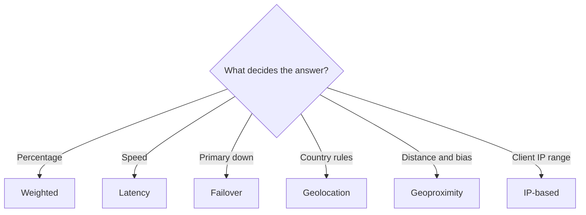

# Route 53 Routing Policies

| Policy | Use it for | Health checks |
| --- | --- | --- |
| Simple | One resource | No |
| Weighted | Percentage split, canary | Yes |
| Latency | Lowest latency Region | Yes |
| Failover | Active-passive DR | Yes, required on primary |
| [[Route 53 Geolocation Routing\|Geolocation]] | By user's country or continent | Yes |
| [[Route 53 Geoproximity Routing\|Geoproximity]] | By distance, with bias | Yes |
| IP-based | By client [[CIDR and IP Addressing\|CIDR]] | Yes |
| Multivalue | Up to 8 healthy records | Yes |

## In this topic
- [[Route 53 Failover Routing]]
- [[Route 53 Geolocation Routing]]
- [[Route 53 Geoproximity Routing]]
- [[Route 53 IP-based Routing]]
- [[Route 53 Latency Routing]]
- [[Route 53 Multivalue Routing]]
- [[Route 53 Simple Routing]]
- [[Route 53 Weighted Routing]]

## Exam tasks
- [[Task 2.2 Design highly available and or or fault-tolerant architectures]]

---
**Up:** [[Amazon Route 53]] · **Map:** [[Networking and Content Delivery Map]]
