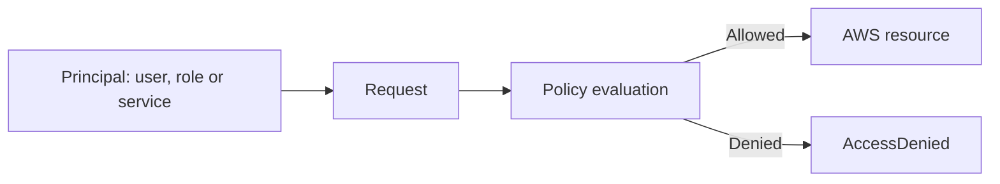

# AWS IAM

**AWS Identity and Access Management (IAM)** controls who can do what in an AWS account. It's a global service and free.

Best practice:

- Protect the root user with [[IAM Password Policy and MFA|MFA]], keep no root [[AWS Access Methods|access keys]], and don't use it daily.
- Use roles and temporary credentials, not long-lived keys.
- Give [[Amazon EC2|EC2]] an **instance profile** and [[AWS Lambda|Lambda]] an **execution role**.
- Use [[AWS IAM Identity Center]] for people.

## In this topic
- [[AWS Access Methods]]
- [[AWS STS]]
- [[Cross-Account Access]]
- [[Federation]]
- [[IAM Access Analyzer]]
- [[IAM Condition Keys]]
- [[IAM Password Policy and MFA]]
- [[IAM Permission Boundaries]]
- [[IAM Policies for S3]]
- [[IAM Policy Evaluation Logic]]
- [[IAM Policy Structure]]
- [[IAM Policy Types]]
- [[IAM Roles Anywhere]]
- [[IAM Security Tools]]
- [[IAM Users Groups and Roles]]
- [[Least Privilege]]
- [[Resource-based Policies vs IAM Roles]]

## Exam tasks
- [[Task 1.1 Design secure access to AWS resources]]

---
**Map:** [[Security Identity and Compliance Map]]
