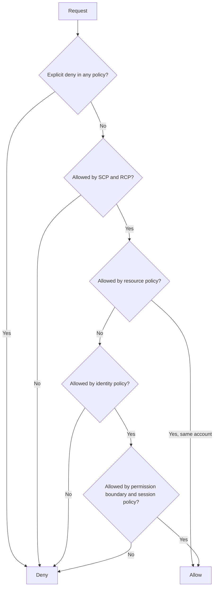

# IAM Policy Evaluation Logic

The source had this only as an image. The rule: **an explicit deny always wins, and everything starts denied.**

For [[Cross-Account Access|cross-account access]], **both** the identity policy in the caller's account and the resource policy must allow the action. This diagram is simplified from AWS's full flow.

## Exam tasks
- [[Task 1.1 Design secure access to AWS resources]]

---
**Up:** [[AWS IAM]] · **Map:** [[Security Identity and Compliance Map]]
