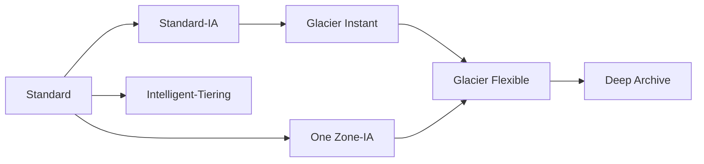

# S3 Storage Classes

- **[[Amazon S3|S3]] Standard - General Purpose**

    Used for frequently accessed data. Has low latency and high throughput. Sustain 2 concurrent facility failures. It’s used for big data analytics, mobile and gaming applications, content distribution …

IA storage classes are used for data that is less frequently accessed, but requires rapid access when needed. They have lower cost than S3 Standard.

- **S3 Standard-IA**

    It’s used for [[Disaster Recovery Strategies|disaster recovery]] and backups. Has 99.9% availability.

- **S3 One Zone-IA**

    It’s used for storing secondary backup copies of on-premise data, or data we can recreate. Has high durability in a single AZ. If AZ is destroyed data is lost.

[[Amazon S3 Glacier|S3 Glacier]] storage classes are low-cost [[Storage Types|object storage]] meant for archiving and backup. Pricing consist of price for storage + object retrieval cost.

- **S3 Glacier Instant Retrieval**

    Has millisecond retrieval time, great for data accessed once a quarter. Minimum storage duration is 90 days.

- **S3 Glacier Flexible Retrieval**
    - Expedited - 1 to 5 minutes retrieval time.

        Provisioned capacity ensures that our retrieval capacity for expedited retrievals is available when we need it. Each unit of capacity provides that at least three expedited retrievals can be performed every five minutes and provides up to 150 MB/s of retrieval throughput.

    - Standard - 3 to 5 hours retrieval time.
    - Bulk - 5 to 12 hours retrieval time (free).

    Minimum storage duration is 90 days.

- **S3 Glacier Deep Archive**
    - Standard - 12 hours.
    - Bulk - 48 hours.

    Minimum storage duration is 180 days.

- **S3 Intelligent Tiering**

    Allows us to move objects between existing tiers based on usage pattern. We need to pay small montly monitoring and auto-tiering fee. There are no retrieval charges in S3 Intelligent-Tiering.

    - Frequent Access tier (automatic) - default tier.
    - IA tier (automatic) - objects not accessed for 30 days.
    - Archive Instant Access tier (automatic) - objects not accessed for 90 days.
    - Archive Access tier (optional) - configurable from 90 days to 700+ days.
    - Deep Archive Access tier (optional) - configurable from 180 days to 700+ days.

| Class | Availability | AZs | Min days | Min size | Notes |
| --- | --- | --- | --- | --- | --- |
| Standard | 99.99% | 3+ | None | None | Default |
| Intelligent-Tiering | 99.9% | 3+ | None | None | Monitoring fee, no retrieval fee |
| Standard-IA | 99.9% | 3+ | 30 | 128 KB | Retrieval fee |
| One Zone-IA | 99.5% | 1 | 30 | 128 KB | Recreatable data |
| Express One Zone | 99.95% | 1 | None | None | Single-digit ms, directory buckets |
| Glacier Instant Retrieval | 99.9% | 3+ | 90 | 128 KB | Milliseconds |
| Glacier Flexible Retrieval | 99.99% after restore | 3+ | 90 | N/A | Minutes to hours |
| Glacier Deep Archive | 99.99% after restore | 3+ | 180 | N/A | 12 to 48 hours |

All have 11 nines of durability.

Lifecycle rules move data down this waterfall, not back up.

## Exam tasks
- [[Task 3.1 Determine high-performing and or or scalable storage solutions]]
- [[Task 4.1 Design cost-optimized storage solutions]]

---
**Up:** [[Amazon S3]] · **Map:** [[Storage Map]]
