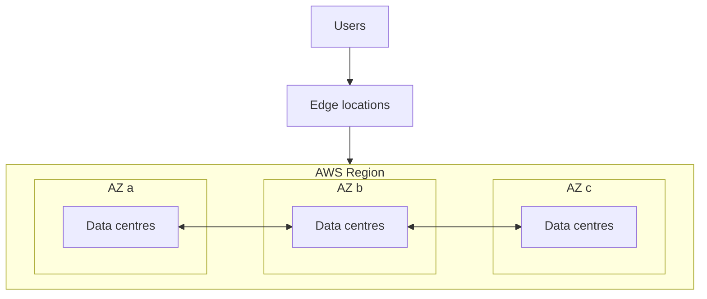

# AWS Global Infrastructure

- **Region:** a separate geographic area with multiple Availability Zones. Most services are regional, and data stays in a Region unless you move it. Choose one by compliance, latency, service availability and cost.
- **Availability Zone (AZ):** one or more data centres with independent power, cooling and networking, connected by low-latency links. Spreading across AZs protects against a data centre failure.
- **Edge location:** a point of presence used by [[Amazon CloudFront|CloudFront]], [[Amazon Route 53|Route 53]], [[AWS Global Accelerator|Global Accelerator]] and [[AWS WAF|WAF]] to serve users close by.
- **[[AWS Local Zones|Local Zone]]:** extends a Region closer to a metro area for single-digit millisecond latency. See [[AWS Hybrid and Edge Compute]].
- **Global services:** [[AWS IAM|IAM]], Route 53, CloudFront and WAF for CloudFront aren't tied to a single Region.

## Exam tasks
- [[Task 1.1 Design secure access to AWS resources]]
- [[Task 2.2 Design highly available and or or fault-tolerant architectures]]

---
**Up:** [[Concepts Map]]
