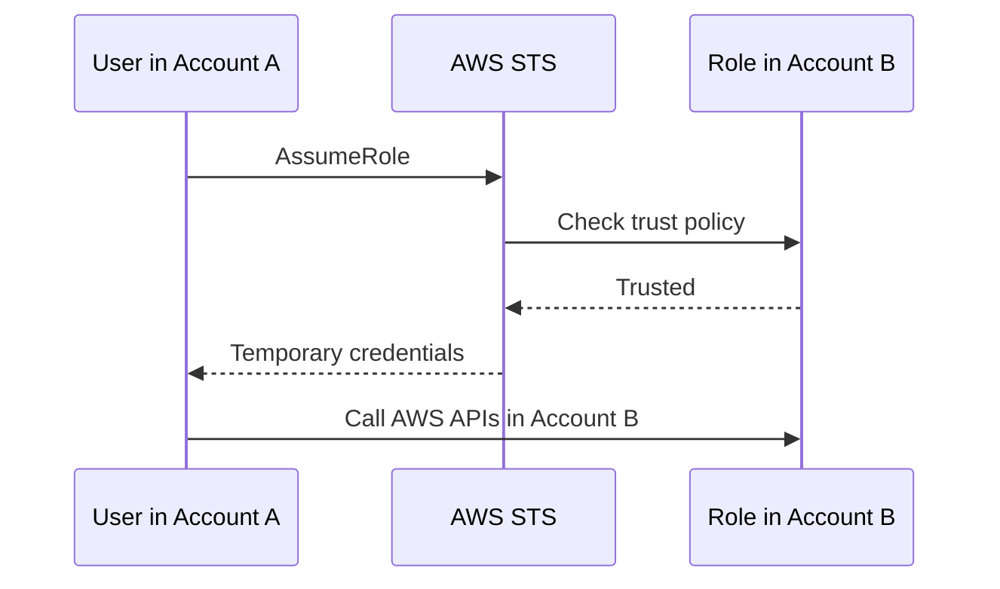

# Cross-Account Access

1. Create a role in the target account with a **trust policy** naming the source account.
2. Attach permissions to that role.
3. Allow principals in the source account to call `sts:AssumeRole`.

For third parties, require an **ExternalId** in the trust policy to prevent the confused deputy problem. Resource-based policies are the alternative, and they let the caller keep its own permissions. See [[Resource-based Policies vs IAM Roles]].

## Exam tasks
- [[Task 1.1 Design secure access to AWS resources]]

---
**Up:** [[AWS IAM]]
