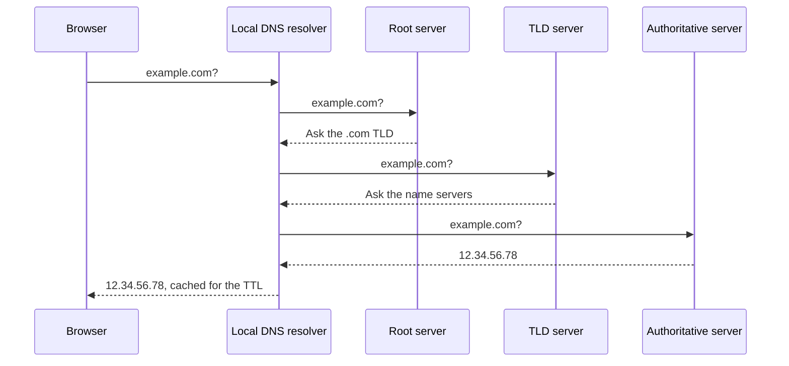

# DNS Fundamentals

**DNS Terminologies**

- Domain Registrar - [[Amazon Route 53|Route 53]], GoDaddy, etc…
- DNS Records - A, AAAA, CNAME, NS, etc…
- Zone File - contains DNS records.
- Name Server - resolves DNS queries (authoritative or non-autorithative).
- Top Level Domain (TLD) - .com, .us, .gov, .org …
- Second Level Domain (SLD) - amazon.com, google.com.

**How DNS Works**

---
**Up:** [[Amazon Route 53]]
