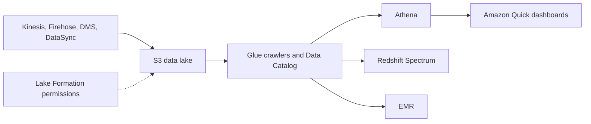

# Data Lakes

A central store of raw and processed data in any format, normally on [[Amazon S3]].

Secure it with [[AWS Lake Formation]], [[S3 Access Control|bucket policies]], [[AWS KMS|KMS]] encryption and [[VPC Endpoints]] for ingestion.

## Exam tasks
- [[Task 3.5 Determine high-performing data ingestion and transformation solutions]]

---
**Up:** [[Concepts Map]]
