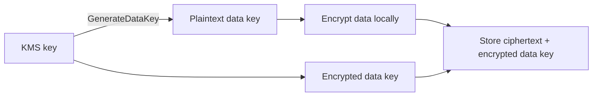

# Envelope Encryption

A data key encrypts the data, and a [[AWS KMS|KMS key]] encrypts the data key. Only the encrypted data key is stored next to the data.

This keeps KMS calls low and lets large data be encrypted locally. An [[S3 Encryption|S3 Bucket Key]] reduces KMS calls further.

## Exam tasks
- [[Task 1.3 Determine appropriate data security controls]]

---
**Up:** [[AWS KMS]]
