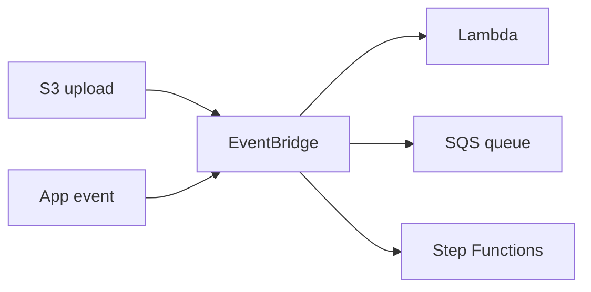

# Event-Driven Architecture

Producers emit events and consumers react, without knowing about each other.

Typical sources are [[S3 Event Notifications]], [[DynamoDB Streams]] and [[Amazon EventBridge]]. See [[SNS and SQS Fan-Out]].

## Exam tasks
- [[Task 2.1 Design scalable and loosely coupled architectures]]

---
**Up:** [[Concepts Map]]
