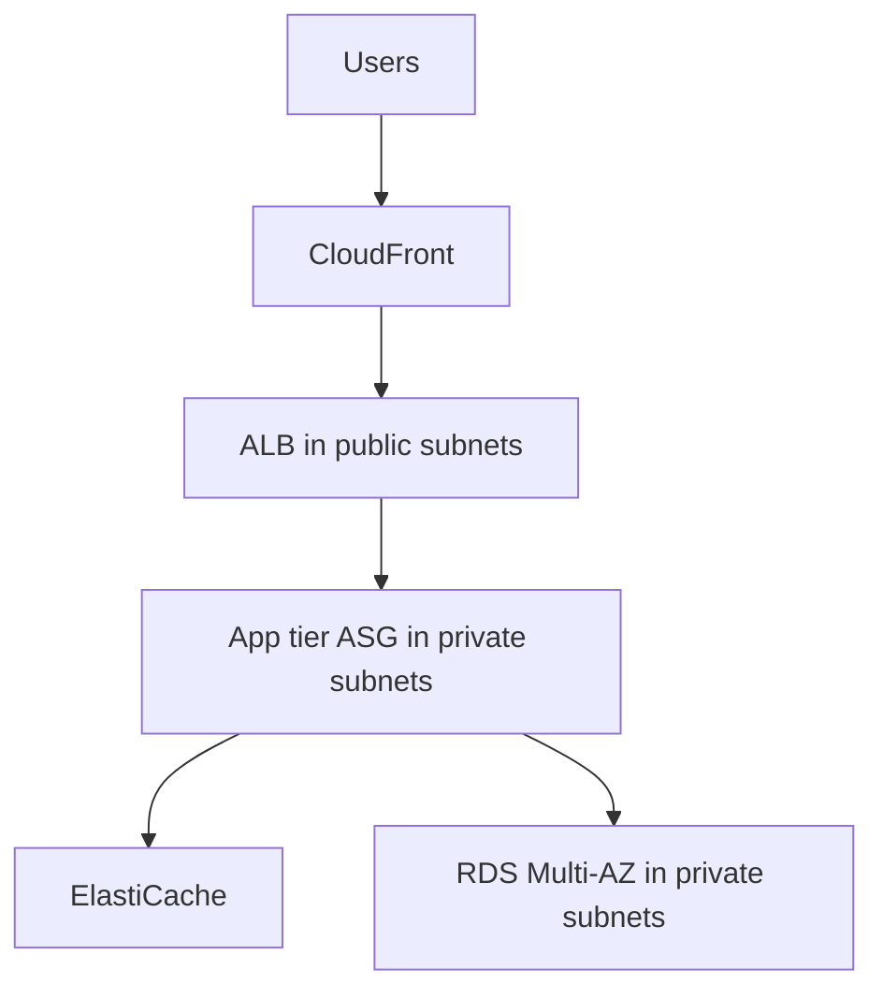

# Multi-Tier Architecture

Separates presentation, application and data layers, each in its own [[Amazon VPC|subnets]] and scaled independently.

Each tier's [[Security Groups|security group]] allows traffic only from the tier above. See [[Case Study Clothes Store App]].

## Exam tasks
- [[Task 2.1 Design scalable and loosely coupled architectures]]

---
**Up:** [[Concepts Map]]
