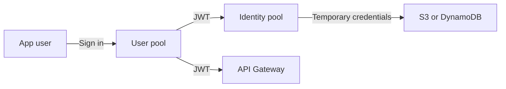

# Cognito User Pools vs Identity Pools

| | User pools | Identity pools |
| --- | --- | --- |
| Purpose | Sign-up and sign-in | AWS credentials for users |
| Output | JWT tokens | Temporary AWS credentials |
| Use with | [[Amazon API Gateway\|API Gateway]], [[Application Load Balancer\|ALB]], [[AWS AppSync\|AppSync]] | Direct access to [[Amazon S3\|S3]], [[Amazon DynamoDB\|DynamoDB]] |

---
**Up:** [[Comparisons Map]]
