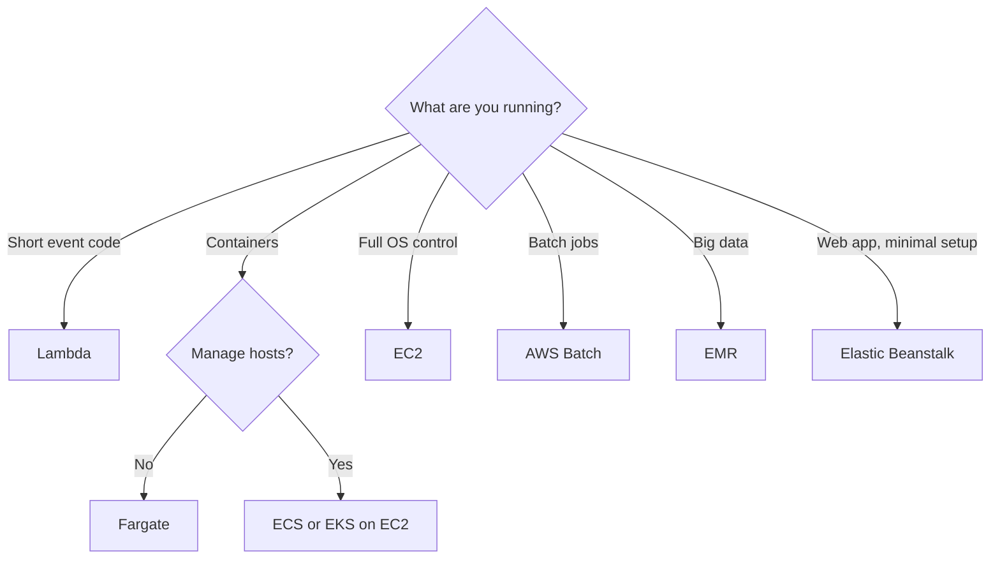

# Compute Selection Guide

## Exam tasks
- [[Task 2.1 Design scalable and loosely coupled architectures]]
- [[Task 3.2 Design high-performing and elastic compute solutions]]

---
**Up:** [[Decision Guides Map]]
