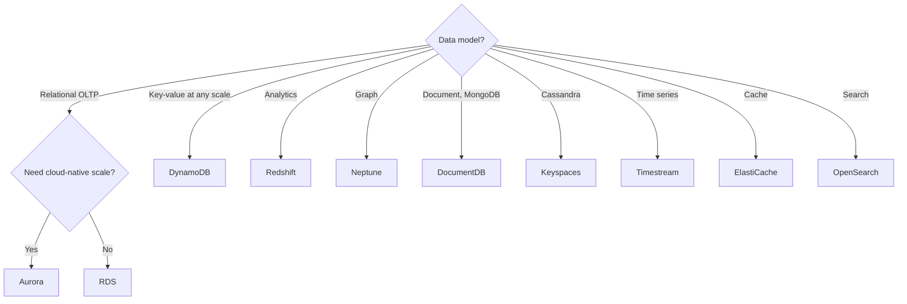

# Database Selection Guide

Keywords: "heterogeneous migration" points to [[AWS DMS]]. "Too many connections" points to [[RDS Proxy]].

## Exam tasks
- [[Task 3.3 Determine high-performing database solutions]]
- [[Task 4.3 Design cost-optimized database solutions]]

---
**Up:** [[Decision Guides Map]]
