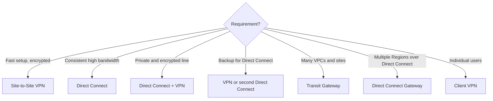

# Hybrid Connectivity Guide

Resilient [[AWS Direct Connect|Direct Connect]]: two connections at two locations for high resiliency, or two at each for maximum resiliency.

## Exam tasks
- [[Task 3.4 Determine high-performing and or or scalable network architectures]]

---
**Up:** [[Decision Guides Map]]
