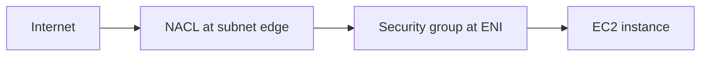

# Security Groups vs NACLs

The source had this only as an image.

| | [[Security Groups]] | [[Network ACLs]] |
| --- | --- | --- |
| Level | [[Elastic Network Interface\|ENI]] or instance | Subnet |
| Rules | Allow only | Allow and deny |
| State | Stateful: return traffic is allowed | Stateless: return traffic needs a rule |
| Evaluation | All rules together | Lowest number first, first match wins |
| References | IPs and other [[Security Groups\|security groups]] | IPs only |
| Default | Inbound denied, outbound allowed | Default [[Network ACLs\|NACL]] allows all, custom NACL denies all |

## Exam tasks
- [[Task 1.2 Design secure workloads and applications]]

---
**Up:** [[Comparisons Map]]
